# Лабораторная работа № 1. Свой Docker

В лабе разбирались, из чего состоит контейнер в Linux. Сначала запустили обычный самописный Go-сервис, потом попробовали сами изолировать его через namespaces, ограничить ресурсы через cgroups и убрать лишние права, а в итоге собрали всё в один скрипт и сравнили результат с Docker

Так как мы macOS юзеры, то сами эксперименты проводили в виртуалке Multipass с Ubuntu 22.04.5: namespaces и cgroups работают именно в Linux. В виртуалке было 2 ядра и около 3 ГБ оперативной памяти.

## Часть 0. Сервис

Для проверки у нас небольшой сервис на Go — [main.go](./api/main.go). В нем три ручки: `/health` отдаёт `ok`, `/eat?mb=N` выделяет N мегабайт и держит их, `/burn` крутит одно ядро в бесконечном цикле.

С `/eat` был один прикол, если просто создать массив, сборщик мусора может его освободить. Поэтому сделали сохранение выделенных буферов в глобальном слайсе и запись значения в страницы памяти. Страницы приходится трогать руками (`buf[i] = 1` через каждые 4096 байт). Без этого ядро память не закоммитит, RSS не вырастет и OOM не случится.

- в `/eat` буфер кладётся в глобальный слайс, иначе GC его выкинет и память не будет занята;
- страницы приходится трогать руками (`buf[i] = 1` через каждые 4096 байт). Без этого ядро память не закоммитит, RSS не вырастет и OOM не случится.

## Часть 1. Запуск напрямую

### Mac и Multipass

лаба у нас про ядро Linux , мы макозавры, у нас ядро XNU, там нет ни namespaces, ни cgroups, ниче нет. Даже Docker Desktop на маке запускает Linux-виртуалку и гоняет контейнеры в ней. 

Значит, нужна своя Linux-виртуалка. Мы взяли Multipass с Ubuntu 22.04. С 22.04, а не с 24.04, потому что в 24.04 непривилегированные user namespaces по умолчанию режет AppArmor, и возиться с этим для лабы не хотелось.

Дальше виртуалка создалась и интернета в ней не было. Похоже на проблему DNS, но нет:

```
ubuntu@lab1:~$ ping -c 2 8.8.8.8
2 packets transmitted, 0 received, 100% packet loss
ubuntu@lab1:~$ ping -c 2 archive.ubuntu.com
PING archive.ubuntu.com (91.189.92.24) ...
2 packets transmitted, 0 received, 100% packet loss
ubuntu@lab1:~$ curl -sI --max-time 5 http://archive.ubuntu.com | head -1
(тишина)
ubuntu@lab1:~$ ip route
default via 192.168.252.1 dev enp0s1 proto dhcp src 192.168.252.2 metric 100
...
ubuntu@lab1:~$ ping -c 2 192.168.252.1
2 received, 0% packet loss
```

Имя резолвится, маршрут по умолчанию есть, шлюз отвечает, а дальше шлюза ничего не идёт. Заодно упал `multipass mount` с ошибкой `unable to contact snap store`. В итоге оказалось, что дело в VPN на маке. С включённым VPN Multipass не работал, NAT для виртуальной сети ломался. VPN выключили, после этого `apt` и всё остальное заработало ура победа

### Сам запуск

Запускаем `./api &`, `curl localhost:8080/health` отвечает `ok`. Скрин получился кривой (команды слиплись в одну строку), но `ok` на нём видно:

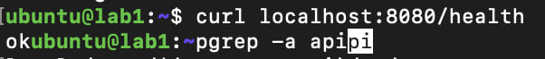

В `ps` это обычный процесс обычного пользователя `ubuntu` с PID 2292, ничем не отличающийся от остальных. Самое наглядное, что можно показать для точки отсчёта, это его namespaces. Сравнение с PID 1 (init):

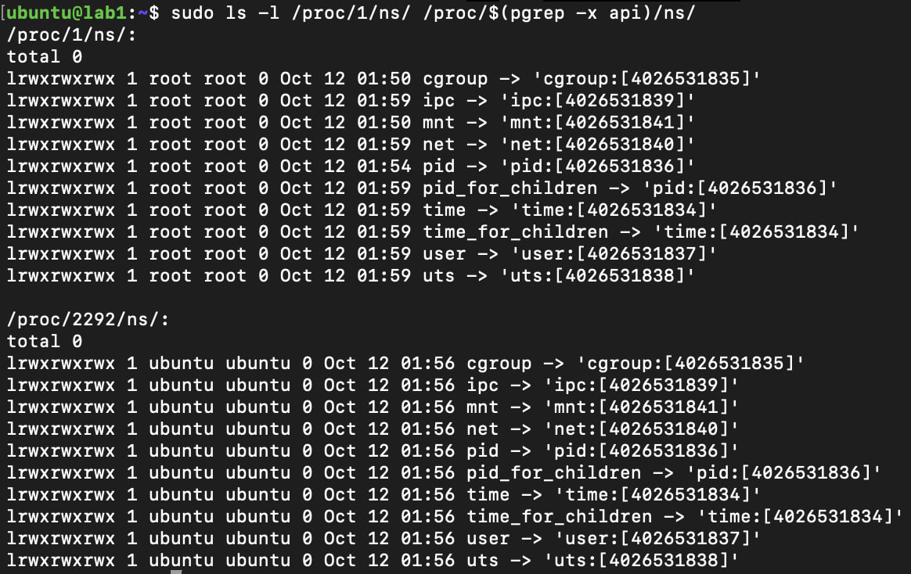

Идентификаторы всех namespaces у `api` и у init совпадают. Процесс живёт в тех же pid, net, mnt, ipc, uts и user, что и вся система.

## Часть 2. Namespaces

```
unshare -i -m -n -p -u -U -r -f --mount-proc bash
```

Этой командой мы даём процессу свои ipc, mount, net, pid, uts и user namespace. Флаг `-r` делает нас root внутри, `-f` нужен, чтобы bash стал PID 1, а `--mount-proc` перемонтирует `/proc`, иначе `ps` покажет процессы хоста.

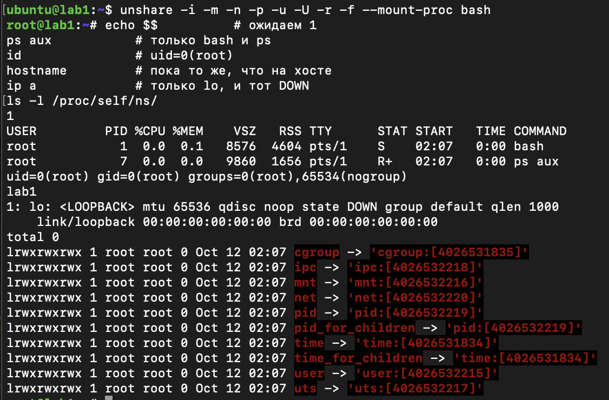

Внутри всё как и должно быть: `$$` равен 1, `ps` показывает только `bash` и самого себя, `id` говорит, что мы root, а в сети один `lo`, да и тот выключен. Снаружи этот же процесс принадлежит обычному `ubuntu`. Сравнение с init показывает, что отличаются все namespaces, кроме cgroup и time (их мы не просили):

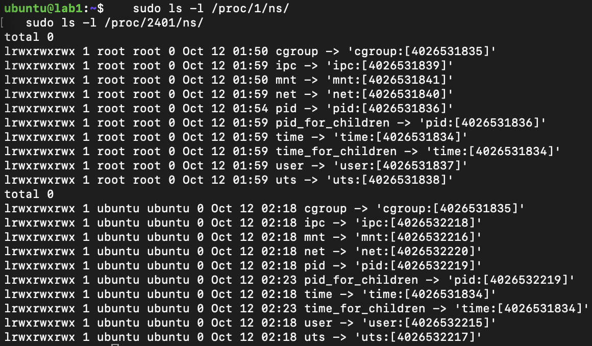

Запущенный внутри `./api` получил PID 61, потому что PID 1 занял `bash`.

Из забавного, мы забыли закрыть этот терминал, и в начале следующей части `sudo` внутри него разразился руганью про файлы, которые принадлежат uid 65534. Мы уже решили, что сломали хост и придётся пересоздавать ВМ, но `whoami` показал `root`, а на хосте мы `ubuntu`. Мы просто сидели в user namespace, где настоящего root хоста не существует и его файлы выглядят как `nobody`. Вышли, и всё ок.

## Часть 3. cgroups v2

Создали свою cgroup `/sys/fs/cgroup/api`, включили контроллеры и положили туда PID сервиса.

Начали с памяти: поставили лимит 100 МБ и выключили swap, иначе ядро не убьёт процесс, а будет гонять память в своп. Просим `/eat?mb=200`, и сервис падает:

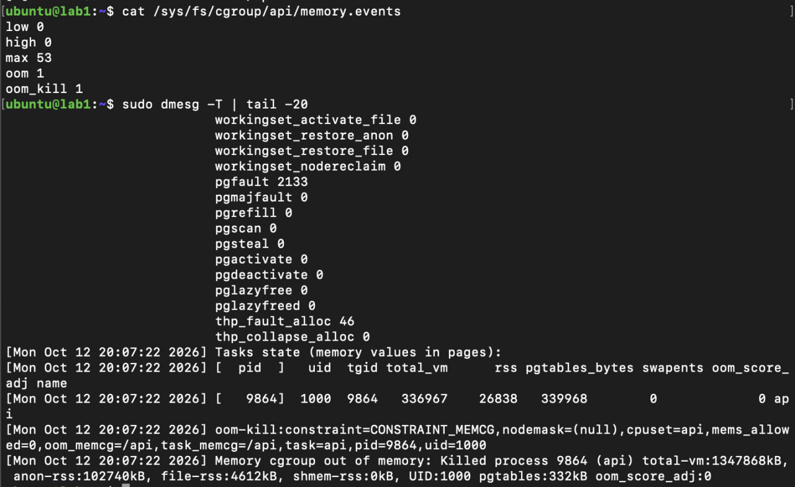

В `memory.events` появился `oom_kill 1`, а в `dmesg` написано `oom_memcg=/api`. Ядро честно сообщает, что убило процесс из-за лимита именно нашей группы, а не потому что кончилась память на машине. В Kubernetes мы бы увидели в статусе пода `OOMKilled`.

Дальше CPU. Выставили `cpu.max` в `50000 100000`, то есть пол-ядра, и запустили `/burn`:

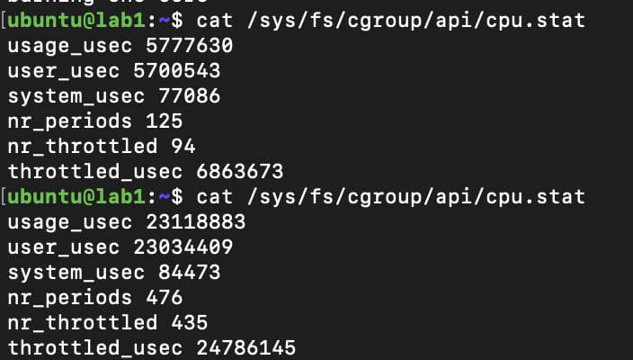

`nr_throttled` равен 435 из 476 периодов, и по `usage_usec` выходит около 49% одного ядра, то есть ровно квота. Интересно, что сервис при этом жив и отвечает на `/health`. Память наказывается смертью, а CPU просто тормозит процесс.

С процессами пришлось повозиться. Мы поставили `pids.max` в 50, запустили `stress-ng`, и ничего не произошло. Оказалось, что он создаёт воркеров сразу при старте, пока мы не успели положить его в cgroup, а потомки родителя за собой не переезжают. Отсюда и главное правило нашего скрипта: сначала в cgroup, потом запуск. Простая форк-бомба на Python ([forkbomb.py](./forkbomb.py)), которая сначала спит, сработала как надо:

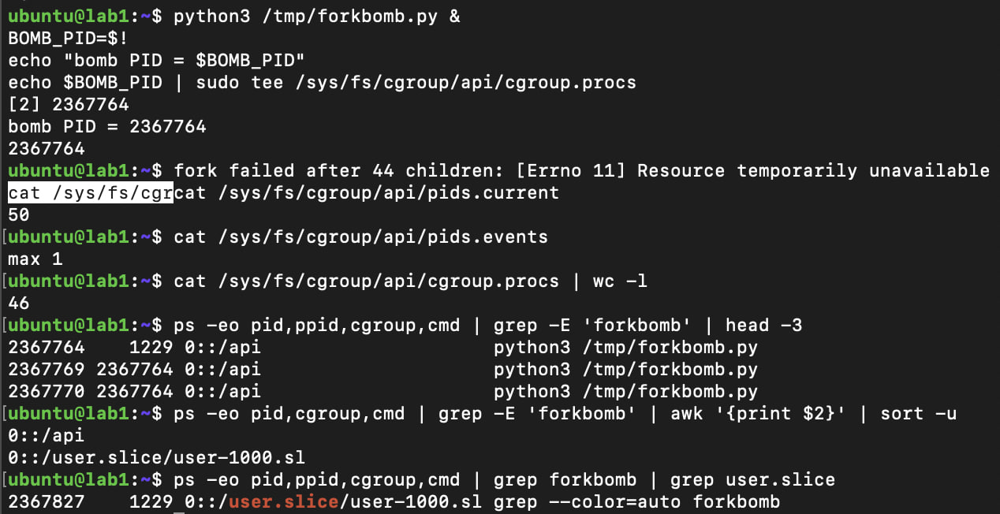

`pids.current` упёрся в 50, а бомба получила `Resource temporarily unavailable`.

## Часть 4. Права

Root в Linux не атомарен: его всемогущество разбито на мелкие capabilities. Мы взяли и отобрали у root право менять время:

```
sudo capsh --drop=cap_sys_time -- -c 'date -s "2026-01-01 00:00:00"'
```

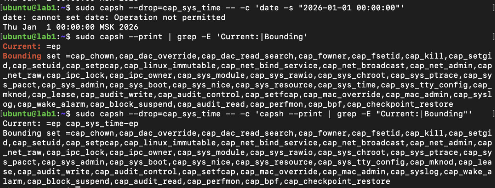

Даже под root `date -s` теперь отвечает `Operation not permitted`.

Seccomp идёт ещё глубже и режет отдельные системные вызовы. Готового инструмента на нашей Ubuntu не нашлось (`setpriv` фильтры не умеет), поэтому мы написали маленькую программу на C с `libseccomp` ([seccomp_test.c](./seccomp_test.c)). Она отвечает `EPERM` на `mkdir` и `mkdirat` и ничего больше не трогает:

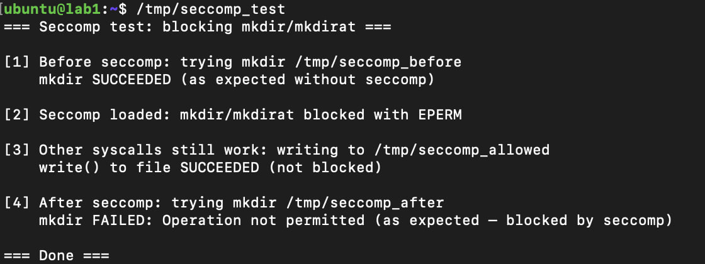

## Часть 5. Свой Docker (`mydocker.sh`)

Теперь собираем всё вместе. Скрипт [mydocker.sh](./mydocker.sh) создаёт cgroup с лимитами (100 МБ, пол-ядра, 50 процессов), кладёт туда сам shell и запускает сервис через `unshare`, `setpriv` и `seccomp-exec`. Выходит 5 namespaces, нулевые capabilities и фильтр seccomp. User namespace мы так и не сделали, потому что в системе нет `newuidmap`, а ставить пакет ради этого уже не хотелось.

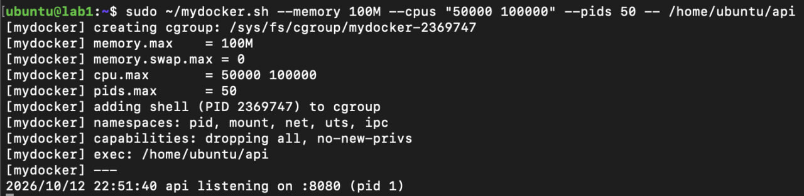

Сервис внутри стал PID 1, работает от root, но без единой capability, а снаружи видны его собственные namespaces и cgroup с нашими лимитами:

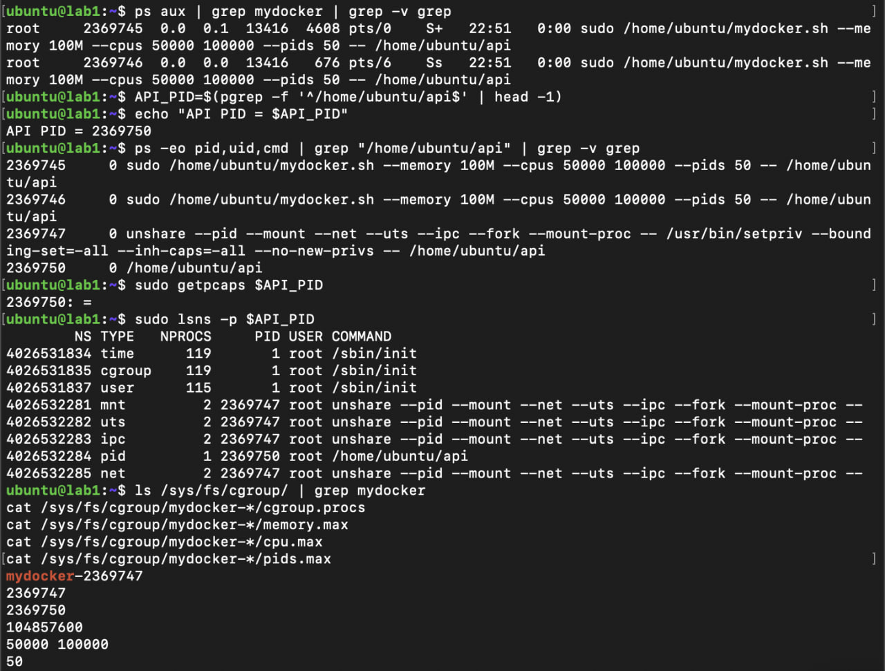

С хоста `curl` получает `Connection refused`, и это нормально: сеть у сервиса своя, пустая. Пробрасывать порты через veth, мост и iptables мы не стали (для лабы это перебор) и просто заходим в namespace через `nsenter`.

Seccomp в скрипт попал не сразу. Первый запуск с обёрткой упал с `execvp: Permission denied`. Причина оказалась тонкой: пока `setpriv` сам запускал `api`, у него ещё были capabilities и он мог пройти в `/home/ubuntu`, а обёртка работает уже совсем без прав и в закрытый домашний каталог не заходит. Мы переложили бинарники в `/usr/local/bin`, и всё запустилось. Теперь у `api` `Seccomp: 2`, нулевой `CapEff` и `NoNewPrivs: 1`:

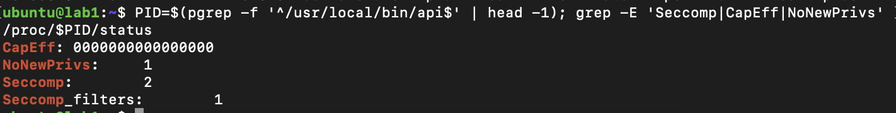

Потом подняли рядом настоящий `docker run` с теми же лимитами и сравнили:

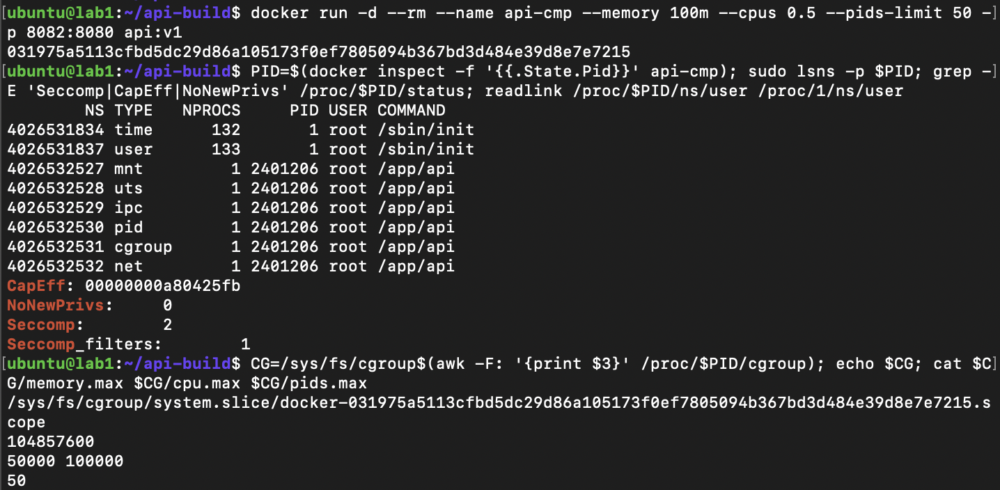

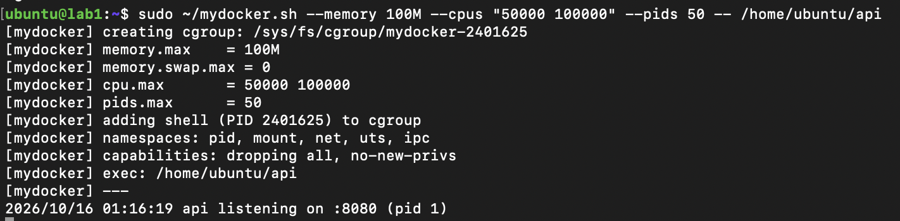

Лимиты в cgroup получились идентичными, и тут стало понятно, что флаги `--memory`, `--cpus` и `--pids-limit` это ровно те записи в файлы, которые мы делали руками. Namespaces тоже те же, а capabilities у нашего скрипта даже строже: ноль против 14 у Docker.

Зато Docker умеет то, чего у нас нет: своя корневая ФС из слоёв образа (у нас сервис видит всю файловую систему хоста), проброс портов, полноценный seccomp-профиль (у нас блокируется один `mkdir`), AppArmor и управление жизненным циклом.

## Часть 6. Образы

Одностадийный образ `api:v1` весит 425 МБ, потому что тащит за собой весь Go-тулчейн. Multi-stage сборка с `FROM scratch` даёт 6.26 МБ, то есть разница больше чем в 60 раз:

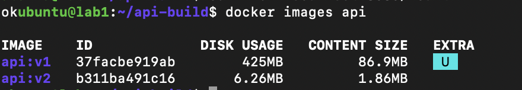

С кэшем всё предсказуемо. Правка `main.go` пересобирает всё после `COPY`, а правка комментария в самом Dockerfile ничего не пересобирает, все шаги берутся из кэша.

Файл, записанный внутрь контейнера, умирает вместе с ним:

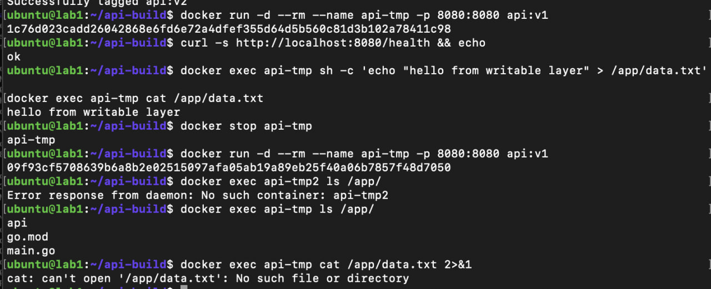

А при монтировании тома он переживает пересоздание, потому что на самом деле лежит на диске хоста:

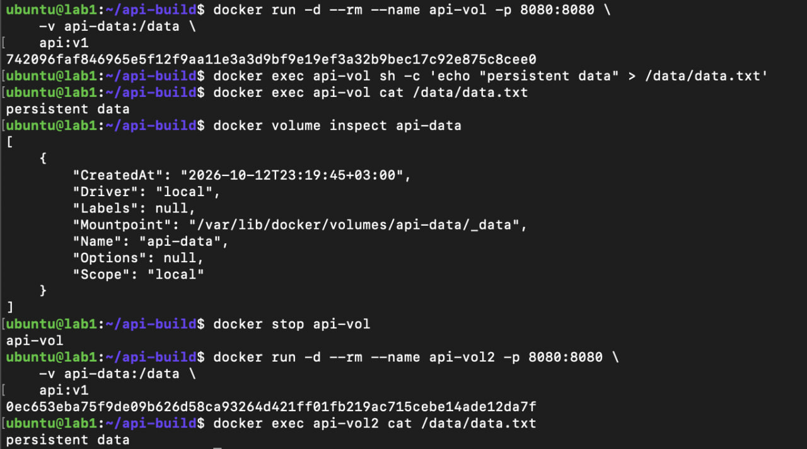

## Часть 7. gVisor

Запускаем тот же образ с `--runtime=runsc` и сразу видим разницу. Под обычным `runc` `uname -a` показывает ядро хоста (`5.15.0-198-generic`), а под gVisor приходит `4.19.0-gvisor`:

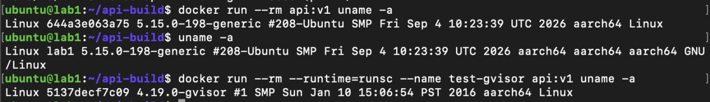

То есть приложение разговаривает уже не с настоящим ядром, а с эмуляцией на Go, которая сама ходит в ядро хоста узким набором вызовов. Это сильно усложняет жизнь атакующему, но стоит производительности и не со всем совместимо.

А вообще главный предел обычных контейнеров в том, что ядро у всех общее. Namespaces, cgroups и seccomp лишь настраивают это одно ядро, и ядерная уязвимость пробивает границу сразу для всех. По-настоящему развести ядра можно только виртуалками вроде Kata или Firecracker.

## Часть 8. Мониторинг

Для мониторинга взяли cAdvisor, который достаёт метрики из cgroup, и Prometheus, который опрашивает его раз в 5 секунд. Grafana на нашей небольшой ВМ поднимать не стали и смотрели графики прямо в интерфейсе Prometheus. Контейнер запускали с теми же лимитами, что и руками.

Под `/burn` CPU упирается в лимит (0.496 при `--cpus 0.5`), а доля throttling держится около 0.95:

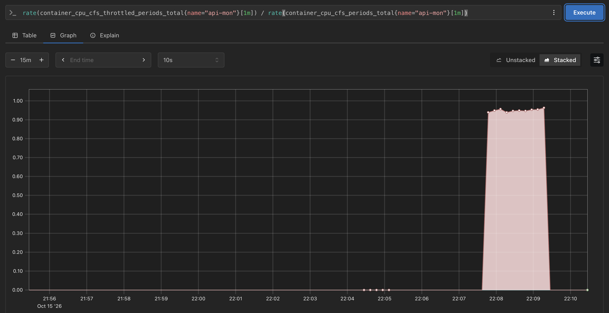

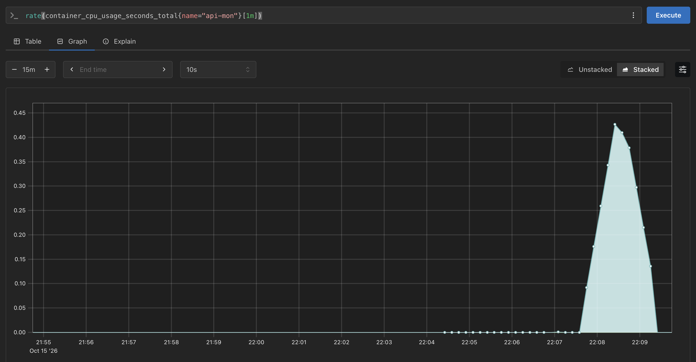

После `/eat?mb=60` память прыгает с 2 до 66 МБ, а повторный такой же запрос уже не помещается в 100 МБ, и контейнер убивает OOM:

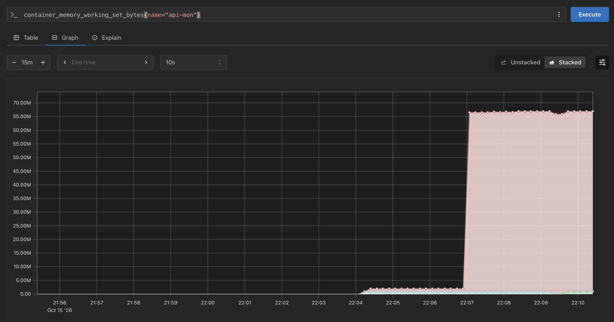

Еще прикол, счётчик `container_oom_events_total` как был нулём, так и остался. Контейнер умер между двумя скрейпами, и Prometheus этого просто не заметил. Выходит, на один счётчик OOM полагаться нельзя, он может пропустить короткое событие.

Поэтому алертов мы сделали три:

1. Память выше 80% лимита дольше 5 минут: `container_memory_working_set_bytes / container_spec_memory_limit_bytes > 0.8`. Это предупреждение, пока контейнер ещё жив.
2. Throttling CPU выше 50% дольше 10 минут: `rate(container_cpu_cfs_throttled_periods_total[5m]) / rate(container_cpu_cfs_periods_total[5m]) > 0.5`. Самый подлый случай: сервис тормозит, а проверки здоровья зелёные.
3. Контейнер пропал: `absent(container_last_seen{name="api-mon"})`. Он поймает OOM, даже когда счётчик его пропустил.

Еще кстати в какой-то момент все графики показывали `no data`. Оказалось, что часы виртуалки отстали от мака на два с половиной дня (она стояла на паузе, пока мак спал, а NTP из сети Multipass не доходит). Выставили время руками, и графики появились.

## Выводы

Контейнер оказался обычным процессом на общем ядре. Namespaces определяют, что он видит, cgroups сколько ему можно, а capabilities и seccomp что ему позволено. Мы собрали это руками проще, чем ожидали, и Docker делает по сути те же записи в те же файлы.

Ещё запомнилось, что память и CPU ограничиваются по-разному, память убивает, CPU тормозит, поэтому без алерта на throttling можно долго не замечать проблему. Образ это слои, и multi-stage со `scratch` уменьшил его с 425 до 6 МБ. А gVisor подменяет ядро для приложения, но обычный контейнер всё равно упирается в общее ядро.
