# Лабораторная работа 2 — Мониторинг сервиса

Идея лабы: поднять в Kubernetes один стек наблюдаемости вокруг сервиса и связать его в одно целое. Метрики лежат в Prometheus, логи в Loki, трейсы в Jaeger, всё это смотрится в Grafana, а алерты уходят через Alertmanager и видны в Karma. Весь стек ставится через Helm, потому что в следующих лабах он понадобится снова.

Язык сервиса: **Go**.

Окружение:

- хост — macOS (arm64), кластер — minikube v1.37.0 (Docker-драйвер), Kubernetes v1.34.0, **2 CPU и 4000 МБ памяти** у ноды: хотел 4 CPU и 6144 МБ, но minikube флаги проигнорировал (почему — ниже, в части 0);
- Docker Desktop выдаёт виртуалке около 7,6 ГБ (настройки по умолчанию, лимит я не менял);
- Helm 4.3.1, чарты: `kube-prometheus-stack` 92.9.0 (Prometheus v3.15.0), `grafana/loki` 7.3.0, `grafana/alloy` 1.13.1, `jaegertracing/jaeger` 4.16.1 (Jaeger v2), `wiremind/karma` 2.13.1;
- все конфиги лежат в репозитории: сервис в [api/](./api/), чарт сервиса в [chart/api/](./chart/api/), values и манифесты стека в [monitoring/](./monitoring/).

---

## Часть 0. Сервис и кластер

Сервис сгенерирован, код лежит в [api/main.go](./api/main.go). Ручки: `/health` отдаёт `ok`, `/fail` возвращает 500 и увеличивает счётчик ошибок, `/slow` спит от одной до трёх секунд, `/load?n=N` делает N запросов к самому себе, `/metrics` отдаёт Prometheus.

Что внутри:

- метрики RED: `http_requests_total{method,path,status}`, `http_request_errors_total{path}` и гистограмма `http_request_duration_seconds{path}`;
- логи через `slog` в JSON, в каждой строке запроса есть `trace_id` текущего спана;
- OpenTelemetry: `otelhttp` создаёт корневой спан на запрос, в `/slow` медленная часть обёрнута в вложенный спан `slow-op`, в `/fail` спан получает статус error. Адрес экспортёра берётся из `OTEL_EXPORTER_OTLP_ENDPOINT`;
- `/metrics` вынесен из-под `otelhttp`, иначе скрейп Prometheus каждые 15 секунд засорял бы Jaeger пустыми трейсами.

Версии OTel пришлось закрепить на 1.24: локальный Go стоит 1.21, а более новые версии библиотеки его уже не принимают. Dockerfile многостадийный (`golang:1.21-alpine` → `scratch`), зависимости скачиваются отдельным слоем, чтобы правка `main.go` не тянула их заново.

### Кластер

Перед стартом я заглянул в остальные лабы: стек из этой лабы переиспользуется в 3–6, а там добавятся ещё оператор БД, CNI и service mesh. Docker Desktop выдаёт виртуалке около 7,6 ГБ, и под стек с запасом я решил взять 4 CPU и 6144 МБ:

```
minikube start --cpus=4 --memory=6144
minikube image build -t api:0.1 .
```

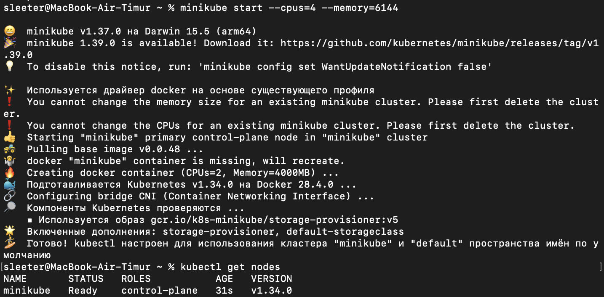

Но на скрине видно, что получилось не то, что просили. minikube ответил `You cannot change the memory size for an existing minikube cluster` и `You cannot change the CPUs for an existing minikube cluster`: профиль `minikube` у меня уже существовал, и для существующего профиля флаги `--cpus` и `--memory` не применяются. Контейнер ноды при этом был потерян и пересоздан, но уже по старым настройкам профиля: `Creating docker container (CPUs=2, Memory=4000MB)`. Проверил `docker inspect minikube`: лимит 4194304000 байт и 2 CPU. То есть вся лаба прошла на 2 CPU и 4 ГБ, и стек поместился. Чтобы получить заявленные 4 CPU и 6 ГБ, надо было сначала сделать `minikube delete`. (`kubectl describe node` при этом показывает 10 CPU и около 8 ГБ: это ресурсы всей Docker-виртуалки, а не лимит контейнера ноды.)

Образ собирается именно командой `minikube image build`. Нода minikube — это контейнер со своим containerd и своим хранилищем образов, обычный `docker build` на хосте кладёт образ в другое место, и под его не увидит. В Deployment при этом стоит `imagePullPolicy: IfNotPresent`: для тега `0.1` это и так значение по умолчанию, но для `latest` по умолчанию было бы `Always`, и под упал бы с `ErrImagePull`, потому что в реестре образа нет.

## Часть 1. Метрики (Prometheus + Grafana)

### Установка

Ставлю `kube-prometheus-stack`: внутри Prometheus Operator, Prometheus, Grafana, Alertmanager, node-exporter и kube-state-metrics. Оператор нужен, потому что скрейп и алерты описываются Kubernetes-объектами (`ServiceMonitor`, `PrometheusRule`), а он превращает их в конфиг Prometheus. Values-файл: [monitoring/values-prometheus.yaml](./monitoring/values-prometheus.yaml).

```
helm repo add prometheus-community https://prometheus-community.github.io/helm-charts
helm install kps prometheus-community/kube-prometheus-stack -n monitoring --create-namespace -f monitoring/values-prometheus.yaml
```

Первый запуск закончился `no such file or directory`: путь к values-файлу был указан от корня репозитория, а команда запускалась из другой папки. Все дальнейшие команды запускаются из `lab-2` с относительными путями.

### Сервис в кластере и скрейп

Сервис завёрнут в свой чарт [chart/api](./chart/api/): Deployment (2 реплики), Service с портом `http` и `ServiceMonitor`:

```yaml
spec:
  selector:
    matchLabels: {app: api}
  endpoints:
    - port: http
      interval: 15s
```

`port` ссылается на **имя** порта в Service, а не на номер, и именно на этом проще всего споткнуться. В Prometheus (Status → Targets) появилось две цели, `http://10.244.0.33:8080/metrics` и `http://10.244.0.34:8080/metrics` (на скрине адреса уже после пересоздания подов при `helm upgrade`), по одной на каждый под. Обе в состоянии UP, а в лейблах видны `job="api"`, `namespace="demo"`, `pod` и `service`, которые оператор подставил из `ServiceMonitor`:

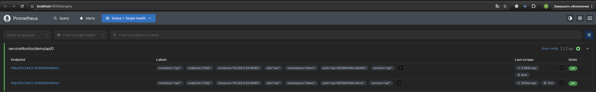

Prometheus скрейпит endpoints (IP подов), а не ClusterIP Service. Иначе каждый скрейп попадал бы на случайный под, и метрики разных реплик смешивались бы в один ряд.


### Грабли: ServiceMonitor молча игнорируется

По умолчанию чарт ставит оператору селектор `release: kps`, то есть читаются только `ServiceMonitor` с лейблом релиза. У нашего объекта такого лейбла нет, и без дополнительной настройки он бы просто не попал в конфиг: ни ошибки, ни цели в Targets. Поэтому в values стоит:

```yaml
prometheus:
  prometheusSpec:
    serviceMonitorSelectorNilUsesHelmValues: false
    ruleSelectorNilUsesHelmValues: false
```

В объекте `Prometheus` после этого `serviceMonitorSelector: {}`, то есть берутся все. Заодно видно, что за namespace отвечают два разных селектора: `serviceMonitorNamespaceSelector` у Prometheus (из каких namespace читать `ServiceMonitor`) и `namespaceSelector` самого `ServiceMonitor` (где искать Service; по умолчанию в его собственном namespace).

### Дашборд RED

Дашборд лежит в репозитории как JSON ([monitoring/dashboards/red.json](./monitoring/dashboards/red.json)) и кладётся в ConfigMap с лейблом `grafana_dashboard=1`: sidecar Grafana сам подхватывает такие карты. Сначала файл был написан руками, потом я доработал внешний вид панелей прямо в Grafana (например, долю ошибок вывел столбцами) и экспортировал результат, так что в репозитории лежит именно этот экспорт (формат `dashboard.grafana.app/v2`). Запросы при этом не менялись. Три панели:

```
# Rate
sum by (path) (rate(http_requests_total{namespace="demo"}[1m]))

# Errors
sum(rate(http_request_errors_total{namespace="demo"}[1m]))
  / sum(rate(http_requests_total{namespace="demo"}[1m]))

# Duration, p95
histogram_quantile(0.95, sum by (le) (rate(http_request_duration_seconds_bucket{namespace="demo"}[1m])))
```

Окно `[1m]` взято минимум в четыре раза больше интервала скрейпа (15 с): иначе в окне слишком мало точек, и `rate` выходит нестабильным. В `histogram_quantile` внутри стоит `sum by (le)`: без лейбла `le` бакеты склеились бы в одну кучу, и квантиль считать было бы не из чего. Это оценка, а не точное значение: Prometheus интерполирует внутри бакета, поэтому точность зависит от границ бакетов (у нас стандартные `DefBuckets`).

### Грабли: пустой график

Сначала я собрал дашборд руками, вставил запрос, и панель была пустой (на скрине ниже запрос уже в режиме Code, а точка на графике появилась только после первых запросов). Причин оказалось две. Во-первых, `rate(...[1m])` без свежего трафика пустой: сервис пишет метрики только когда его дёргают, и после паузы за последнюю минуту нет ни одной точки. Во-вторых, в редакторе панели был включён режим Builder, а текстовый запрос нужно вводить в режиме Code. Проверить, что данные вообще есть, можно прямо в Prometheus: запрос возвращал пустой вектор, пока я не прогнал нагрузку.

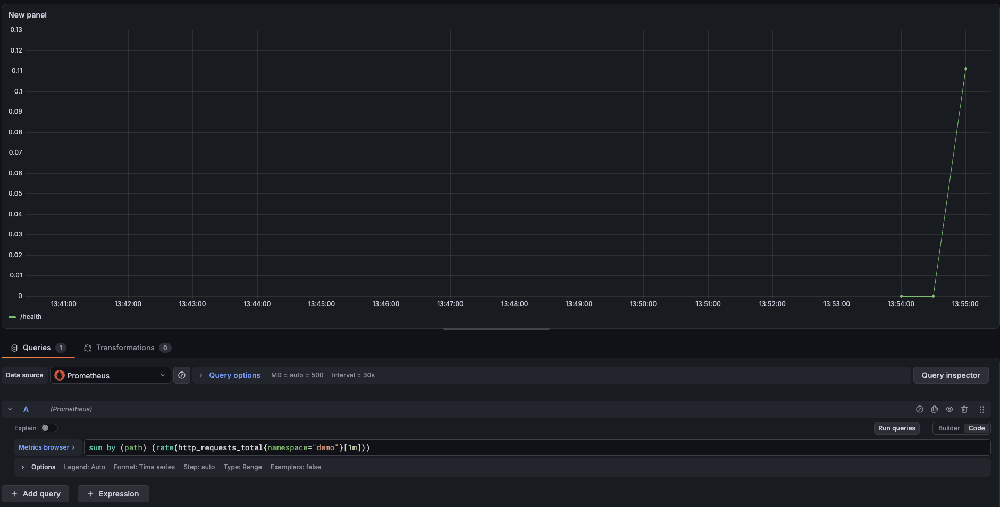

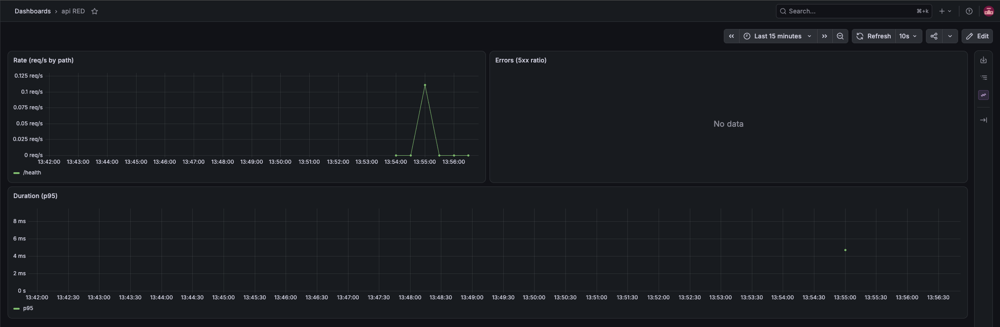

Нагрузка:

```
kubectl port-forward -n demo svc/api 8080:8080
for i in $(seq 1 40); do curl -s localhost:8080/fail >/dev/null; done
for i in $(seq 1 10); do curl -s localhost:8080/slow >/dev/null & done; wait
curl "localhost:8080/load?n=300"
```

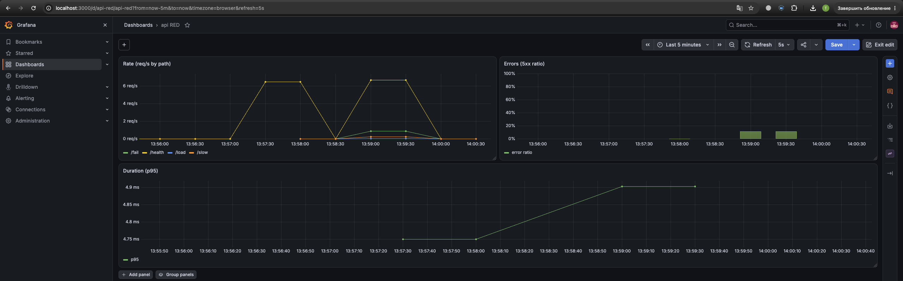

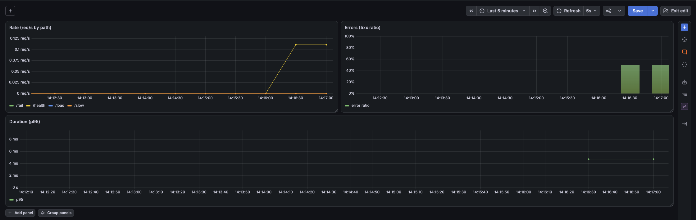

Одно наблюдение: p95 на панели все эти минуты стоит около 5 мс, хотя `/slow` отвечает за секунды. Это не баг: запрос агрегирует **все** пути, а `/load` выдал сотни быстрых запросов к `/health`, и p95 по всей массе определяется ими. Медленные запросы тонут в быстрых, поэтому алерт на задержку позже проверялся потоком одних `/slow`.

Важная оговорка про `/load`: он ходит на `127.0.0.1:8080`, то есть на loopback самого пода, и мимо Service, kube-proxy и балансировки. Для того чтобы подскочил RPS, этого достаточно, но реальный путь клиента он не проверяет, и нагрузка оседает на одной реплике. Для лаб про планирование и сеть так делать нельзя.

## Часть 2. Логи (Loki + Alloy)

Роли разделены: Loki только хранит и ищет, сам он логи ниоткуда не берёт. Берёт их агент, который стоит на каждой ноде, и я выбрал Grafana Alloy (DaemonSet).

Loki ([monitoring/values-loki.yaml](./monitoring/values-loki.yaml)) стоит в режиме SingleBinary с файловым хранилищем, всё распределённое (read/write/backend, кэши, minio, canary) отключено. Alloy ([monitoring/values-alloy.yaml](./monitoring/values-alloy.yaml)) находит поды через Kubernetes API, оставляет только поды своей ноды, навешивает лейблы `namespace`, `pod`, `container`, `app` и отправляет строки в Loki:

<details>
<summary>Конфиг Alloy</summary>

```
discovery.kubernetes "pods" { role = "pod" }

discovery.relabel "pods" {
  targets = discovery.kubernetes.pods.targets
  rule {
    source_labels = ["__meta_kubernetes_pod_node_name"]
    regex         = env("HOSTNAME")
    action        = "keep"
  }
  rule { source_labels = ["__meta_kubernetes_namespace"]          target_label = "namespace" }
  rule { source_labels = ["__meta_kubernetes_pod_name"]           target_label = "pod" }
  rule { source_labels = ["__meta_kubernetes_pod_container_name"] target_label = "container" }
  rule { source_labels = ["__meta_kubernetes_pod_label_app"]      target_label = "app" }
}

loki.source.kubernetes "pods" {
  targets    = discovery.relabel.pods.output
  forward_to = [loki.write.default.receiver]
}

loki.write "default" {
  endpoint { url = "http://loki.monitoring.svc:3100/loki/api/v1/push" }
}
```

</details>

Alloy после установки: под `2/2 Running`, на каждой ноде один (нода у нас одна).

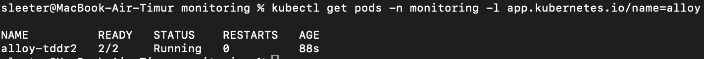

Источник данных Loki добавлен в Grafana тем же values-файлом `kube-prometheus-stack` (`grafana.additionalDataSources`), так что метрики и логи оказываются в одной Grafana.

### Грабли: Loki в CrashLoopBackOff

Первая версия Loki вставала в `Error`, а потом в `CrashLoopBackOff`, и в `kubectl logs --previous` нашлась причина:

```
mkdir /var/loki: read-only file system
error initialising module: ruler-storage
```

Корневая ФС контейнера Loki только на чтение, а при `persistence.enabled: false` чарт ничего записываемого в `/var/loki` не монтирует. Починил включением persistence (PVC на 2 ГБ, в minikube есть дефолтный StorageClass `standard`). `volumeClaimTemplates` у StatefulSet нельзя поменять на лету, поэтому релиз пришлось удалить и поставить заново.

### Поиск ошибки

```
{namespace="demo", app="api"} | json | level="ERROR"
```

`| json` разбирает строку лога на поля, и дальше можно фильтровать по `level`, читать `msg` и `trace_id`.

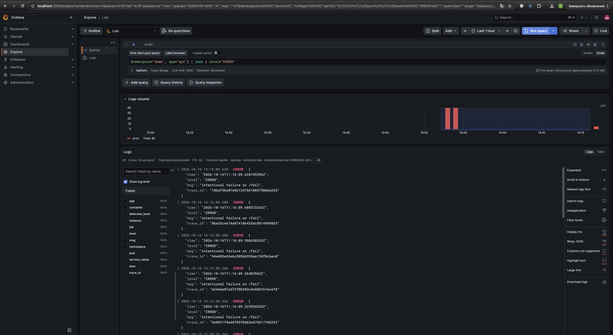

## Часть 3. Трейсы (OpenTelemetry + Jaeger)

Jaeger ставится из чарта `jaegertracing/jaeger` (версия 4, внутри Jaeger v2) с настройками по умолчанию ([monitoring/values-jaeger.yaml](./monitoring/values-jaeger.yaml) — по сути пустой): это all-in-one с хранилищем в памяти, трейсы пропадают при рестарте пода. Для лабы этого хватает.

Сервис отправляет спаны по OTLP/HTTP, адрес лежит в values чарта `api`:

```yaml
otlpEndpoint: http://jaeger.monitoring.svc:4318
```

и попадает в Deployment как `OTEL_EXPORTER_OTLP_ENDPOINT`. Путь `/v1/traces` экспортёр добавляет сам.

В Jaeger UI выбираю сервис `api`. В списке видно шесть трейсов: у трёх запросов `/slow` два спана и длительность 1,1–2,5 с, а у трёх `/fail` один спан, длительность в микросекундах и отметка об ошибке:

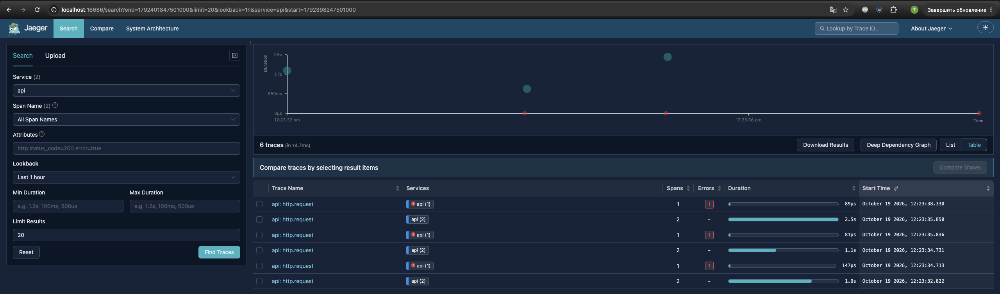

Трейс `/slow`: корневой спан запроса и внутри него длинный вложенный `slow-op`, то есть видно, что вся задержка ушла именно туда:

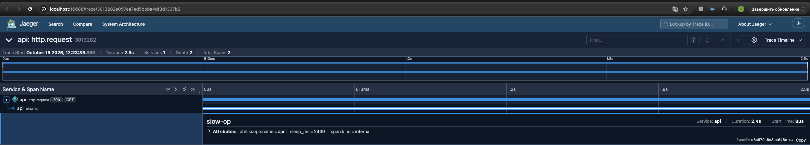

Внутри `slow-op` атрибут `sleep_ms = 2449` совпадает с длительностью спана (2,4 с): спан честно показывает, сколько сервис проспал.

Трейс `/fail`: спан помечен как ошибочный и подсвечен красным:

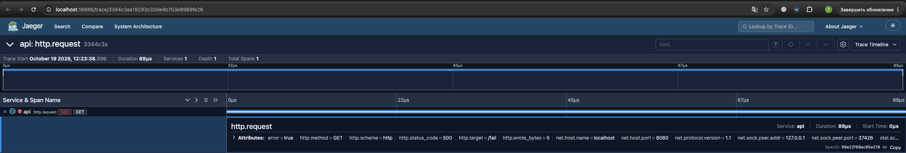

У спана видны `error = true`, `http.status_code = 500` и `http.target = /fail`.

### От лога к трейсу

Чтобы строка лога вела на трейс, у источника Loki в Grafana настроено derived field: из JSON-лога регулярка вытаскивает `trace_id`, а ссылка открывает этот ID в источнике Jaeger (для этого Jaeger тоже добавлен как источник данных).

```yaml
jsonData:
  derivedFields:
    - name: trace_id
      matcherRegex: '"trace_id":"(\w+)"'
      url: '$${__value.raw}'
      datasourceUid: jaeger
```

Две мелочи в этом куске. В YAML в одинарных кавычках обратный слэш не экранируется, поэтому `\w`, а не `\\w`. А `$$` в начале URL нужен потому, что Grafana при провижининге разворачивает `$` как переменную окружения, и `$$` превращается в обычный `$`.

В Explore беру строку с ошибкой, в ней `trace_id`:

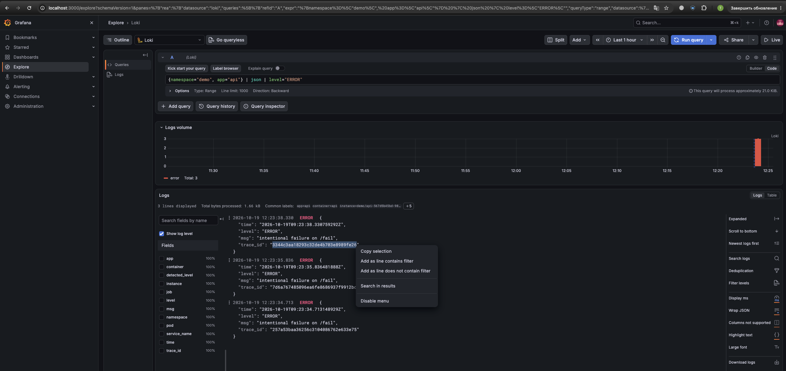

Раскрываю строку: в разделе Links рядом с `trace_id` появилась кнопка Jaeger:

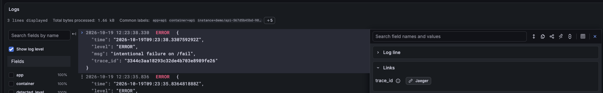

По кнопке справа открывается Jaeger с тем же `trace_id`, и это трейс `/fail` с ошибочным спаном:

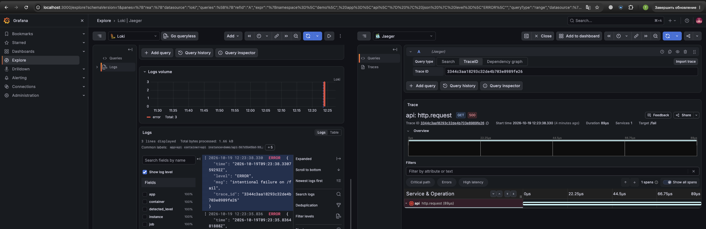

## Часть 4. Алерты (Alertmanager + Karma)

### Получатель

Alertmanager уже входит в `kube-prometheus-stack`. Получателем сделан webhook на маленьком эхо-сервисе ([monitoring/webhook-receiver.yaml](./monitoring/webhook-receiver.yaml)), который печатает тело каждого запроса в stdout, так что срабатывание видно через `kubectl logs`. Маршрутизация в values: алерты с `app="api"` идут в webhook, остальной фон кластера (десятки встроенных правил, которые приходят вместе со стеком) уходит в пустой приёмник `null`. `group_wait: 10s` и `group_interval: 30s` стоят короткими специально, чтобы в лабе не ждать.

### Три критичных алерта

Правила лежат в чарте `api` как `PrometheusRule` ([chart/api/templates/prometheusrule.yaml](./chart/api/templates/prometheusrule.yaml)).

1. **ApiHighErrorRate.** Доля 5xx выше 5% дольше двух минут, и при этом трафик не нулевой:

   ```
   sum(rate(http_request_errors_total{namespace="demo"}[2m]))
     / sum(rate(http_requests_total{namespace="demo"}[2m])) > 0.05
   and sum(rate(http_requests_total{namespace="demo"}[2m])) > 0.05
   ```

   Ловит ситуацию, когда пользователи прямо сейчас получают ошибки. Условие на трафик нужно, чтобы одна случайная ошибка в тихий час не давала 100% и ложного срабатывания. Что делает дежурный: открывает в Grafana логи с `level="ERROR"`, по `trace_id` находит трейс, смотрит, не начались ли ошибки после последнего релиза, и откатывает его.

2. **ApiHighLatencyP95.** p95 времени ответа выше одной секунды дольше двух минут:

   ```
   histogram_quantile(0.95, sum by (le) (rate(http_request_duration_seconds_bucket{namespace="demo"}[2m]))) > 1
   ```

   Среднее может выглядеть нормально, а каждый двадцатый запрос уже ждёт секунды. По метрике видно, что медленно, но не где. Дежурный открывает трейс медленного запроса в Jaeger, находит самый длинный спан и смотрит, куда ушло время: в зависимость, в блокировку или в нагрузку.

3. **ApiDown.** Нет ни одной живой цели скрейпа дольше минуты:

   ```
   absent(up{namespace="demo", job="api"} == 1)
   ```

   Сервис не отвечает вовсе. Выбран `absent`, а не просто `up == 0`: если поды исчезли совсем (scale в ноль, удалён Deployment), у метрики `up` пропадают сами ряды, и выражение `up == 0` не вернёт ничего, а `absent` сработает в обоих случаях. Дежурный начинает с `kubectl get pods -n demo`, потом `describe` и логи пода.

### Провокация

`/fail` гонялся по запросу в секунду около трёх минут (ошибки), `/slow` запускался параллельно по одному запросу в секунду (задержка), а для `ApiDown` Deployment был масштабирован в ноль:

```
kubectl scale deploy/api -n demo --replicas=0
```

Через минуту алерт загорелся, после чего поды вернулись командой `--replicas=2`. Все три правила прошли через `pending` в `firing` в Prometheus:

Сразу после установки правил все три в состоянии inactive (группа `api.rules`, до первой оценки статус «unknown»):

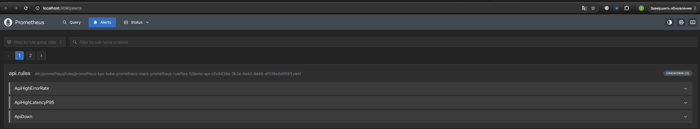

После нагрузки `ApiHighErrorRate` и `ApiHighLatencyP95` в firing:

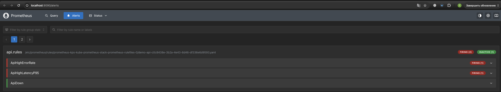

В раскрытом виде видны выражение, `for: 2m`, лейблы и значения: доля ошибок 0,568 (57%), p95 3,625 с, оба активны больше двух минут:

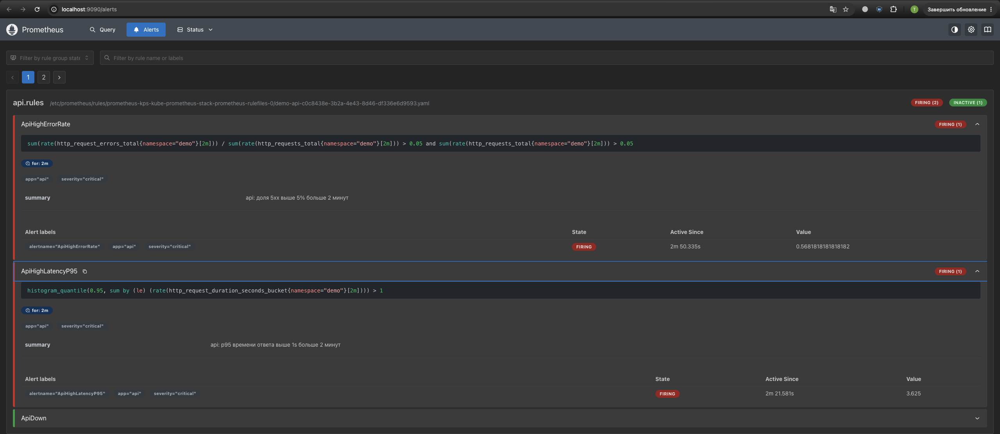

Третий, `ApiDown`, после `scale --replicas=0` сначала в pending (`for: 1m` ещё не прошла):

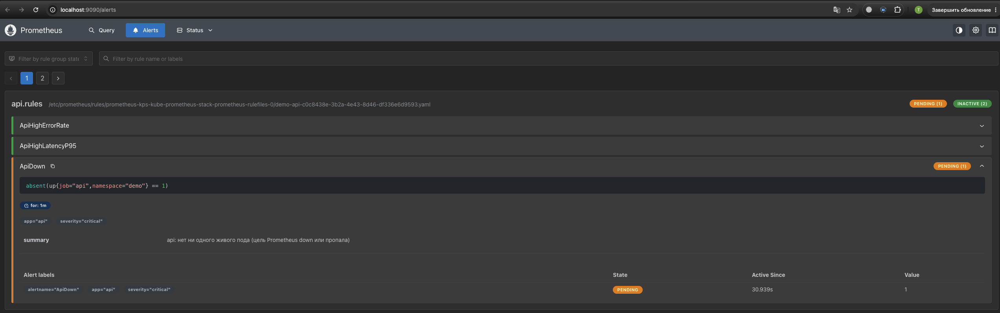

а примерно через минуту в firing:

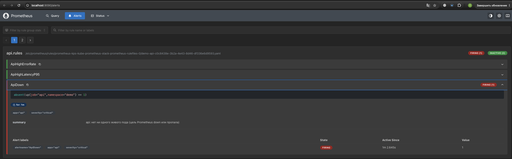

Alertmanager с первыми двумя алертами, группы по получателю `webhook`:

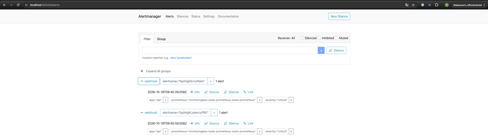

А так выглядит `ApiDown`, после того как поды были выключены: тоже в группе получателя `webhook`:

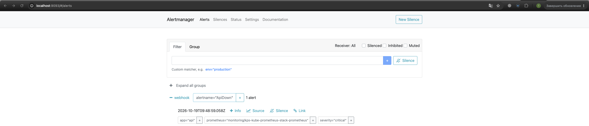

В логе получателя все три имени есть, причём и `firing`, и `resolved` (webhook отправляется и при закрытии алерта, `send_resolved: true`):

```
kubectl logs -n monitoring deploy/webhook-logger --tail=60
```

В выводе видны `alertname: ApiDown`, `ApiHighErrorRate` и `ApiHighLatencyP95`, а в конце запись `POST / HTTP/1.1 200` от `Alertmanager/0.34.1`.

### Karma

Karma ставится одним чартом, в values задан только адрес Alertmanager (`ALERTMANAGER_URI`). Она показывает все активные алерты в одном окне с группировкой и фильтрами, чего штатному интерфейсу Alertmanager не хватает.

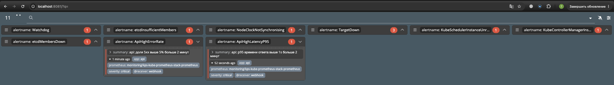

В Karma видны оба моих алерта с получателем `webhook` и аннотацией `summary`. Заодно она показывает всё остальное, что сейчас горит в Alertmanager (11 групп): `Watchdog` (он всегда firing по замыслу, это проверка, что цепочка алертинга жива), `TargetDown`, `etcdInsufficientMembers`, `NodeClockNotSynchronizing` и другие. Это фон одноузлового minikube, у них получатель `null`, поэтому в webhook они не уходят, но в Karma видны, потому что она читает весь Alertmanager без учёта маршрутов.

---

## Сводка сложностей

| Что случилось | Причина | Как решил |
|---|---|---|
| `minikube start --cpus=4 --memory=6144` не подействовал | профиль уже существовал, флаги для существующего профиля игнорируются, нода пересоздалась с 2 CPU и 4000 МБ | лаба прошла на этих ресурсах; для заявленных нужен `minikube delete` перед стартом |
| Под не находит образ | у ноды minikube свой containerd, образ с хоста туда не попадает | `minikube image build`, `imagePullPolicy: IfNotPresent` |
| `helm install`: `no such file or directory` | путь к values был от корня репозитория, а запуск из другой папки | запуск из `lab-2`, пути относительные |
| `ServiceMonitor` не работает, ошибок нет | оператор по умолчанию читает только объекты с `release: kps` | `serviceMonitorSelectorNilUsesHelmValues: false` |
| Пустой график в Grafana | нет свежего трафика для `rate`, режим Builder вместо Code | прогнал нагрузку, переключил на Code |
| Loki в `CrashLoopBackOff` | `mkdir /var/loki: read-only file system`, без persistence нет записываемого тома | включил persistence с PVC на 2 ГБ, переустановил релиз |
| Ссылка из лога на трейс | `\\w` в regex в YAML с одинарными кавычками означал бы буквальный `\`; `$` в URL нужно удваивать | `\w` и `$${__value.raw}` |

## Выводы

Три сигнала дополняют друг друга: метрики говорят, что сломалось и насколько, логи объясняют, что случилось, а трейсы показывают, где ушло время. Особенно удобно, когда `trace_id` из лога открывает нужный трейс одним кликом: три инструмента превращаются в один путь расследования.

Самое коварное в Prometheus Operator то, что ошибок не будет, если не сошёлся лейбл или имя порта: цель просто не появится. Ещё `rate` без свежего трафика пустой, и это не поломка, а в алерте мало одного условия: нужны `for`, порог трафика и `absent` вместо `== 0`.

Хранилище по умолчанию у Prometheus и Jaeger эфемерное (данные пропадут при пересоздании пода), для лабы нормально, для настоящего проекта нет.
