# Лабораторная работа 3 — Платформа для shop

Если кратко, то надо было собрать платформу для сервиса `shop` (`api`, `worker`, `postgres`) и заранее позаботиться о трёх вещах. Во-первых, кластер сам не принимает деплои, которые нарушают правила (политики). Во-вторых, `postgres` не поднимается руками, а описывается объектом оператора, который берёт его эксплуатацию на себя. В-третьих, я своими руками проверяю, что переживает падение control plane. Всё идёт через Helm, мониторинг берётся из стека лабы 2.

Язык сервисов: **Go**.

Окружение:

- хост — macOS (arm64), кластер — minikube (Docker-драйвер), Kubernetes v1.34.0, Helm 4.3.1;
- нода minikube всю лабу шла с лимитом 2 CPU и 4000 МБ (профиль остался с лабы 2), и только в части 3 пришлось поднять его до 4 CPU и 6 ГБ (причины в части 3);
- версии: Kyverno chart 3.9.1 (Kyverno v1.19.1), CloudNativePG chart 0.29.1 (оператор 1.30.1, Postgres 18.6), стек мониторинга из лабы 2 (`kube-prometheus-stack`, Grafana, Loki, Alloy, Jaeger, Alertmanager, Karma) остался в кластере без изменений;
- файлы: сервисы в [api/](./api/) и [worker/](./worker/), политики в [policies/](./policies/), тестовые манифесты в [tests/](./tests/), чарт в [chart/shop/](./chart/shop/).

---

## Часть 0. Сервисы

Сервисы сгенерены, код лежит в [api/main.go](./api/main.go) и [worker/main.go](./worker/main.go). Dockerfile такой же, как в лабе 2 (`golang:1.21-alpine` → `scratch`).

У `api` есть `/health`, который обычно возвращает `ok`, а с `HEALTH_FAIL=true` отвечает 500. Через `POST /order` можно создать заказ, а через `GET /orders` посмотреть последние. Заказы хранятся в Postgres. Ещё есть `/metrics`, чтобы потом забирать метрики в Prometheus.

`worker` раз в две секунды ищет необработанные заказы и меняет у них `processed` на `true`. Использовал `FOR UPDATE SKIP LOCKED`, чтобы две реплики не взяли один и тот же заказ.

Сразу сделал так, чтобы `/health` не зависел от базы. Если Postgres временно упадёт, незачем перезапускать весь `api`. Подключение к БД идёт в фоне с повторными попытками, а перед остановкой `api` ждёт пять секунд, чтобы во время rolling update успели обновиться endpoints и запросы не улетали в уже остановленный под.

## Часть 1. Политики для кластера

Начал с того, что решил запретить создавать в кластере что попало. Для этого поставил Kyverno. Он умеет проверять Kubernetes-манифесты до того, как они попадут в кластер. Мне он показался проще Gatekeeper, потому что правила пишутся обычным YAML, без Rego.

```bash
helm install kyverno kyverno/kyverno -n kyverno --create-namespace
```

После установки проверил поды Kyverno и его admission webhook. Всё зарегистрировалось.

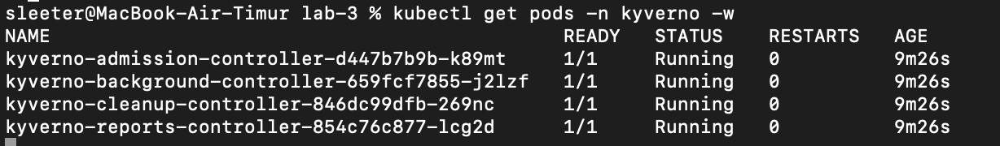

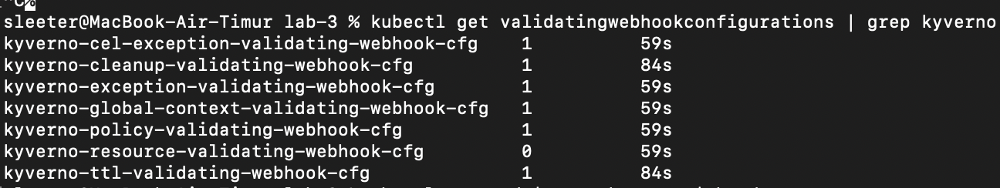

Потом написал пять политик в [policies/](./policies/). Они требуют у контейнеров `requests` и `limits` по CPU и памяти, разрешают образы только из `shop/*` и `ghcr.io/cloudnative-pg/*`, проверяют метки `app` и `team`, запрещают `privileged: true` и тег `latest`. Везде поставил `Enforce`, чтобы неправильные объекты действительно отклонялись, а не просто появлялось предупреждение.

Системные namespaces и те, где уже работали мониторинг и операторы, исключил. Иначе мои правила начали бы ломать чужие поды. Политики написаны для Pod, но Kyverno автоматически применяет их и к Deployment со StatefulSet.

```bash
kubectl apply -f policies/
kubectl get clusterpolicy
```

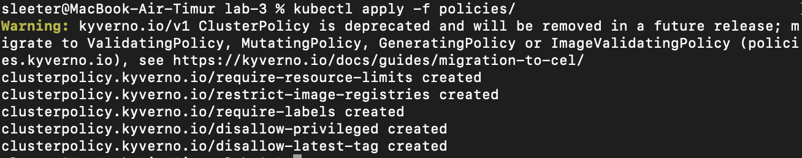

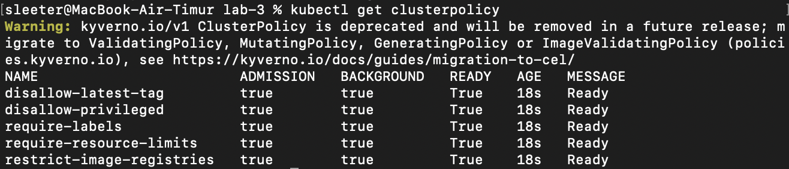

В выводе заметил предупреждение, что `ClusterPolicy` в этой версии Kyverno уже устаревает и вместо него предлагают `ValidatingPolicy` на CEL. Для лабы оставил рабочий вариант.

### Проверка правил

Чтобы не проверять не только на словах, сделал в [tests/](./tests/) один нормальный манифест и пять неправильных. Каждый неправильный нарушал только одно правило.

Нормальный Pod Kyverno пропустил и создал.

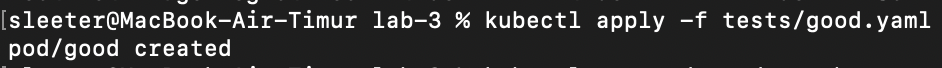

Правда, сам Pod потом ушёл в `CrashLoopBackOff`. Я удивился, а потом посмотрел логи и увидел, что для `api` не передали `DATABASE_URL`. Это уже ошибка запуска приложения, а не политики. Kyverno свою работу сделал, объект он разрешил.

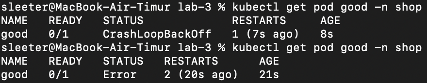

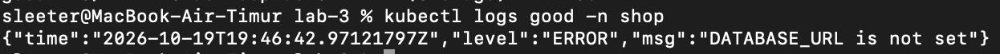

Остальные пять манифестов Kyverno отклонил. На скриншотах видно, что в каждом случае он пишет, какое правило нарушено. По очереди проверил отсутствие лимитов, неправильный реестр, отсутствие меток, привилегированный контейнер и тег `latest`.

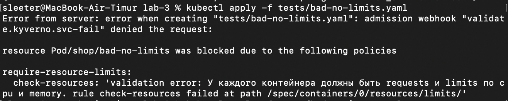

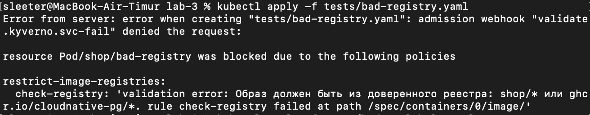

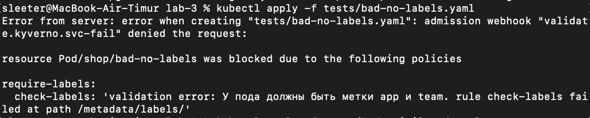

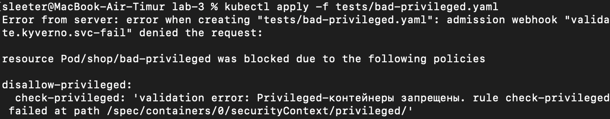

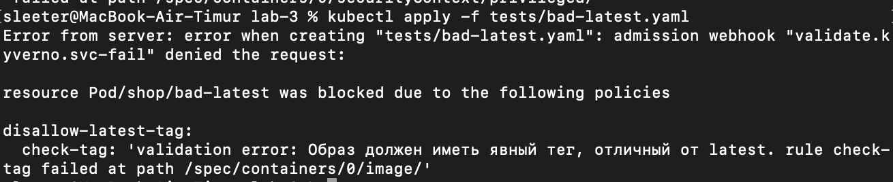

С запуском Kyverno, кстати, пришлось подождать минут десять. Образы тянулись с `reg.kyverno.io`, а интернет опять работал через раз. В событиях было `Pulling`, так что проблема оказалась не в манифестах, а в загрузке образов.

## Часть 2. Helm-чарт для shop

Теперь сделал Helm-чарт [chart/shop](./chart/shop/) для `api` и `worker`. У `api` три реплики, у `worker` две. У всех контейнеров указал ресурсы, нужные метки, конкретные теги образов `shop/api:0.1` и `shop/worker:0.1`, а ещё readiness и liveness на `/health`.

Образы собирал через `minikube image build`, потому что внутри minikube своё хранилище. Заодно проверил чарт через серверный dry-run. С правильными ресурсами всё прошло, а если их убрать, Kyverno сразу отклоняет манифест. То есть политики работают и при установке через Helm.

```bash
helm install shop chart/shop -n shop
```

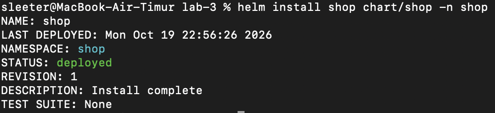

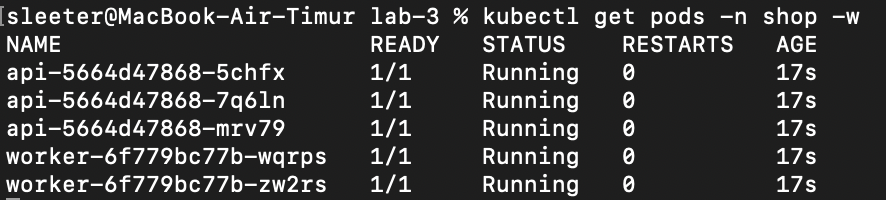

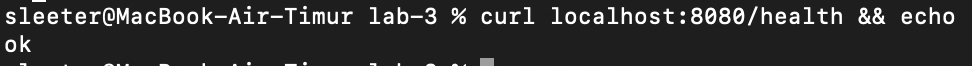

### Как Kubernetes возвращает поды

Сначала просто удалил один Pod `api`. Deployment почти сразу создал ему замену, у нового пода был маленький `AGE`.

С первой командой удаления я, правда, немного затупил. `kubectl get ... -o name` уже возвращает `pod/имя`, а я дописал `pod` ещё раз и получил ошибку. Убрал лишнее слово, и всё удалилось нормально.

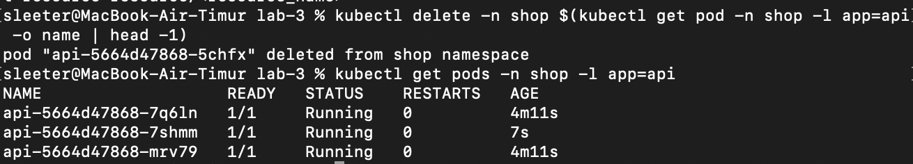

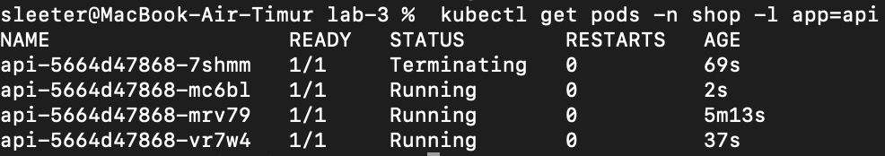

Дальше поменял `api.replicas` с трёх на пять и выполнил `helm upgrade`. Появилось пять подов, после чего я вернул три.

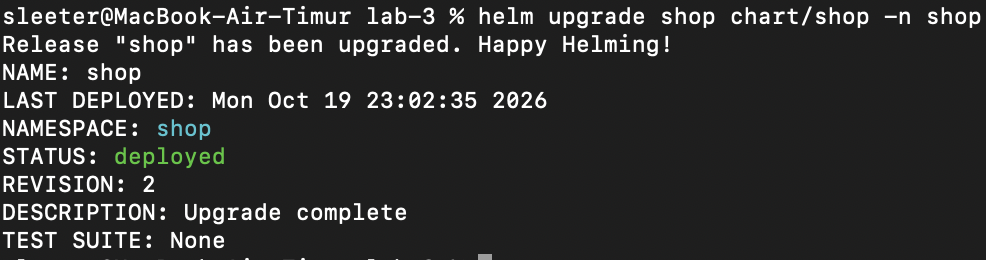

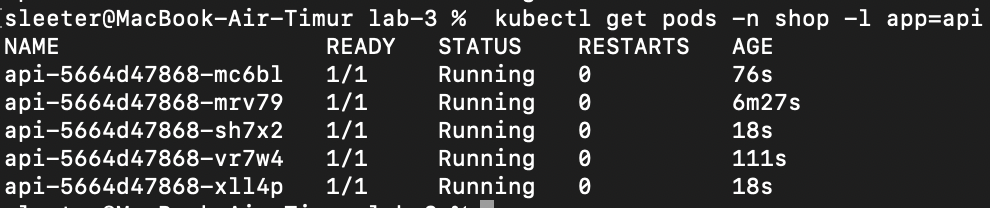

### Rolling update

Теперь захотел проверить обновление без ошибок для клиентов. Поставил `maxSurge: 1` и `maxUnavailable: 0`, чтобы сначала поднимался новый Pod, а старый удалялся только после готовности нового.

Нагрузку запускал прямо с ноды minikube на ClusterIP. Через `kubectl port-forward` проверять было бы неправильно, потому что он привязывается к конкретному поду и может оборваться при его удалении.

```bash
IP=$(kubectl get svc api -n shop -o jsonpath='{.spec.clusterIP}')
minikube ssh "for i in \$(seq 1 600); do curl -s -o /dev/null -w '%{http_code}\n' --max-time 2 http://$IP:8080/health; sleep 0.2; done" | sort | uniq -c
```

Параллельно собрал `shop/api:0.2` и обновил релиз. На скринах видно, что Kubernetes поднимал новые поды по одному, пока старые продолжали работать.

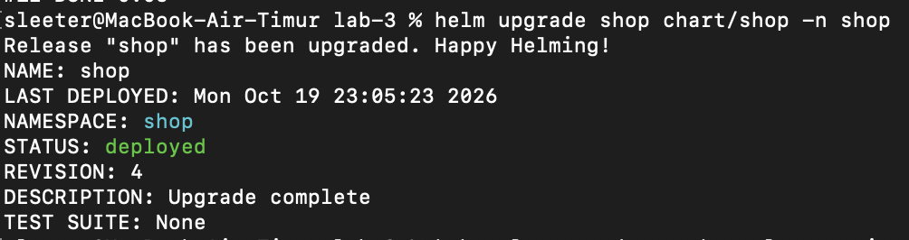

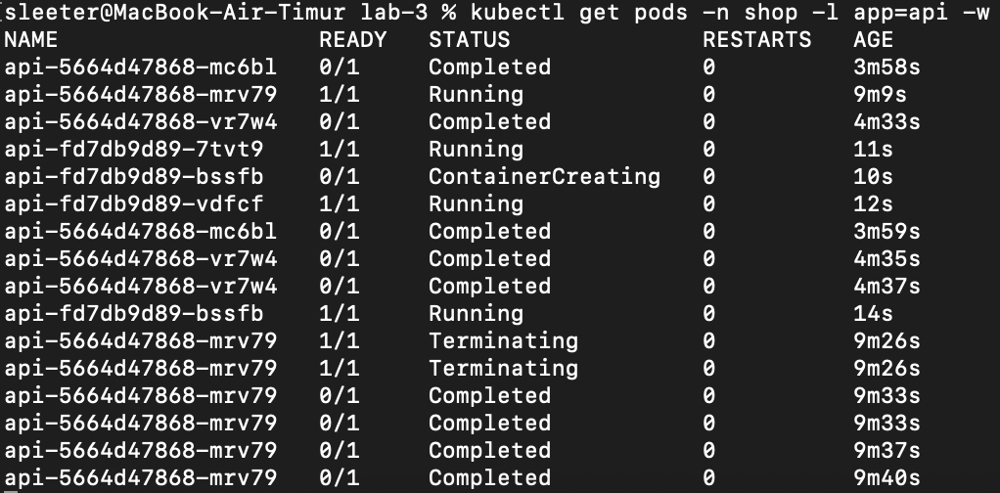

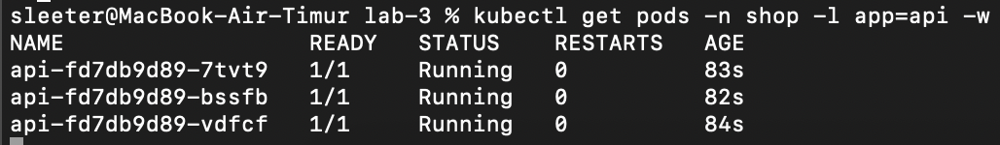

В итоге все 600 запросов вернули `200`. Отлично, обновление прошло без ошибок.

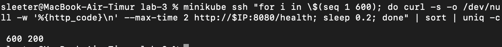

### Сломанное обновление

На этот раз специально всё испортил. Включил `HEALTH_FAIL=true` и сделал ещё один `helm upgrade`.

Новый Pod отвечал на `/health` кодом 500, поэтому readiness его не пропускала. А liveness постоянно пыталась его перезапустить. Но благодаря `maxUnavailable: 0` три старых здоровых пода остались работать.

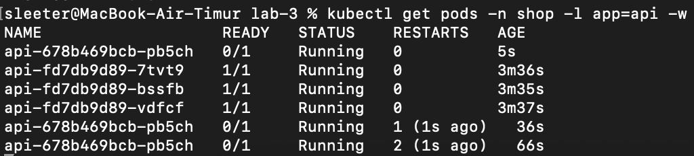

`kubectl rollout status` так и ждал завершения обновления.

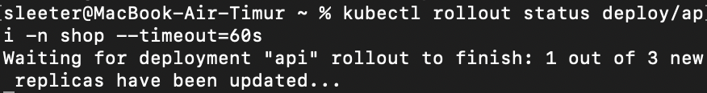

И даже при этом все 600 запросов опять получили `200`. То есть плохой релиз не попал в трафик.

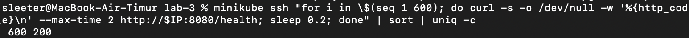

После этого откатился на рабочую четвёртую ревизию.

```bash
helm rollback shop 4 -n shop
```

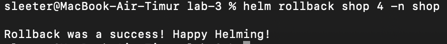

Подов снова стало три, все здоровые. В `helm history` появилась шестая ревизия с `Rollback to 4`. То есть rollback создаёт новую ревизию на основе старой, а не удаляет историю.

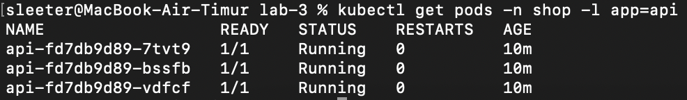

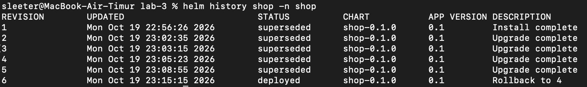

## Часть 3. Postgres через оператора

С базой решил не возиться через обычный StatefulSet и поставил CloudNativePG. Он сам создаёт поды Postgres, сервисы, секреты и следит, чтобы БД была в нужном состоянии.

```bash
helm install cnpg cnpg/cloudnative-pg -n cnpg-system --create-namespace
```

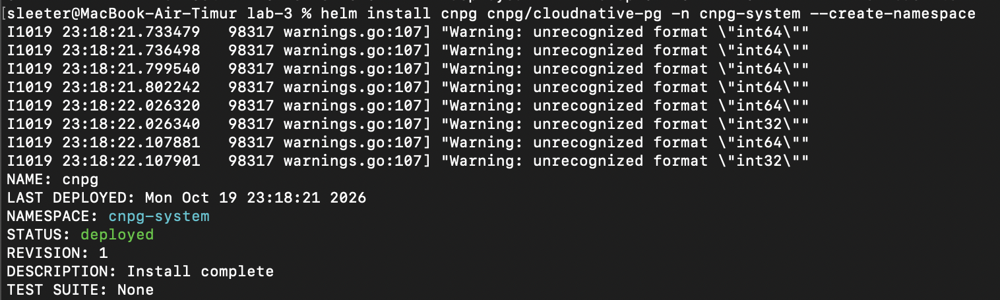

Проверил CRD, там появился `clusters.postgresql.cnpg.io`. Это и есть новый тип ресурса, через который я буду описывать базу.

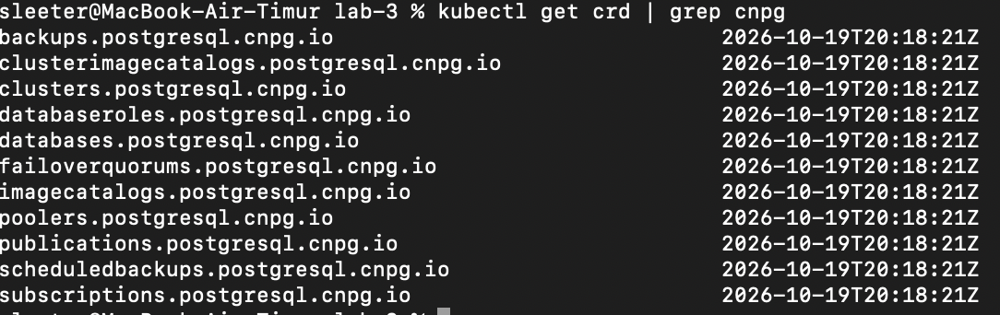

Добавил в Helm-чарт [db-cluster.yaml](./chart/shop/templates/db-cluster.yaml). В нём запросил одну инстанцию Postgres и 1 ГБ диска, указал ресурсы и метки через `inheritedMetadata`. Последнее важно, иначе Kyverno заблокировал бы поды, которые создаёт оператор.

Адрес базы сервисы получают из секрета `shop-db-app`, ключ `uri`. Сам секрет создаёт оператор, поэтому пароль в чарт я не записывал.

```bash
helm upgrade shop chart/shop -n shop
```

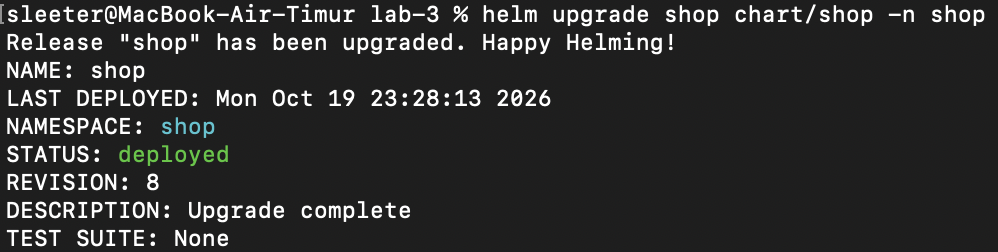

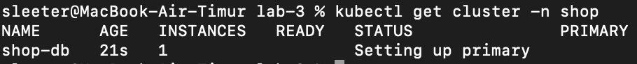

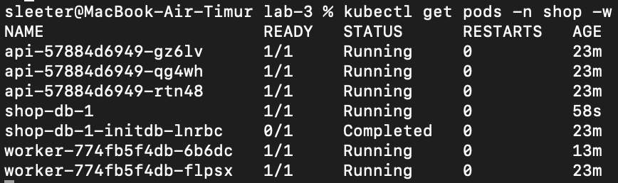

Когда всё поднялось, проверил обычный сценарий. Отправил заказ через `api`, он сохранился в Postgres, а `worker` через пару секунд поменял `processed` на `true`.

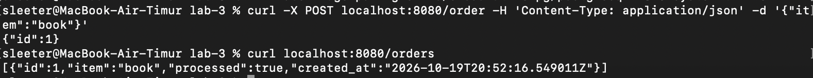

### Немного не рассчитал с ресурсами

Вот тут было больше всего прикольных(не очень) приключений. Сначала образ Postgres скачивался около 17 минут. Я смотрел `kubectl describe pod`, там было `Pulling`, поэтому просто дождался загрузки.

Потом нода с 2 CPU и 4 ГБ уже не вытягивала одновременно Kyverno, Postgres и весь мониторинг из прошлой лабы. CloudNativePG-оператор, Prometheus Operator и сам Prometheus начали падать в `CrashLoopBackOff`. У оператора БД liveness ждёт всего секунду, а на перегруженной ноде он просто не успевал ответить. После `rollout restart` поды удалось вернуть.

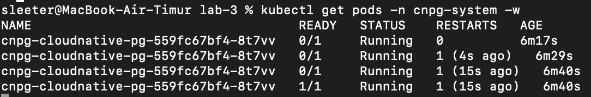

Ещё удаление пода Postgres тянулось очень долго. У него `stopDelay` 1800 секунд, чтобы дать базе нормально остановиться. Но тут всё усугубляла нехватка ресурсов. `docker stats` показывал примерно 203% CPU и 3,85 ГБ памяти из 3,91 ГБ.

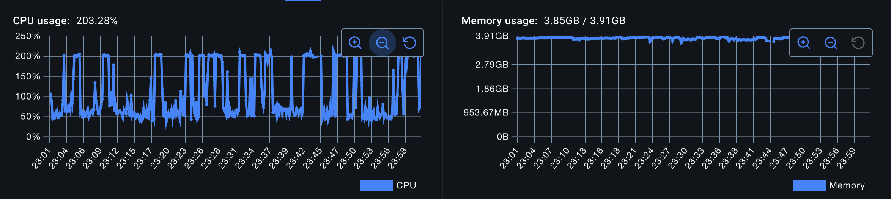

В итоге решил не пересоздавать кластер, а просто увеличил лимиты контейнера minikube.

```bash
docker update --cpus=4 --memory=6g --memory-swap=6g minikube
```

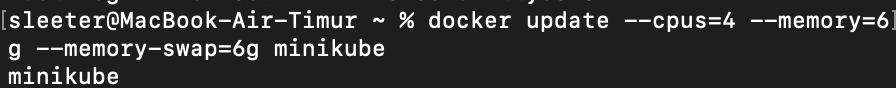

После этого стало заметно спокойнее. Использовалось около 4,6 ГБ из 6 ГБ, нагрузка на CPU снизилась. Ничего из мониторинга я при этом не удалял.

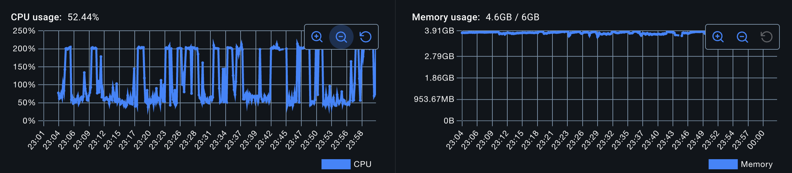

### Проверка восстановления БД

Теперь специально удалил Pod Postgres.

```bash
kubectl delete pod -n shop shop-db-1
```

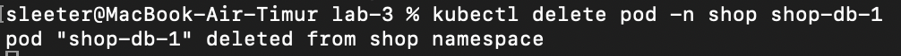

Пока база была недоступна, `/orders` отвечал `db error`, зато `/health` продолжал возвращать `ok`. Вот тут как раз пригодилось то, что я в самом начале не привязал healthcheck к БД. Иначе Kubernetes начал бы ещё и `api` перезапускать.

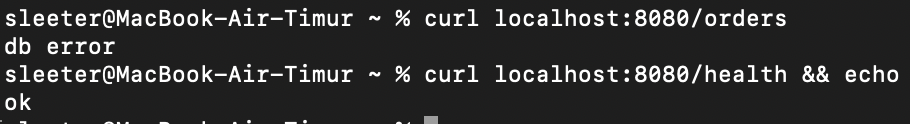

Оператор поднял БД обратно. Pod прошёл через `Terminating`, `Pending`, `Init` и `Running`, последние этапы заняли около 11 секунд. Имя осталось `shop-db-1`, а данные сохранились на старом PVC.

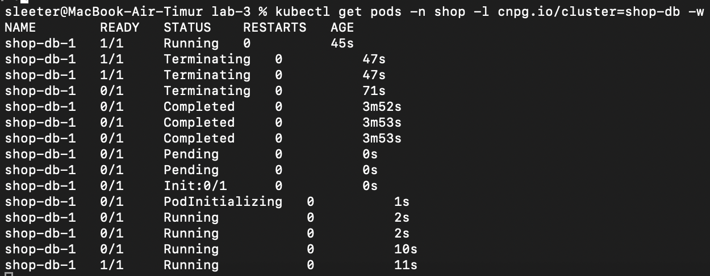

После восстановления проверил старый заказ `book`, он никуда не пропал.

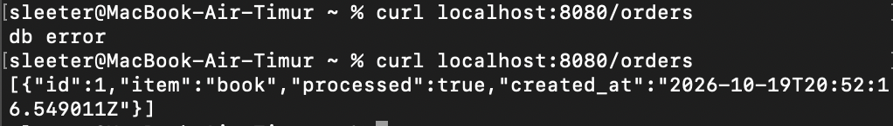

### Что хранится в spec и status

Посмотрел, что оператор вообще пишет в своём ресурсе `Cluster`.

В `spec` лежит желаемое состояние. Там мои `instances: 1`, `storage.size: 1Gi`, лимиты и `inheritedMetadata`, плюс много настроек, которые оператор добавил сам, например `stopDelay: 1800`.

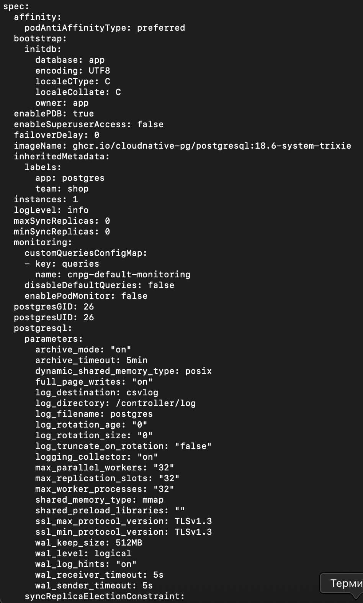

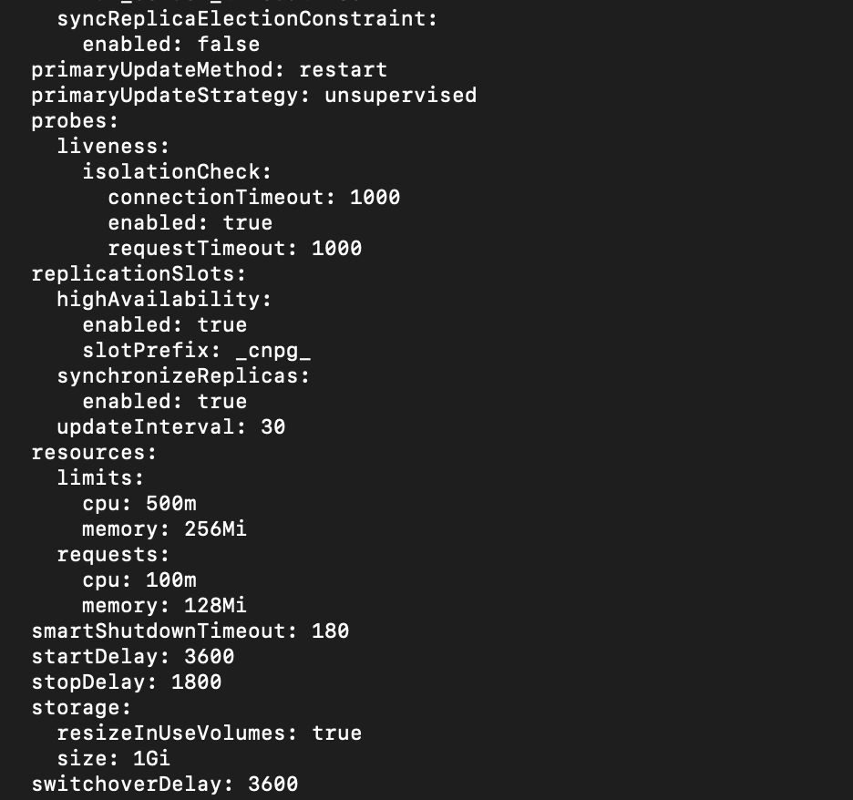

А в `status` уже то, что происходит на самом деле. Там видно `currentPrimary: shop-db-1`, состояние PVC, сертификаты и `phase: Cluster in healthy state`.

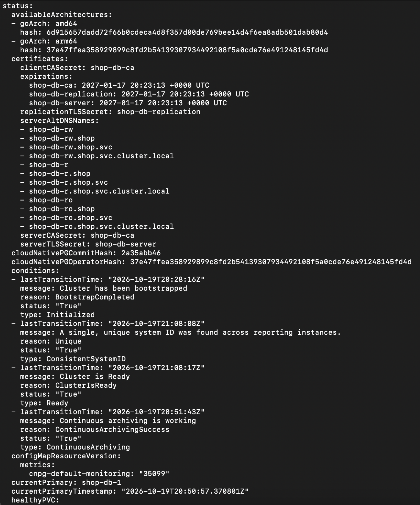

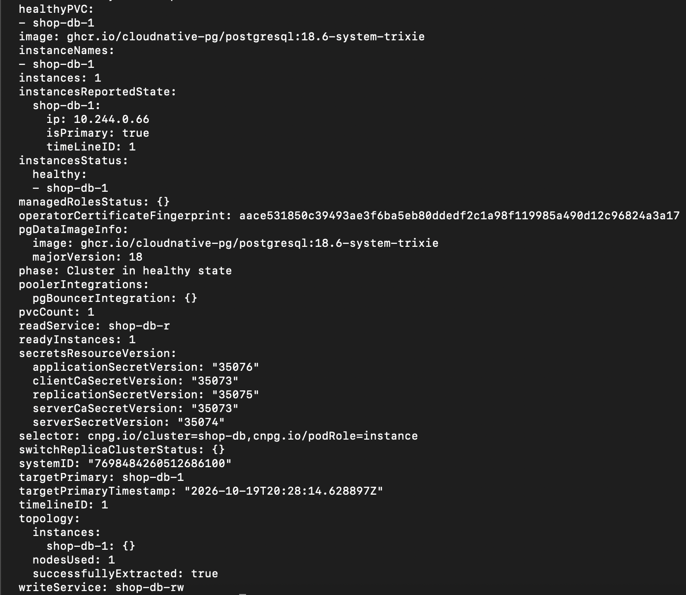

По сути оператор похож на обычные контроллеры Kubernetes. Они тоже сравнивают желаемое состояние с фактическим. Только `controller-manager` умеет управлять стандартными объектами, а CloudNativePG ещё понимает, как устроен сам Postgres, кто primary, где данные и как правильно вернуть базу после падения. Для этого ему и нужен CRD.

## Часть 4. Что будет без control plane

Дальше захотел проверить, останется ли приложение работать, если выключить Kubernetes API. По идее уже запущенным контейнерам apiserver не нужен. За ними следит kubelet, а трафик через Service продолжает идти по настроенным правилам.

В minikube `kube-apiserver` запущен как static pod, поэтому для остановки я просто убрал его манифест из `/etc/kubernetes/manifests/`. Перед этим проверил, что `/health` и заказы работают.

```bash
minikube ssh "sudo mv /etc/kubernetes/manifests/kube-apiserver.yaml /tmp/"
```

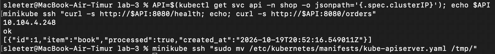

После этого `kubectl` перестал подключаться к кластеру.

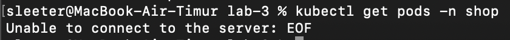

Попробовал сделать `scale` и `helm upgrade`, но получил `EOF` и `kubernetes cluster unreachable`. То есть менять состояние кластера уже нельзя.

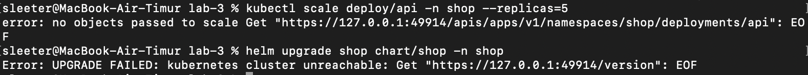

Зато сам `shop` продолжил работать. Я зашёл с ноды на ClusterIP, проверил `/health`, создал заказ `during-outage` и через пару секунд увидел, что `worker` уже поставил ему `processed: true`. Получается, все три части приложения живы, даже когда apiserver лежит.


Потом вернул манифест на место. Примерно через полминуты `kubectl get nodes` снова начал отвечать, а поды так и оставались запущенными.


Напоследок проверил масштабирование. Команда сразу ответила `scaled`, но какое-то время было только `3/5` подов. Оказалось, controller-manager ещё восстанавливал свои кэши после возвращения apiserver. Примерно через минуту он догнал нужное состояние и поднял новые поды.


В общем, пока control plane недоступен, уже запущенное приложение вполне может продолжать работать. А вот деплоить, менять количество реплик или рассчитывать на обычное восстановление подов контроллерами в это время нельзя. Kubelet ещё следит за контейнерами на своей ноде, но новые поды через Kubernetes создать некому.

## Часть 5. Мониторинг

Новый Prometheus поднимать не стал, использовал тот, что остался со второй лабы. Добавил в чарт ServiceMonitor для `api` и `worker`, отдельный Service для воркера и PrometheusRule. Без Service у воркера Prometheus не смог бы найти его через ServiceMonitor.

```bash
helm upgrade shop chart/shop -n shop
```


В Prometheus появились три цели `api` и две `worker`. Все были `UP`, значит, метрики с обеих частей приложения собираются.


### Алерты

Сделал три правила, чтобы ловить самые неприятные ситуации.

Первое, `ShopApiHighErrorRate`, срабатывает, если у `api` больше 5% ответов 5xx в течение двух минут. Дополнительно проверяю, что трафик не нулевой, иначе одна случайная ошибка могла бы дать ложную тревогу.

```promql
sum(rate(http_requests_total{namespace="shop", job="api", status=~"5.."}[2m]))
  / sum(rate(http_requests_total{namespace="shop", job="api"}[2m])) > 0.05
and sum(rate(http_requests_total{namespace="shop", job="api"}[2m])) > 0.05
```

Если такое случится, сначала стоит посмотреть логи `api`, затем историю релизов и при необходимости откатить последнее обновление.

Второе, `ShopDatabaseNotReady`, проверяет, что хотя бы один Pod Postgres готов. Если готовых нет больше минуты, это уже проблема. Тут особенно важно, что `/health` у `api` может оставаться зелёным, хотя заказы в базу не записываются.

```promql
(sum(kube_pod_status_ready{namespace="shop", condition="true", pod=~"shop-db-[0-9]+"}) or vector(0)) < 1
```

`or vector(0)` добавил, чтобы правило работало даже при полном исчезновении ряда метрики. В таком случае я бы проверил состояние Cluster, PVC и логи CloudNativePG.

Третье правило, `ShopWorkerDown`, нужно на случай, когда обработчиков заказов вообще не осталось. Заказы тогда принимаются, но навсегда зависают с `processed: false`.

```promql
absent(up{namespace="shop", job="worker"} == 1)
```

Здесь `absent` полезнее простого `up == 0`, потому что сработает, даже если сами цели пропали из Prometheus.

### Проверка алерта

Сначала все три правила были в `inactive`.


Для проверки выбрал `ShopWorkerDown` и уменьшил количество реплик воркера до нуля.

```bash
kubectl scale deploy/worker -n shop --replicas=0
```

Через какое-то время правило перешло в `pending`, а затем в `firing`.


Заодно создал заказ `stuck`. Он записался в базу, но обрабатывать его оказалось некому, так что `processed` остался `false`.


После этого вернул две реплики воркера. Он обработал зависший заказ, а алерт вернулся в `inactive`.


Два других алерта отдельно не провоцировал, потому что по заданию достаточно было проверить хотя бы один.

## Выводы

В этой лабе больше всего понравилось смотреть, как Kubernetes сам возвращает нужное состояние. Я удалял поды, ломал обновление, выключал apiserver, а потом проверял, что реально продолжает работать. Особенно показательный момент получился с control plane. Управлять кластером уже нельзя, а заказы при этом спокойно создаются и обрабатываются.

Ну еще Kyverno помог заранее отсеять неправильные манифесты, а CloudNativePG избавил от ручного восстановления базы. Правда, сильнее всего я намучился даже не с ними, а с ресурсами minikube. На 2 CPU и 4 ГБ весь этот набор сервисов не помещался, так что пришлось поднять лимиты до 4 CPU и 6 ГБ.
