# Лабораторная работа 4. SLA критического пути под перегрузкой

В этой лабе я разбиралась, как оставить оформление заказов рабочим, когда кластеру не хватает ресурсов. В shop заказы проходят через API и PostgreSQL, а рядом работает batch, условная ночная аналитика. Под нагрузкой хотелось сохранить именно заказы, а фоновыми задачами при необходимости пожертвовать.

Приложение заново не писала: взяла API, worker, чарт shop и политики из третьей лабы. Мониторинг подготовила на основе второй. Ресурсы, размещение и приоритеты меняла в values и шаблонах чарта, потом применяла через helm upgrade.

## Окружение

Работу выполняла на Windows через WSL2 Ubuntu 20.04 с Docker Engine. Кластер kind состоит из control-plane и worker-ноды, Kubernetes - 1.34.0, Helm - 4.3.1. Для размещения приложения на обеих нодах я сняла taint с control-plane.

У ноутбука 8 ГБ RAM, WSL доступно около 3,7 ГиБ и 1 ГиБ swap. Использованные версии чартов: CloudNativePG 0.29.1, Kyverno 3.9.1, kube-prometheus-stack 92.9.0.

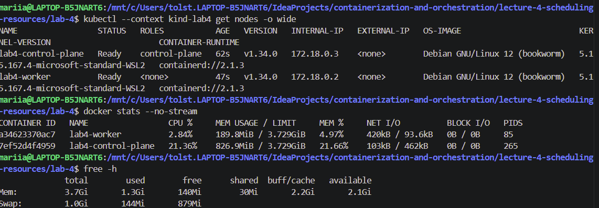

## Подготовка. Перенос shop из третьей лабы

Сначала скопировала сервисы и чарт в папку четвёртой лабы. Образы собрала локально и загрузила на обе ноды через kind load docker-image. У Docker на хосте и containerd внутри kind разные хранилища, поэтому одной сборки было недостаточно. PostgreSQL оставила под управлением CloudNativePG.

После установки проверила, что приложение вообще работает: создала заказ, подождала и увидела processed: true. Значит, API записал заказ в базу, а worker его обработал. Потом проверила метрики. У трёх API и двух worker появился up = 1, а через kubelet/cAdvisor стали видны CPU и память контейнеров.

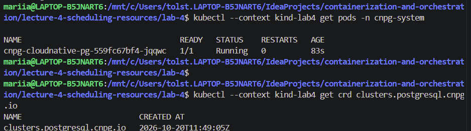
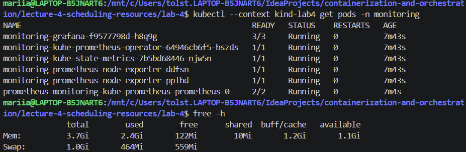
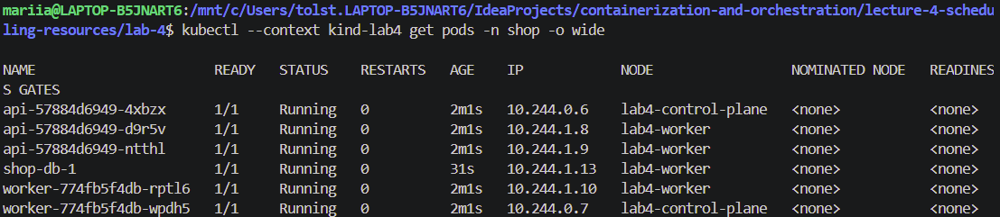
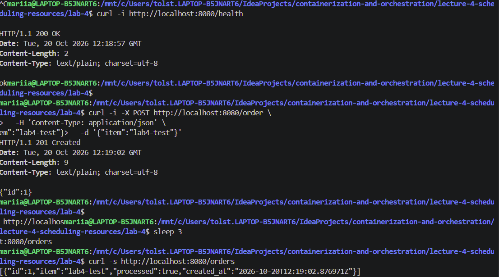
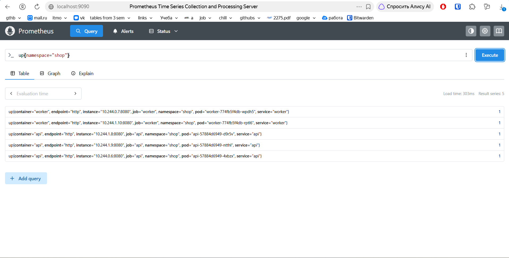
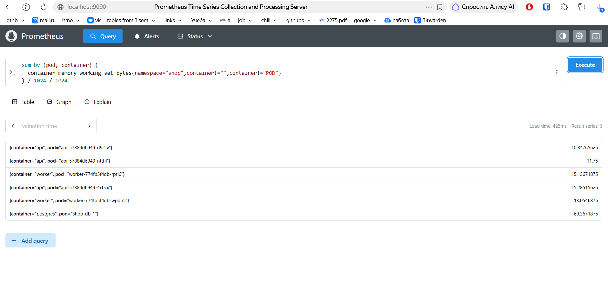

## Часть 0. Сервис batch

Для фоновой нагрузки я использовала Python-сервис с параметрами `MEMORY_MIB` и `CPU_PERCENT`, передаваемыми из Helm values. Код находится в [batch/main.py](batch/main.py), сборка - в [batch/Dockerfile](batch/Dockerfile).

Первая версия записывала память только при запуске. Часть страниц уходила в swap, поэтому размер выделенного массива не совпадал с текущим потреблением RAM. В образе `shop/batch:0.2` я добавила регулярное обращение к страницам и проверила working set и swap отдельно.

Для batch использовала стратегию Recreate, чтобы при обновлении старый и новый экземпляры не потребляли память одновременно.

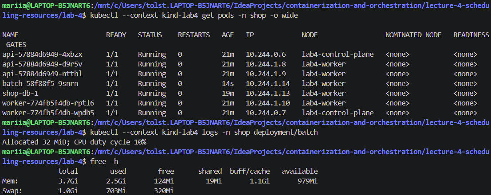

## Части 1 и 4. Как я разнесла API по нодам

В values предусмотрен выбор `podAntiAffinity` или `topologySpreadConstraints`. Я выбрала topology spread по `kubernetes.io/hostname`, с `maxSkew: 1` и `whenUnsatisfiable: DoNotSchedule` для селектора `app: api`.

Три реплики на двух нодах распределяются как 2+1. Жёсткий podAntiAffinity по hostname позволил бы разместить только две реплики: третья осталась бы Pending. Поэтому для этой площадки я выбрала ограничение дисбаланса.

Разнесение уменьшает число API, теряемых при отказе одной ноды. При этом единственный PostgreSQL остаётся точкой отказа: разнесение API не обеспечивает отказоустойчивость всей цепочки.

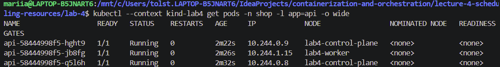

## Часть 2. Площадка и политики

Я добавила batch в Helm-чарт с requests/limits CPU и памяти, метками `app` и `team` и явным тегом разрешённого образа.

Kyverno проверяет ресурсы, метки, разрешённые реестры, запрет privileged и latest. Namespace shop не исключён из проверок. Системные namespaces, мониторинг и операторы исключены, чтобы правила приложения не блокировали инфраструктуру.

Для экономии ресурсов я установила admission-контроллер без дополнительных фоновых контроллеров. Серверный dry-run Pod без ресурсов получил отказ `require-resource-limits`. Сам Pod при этой проверке не сохранялся.

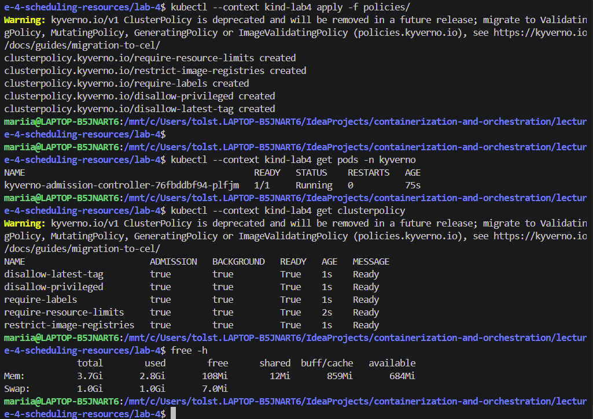
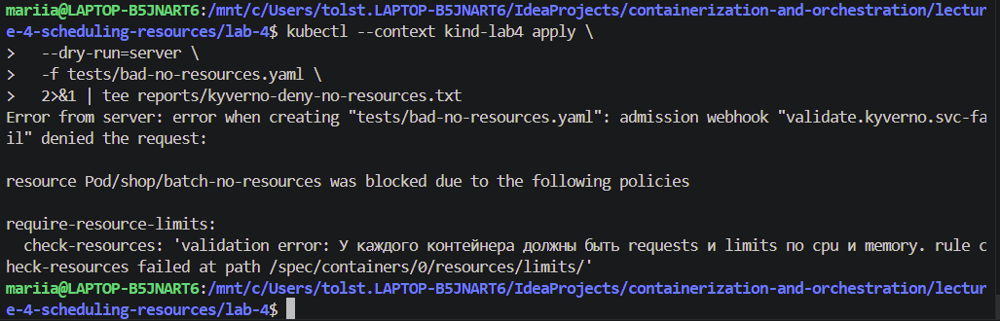

## Часть 3. Подбор ресурсов через krr

Изначально ресурсы были выставлены примерно. Чтобы сравнить догадку с реальным потреблением, я запустила k6 по POST /order и дала Prometheus собрать данные. Потом запустила krr с окном 1 час, шагом 0,5 минуты и points-required: 10. Кластер был свежий, поэтому krr предупреждал, что истории мало. Для лабы рекомендации получила, но переносить такой короткий замер в production без дополнительных наблюдений я бы не стала.

Стандартная версия krr обнаруживала Deployment, но не Cluster CloudNativePG. Адаптер [tools/krr-cnpg.py](tools/krr-cnpg.py) добавляет существующий Pod базы в анализ, не меняя управление PostgreSQL оператором.

| Сервис | Исходный CPU request | CPU request krr | Память krr |
|---|---:|---:|---:|
| api | 50m | 21m | 100Mi |
| worker | 50m | 18m | 100Mi |
| postgres | 100m | 120m | 117Mi |

Рекомендации немного менялись между запусками из-за скользящего окна. Одинаковые 100Mi для небольших сервисов согласуются с минимальным порогом стратегии, а не с одинаковым фактическим потреблением.

Simple предлагала убрать CPU limits. Я не применила это буквально: limits требуются заданием и политиками. Первое приравнивание небольшого CPU request к limit оказалось неудачным - появились задержки и провалы probes. После нагрузочных проверок я увеличила CPU.

| Сервис | Финальные CPU request / limit | Memory request / limit |
|---|---|---|
| api | 500m / 500m | 100Mi / 100Mi |
| worker | 18m / 200m | 100Mi / 100Mi |
| postgres | 1 / 1 | 117Mi / 117Mi |
| batch, обычный режим | 50m / 300m | 48Mi / 448Mi |

В итоге CPU у API и базы пришлось поднять относительно krr. Важно, что эти финальные числа я получила уже после нагрузочных проверок: в самом отчёте krr их нет. Память оставила по рекомендации. Исходные отчёты и результаты проверок сохранила в [reports/](reports/), в том числе krr-cnpg.txt.

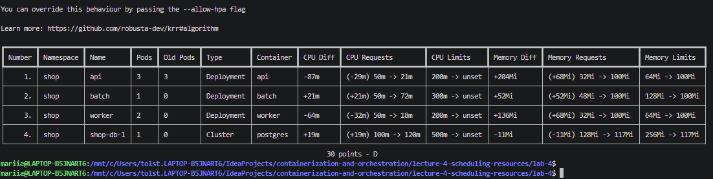
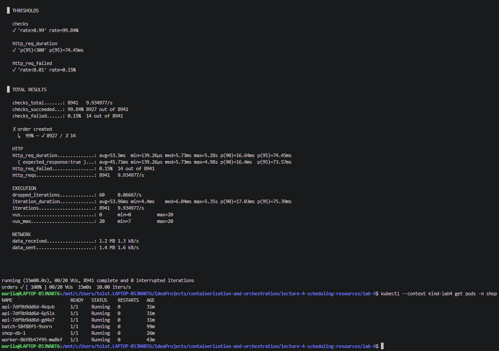

## Часть 5. Приоритеты, QoS и PDB

API и PostgreSQL получили Guaranteed благодаря равенству requests и limits CPU и памяти. Их класс `shop-critical` имеет приоритет 100000. Batch остаётся Burstable с классом `shop-batch-low`, приоритет -1000.

Сначала у batch был приоритет 1000. Он был ниже API, но выше операторов с приоритетом 0. Это привело к выселению оператора раньше batch. После опыта я исправила приоритет фоновой нагрузки.

Scheduler использует приоритет для preemption. При eviction по памяти kubelet учитывает превышение requests, приоритет и потребление относительно requests. QoS сам по себе не определяет весь порядок жертв, а Guaranteed не даёт абсолютной защиты.

PDB API включён в чарт и задаёт `minAvailable: 2`: при трёх здоровых репликах допускается одно добровольное выселение. PDB `shop-db-primary` с `minAvailable: 1` создаёт CloudNativePG для единственной primary. Я использовала бюджет оператора, не создавая пересекающийся PDB вручную; его поведение связано с конфигурацией Cluster.

PDB не предотвращает OOM, node-pressure eviction и прямой delete Pod.

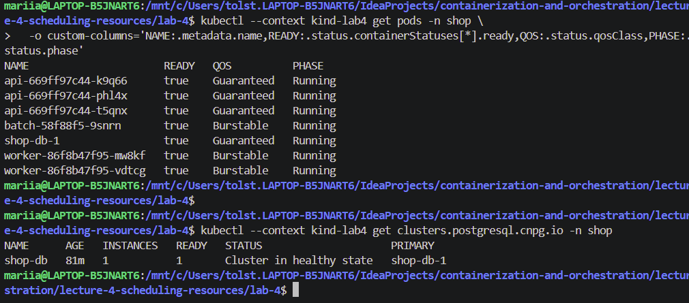
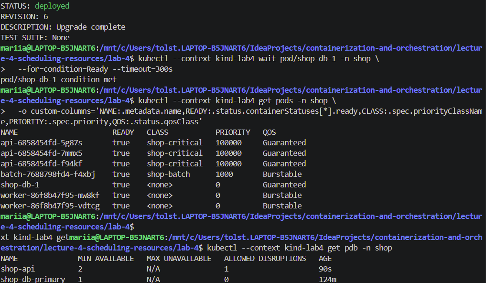
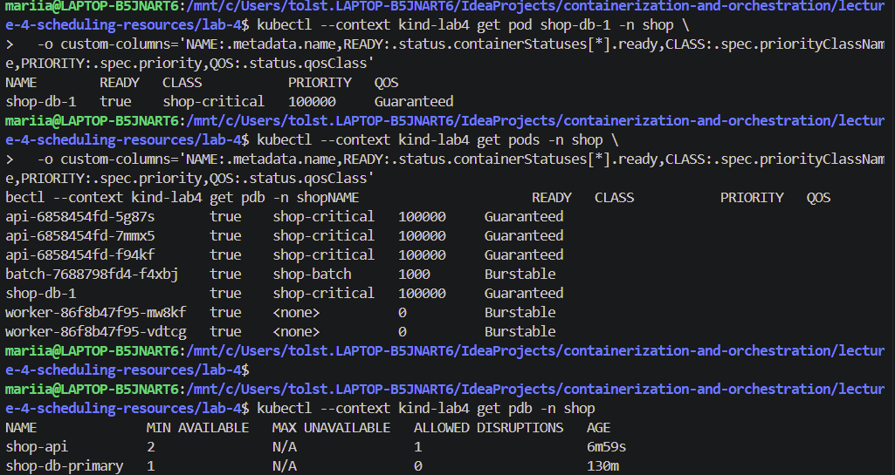

## Часть 6. Pending и preemption

Я увеличивала CPU requests batch через values, сохраняя небольшую фактическую нагрузку. Лишние поды оставались Pending с причиной `Insufficient cpu`. Scheduler размещает поды по requests и allocatable, а не текущему потреблению CPU.

При появлении новых высокоприоритетных API scheduler вытеснил batch. Механизм подтверждён событиями `Preempted`. Статус Terminating сам по себе недостаточен, поскольку бывает и при обычном обновлении. Пока batch завершался, API мог ждать на nominated node. Ограничение разнесения при этом продолжало действовать.

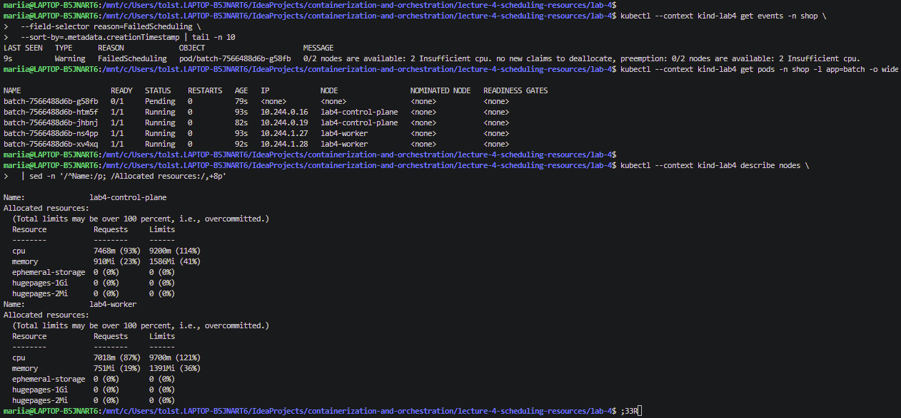
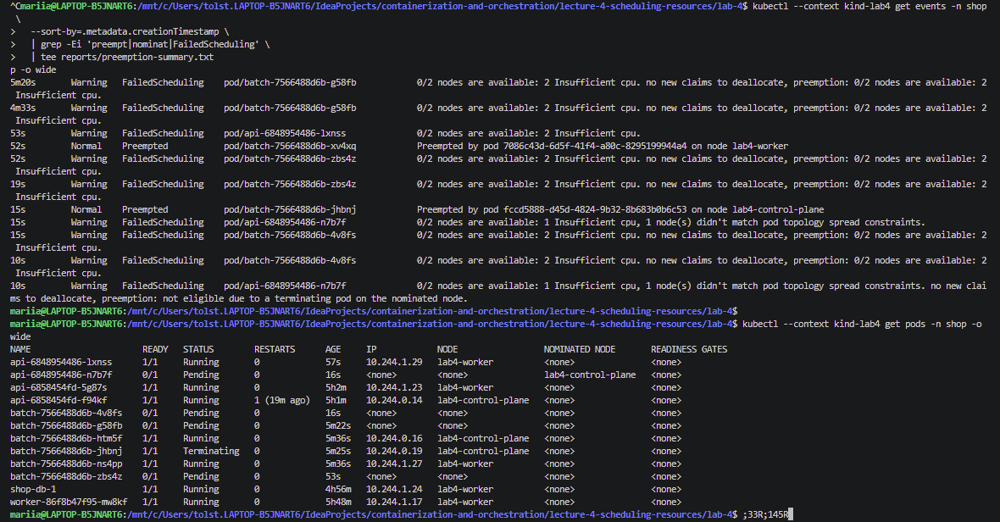
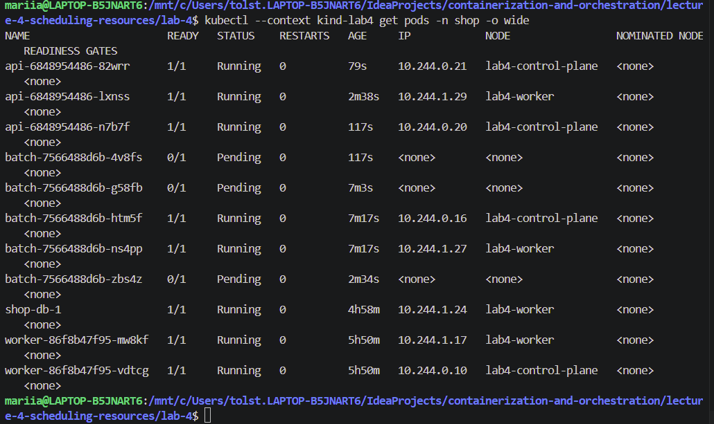

## Часть 7. Кого kubelet выселит при нехватке памяти

С памятью оказалось сложнее, чем с CPU. В конфиге kubelet kind не было memory.available в evictionHard. Ещё выяснилось, что свободная память по мнению отдельной ноды и свободная память всей WSL различаются. Обе ноды живут в одной WSL, поэтому просто увеличивать batch до упора было плохой идеей.

Сначала попробовала поднять hard-порог и получила другой эффект: уменьшился Node Allocatable, а kubelet начал отказывать подам в допуске с OutOfmemory. Под эксперимент попал даже API. Это был не тот eviction, который требовалось показать, поэтому этот результат оставила как неудачную попытку.

После этого перешла на soft-порог с выдержкой 60 секунд. Сам порог настроила отдельно на worker, а потребление batch по-прежнему меняла через Helm. Конфиги до и после изменения сохранила в reports, чтобы потом вернуть ноду в исходное состояние.

В первом soft-опыте был выселен оператор CloudNativePG. После исправления приоритета batch на -1000 kubelet поставил batch первым в очередь жертв. При потреблении около 164Mi, request 48Mi и limit 448Mi появилось событие `Evicted` с причиной нехватки памяти ноды. API и PostgreSQL оставались готовыми.

Это отличается от `OOMKilled` по лимиту контейнера. Причину в этом опыте подтверждают событие kubelet и его журнал, а не только статус Error или код завершения процесса. После опытов я восстановила исходную конфигурацию kubelet.

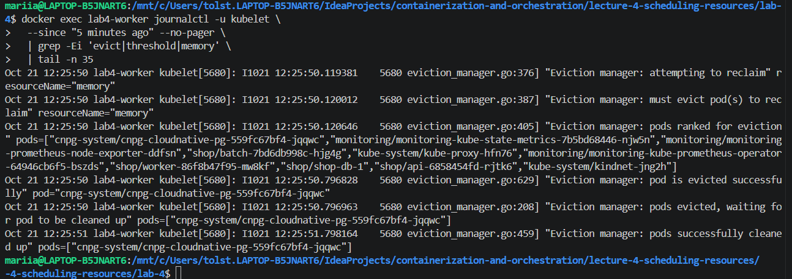
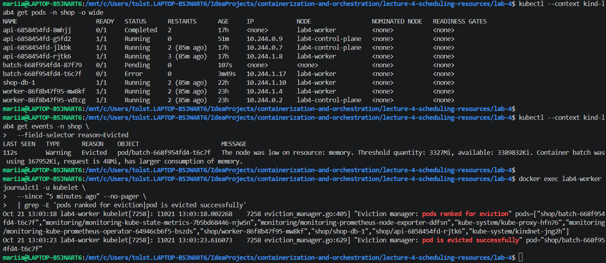

## Часть 8. SLA под нагрузкой

Я зафиксировала цель для стенда: 10 заказов/с, p95 < 1 секунды, ошибок < 1%, dropped_iterations = 0. Первоначальный порог 300 мс не выдерживался в отдельных диагностических прогонах. Эти результаты сохранены; цель 1 секунда была зафиксирована до успешных итоговых опытов.

Первые замеры через port-forward нагружали одну реплику. Итоговые проверки выполняла через ClusterIP Service из сети kind, с отключённым повторным использованием соединений. Распределение запросов между тремя API проверила отдельно.

### Давление по памяти

Во время пятиминутного теста я увеличила память batch. При soft-пороге worker 3370Mi он получил Evicted. API и PostgreSQL продолжали работать без новых перезапусков.

Начало создания давления - 21.10.2026 14:01:31 UTC. Графики сохранены за 13:59:31-14:06:31 UTC. Результат: 3001 запрос, p95 147,81 мс, ошибок и пропущенных итераций нет.

### Preemption

Первый опыт с изменением ресурсов API провалился: p95 5 секунд, 27,87% ошибок, 777 пропущенных итераций. PostgreSQL перезапустился после провала liveness. Ошибки связи с Kubernetes API начались ещё до опыта, поэтому весь сбой нельзя приписать preemption.

Для повторной проверки я временно отключила Grafana; Prometheus продолжал собирать метрики. В k6 использовала 50 заранее выделенных VU при прежнем темпе 10 заказов/с.

Batch резервировал 5600m CPU на worker при небольшой реальной нагрузке. Во время теста я увеличила API с 3 до 6 реплик, не меняя шаблон и ресурсы существующих подов. Разнесение потребовало разместить новые API на worker. Scheduler вытеснил batch; новое событие относилось к `batch-576f5c7568-gnblr`.

Все шесть API стали готовы, PostgreSQL не перезапускался во время опыта. Все пороги пройдены. Результат относится к пятиминутному окну этого стенда с временно отключённой Grafana. После проверки обычные настройки и Grafana восстановлены.

| Опыт | Запросы | p95 | Ошибки | Dropped iterations |
|---|---:|---:|---:|---:|
| Базовый, 5 минут | 3001 | 29,83 мс | 0% | 0 |
| Eviction batch, 5 минут | 3001 | 147,81 мс | 0% | 0 |
| Первый preemption, неудачный | 2224 | 5 с | 27,87% | 777 |
| Повторный preemption, 5 минут | 3001 | 519,01 мс | 0,03% | 0 |

В успешных опытах деградировал batch: он был выселен, а его замена оставалась Pending. Критический путь выдержал выбранный SLA.

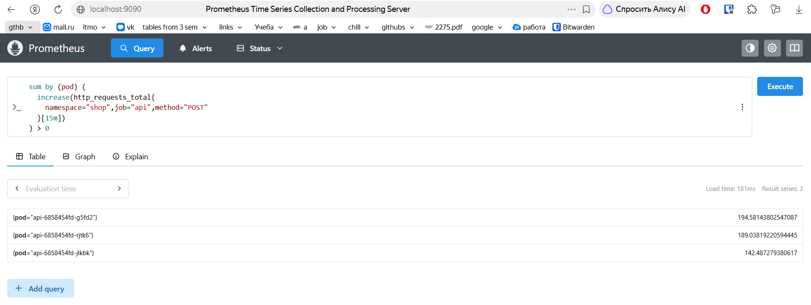
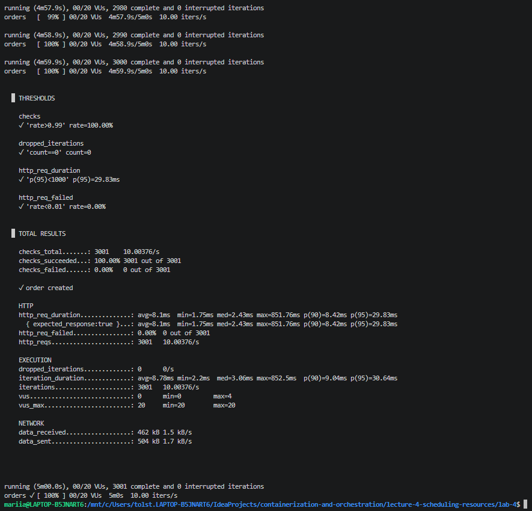
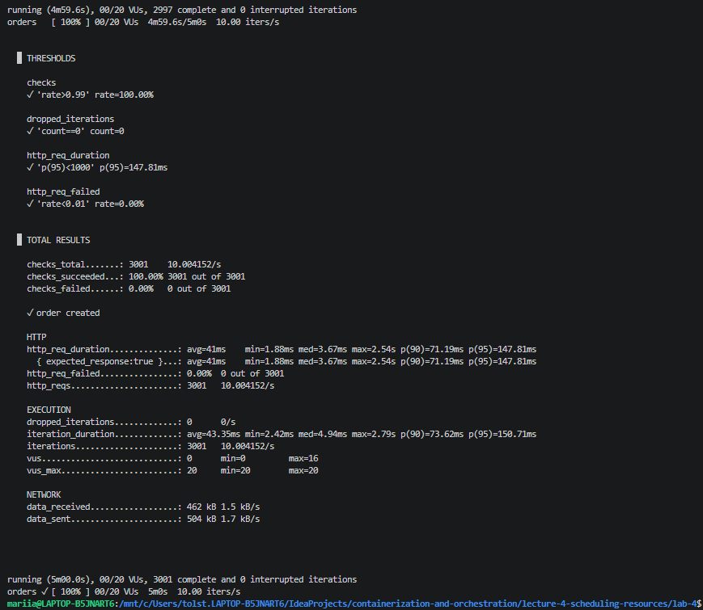
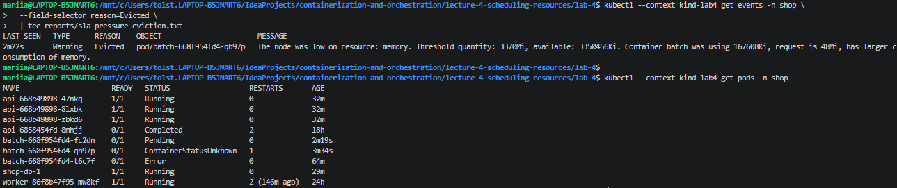
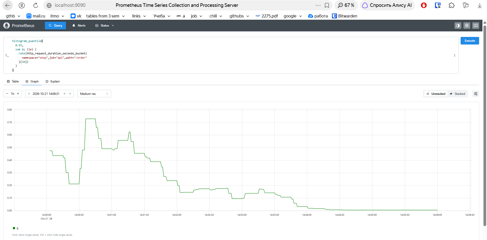
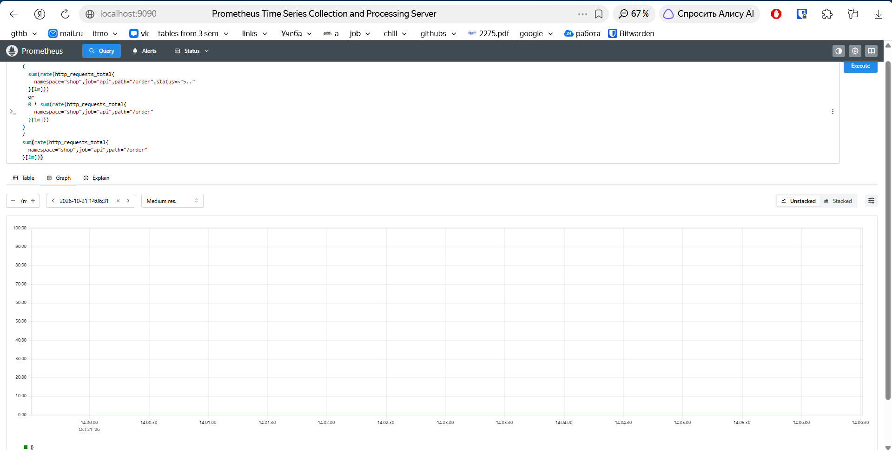
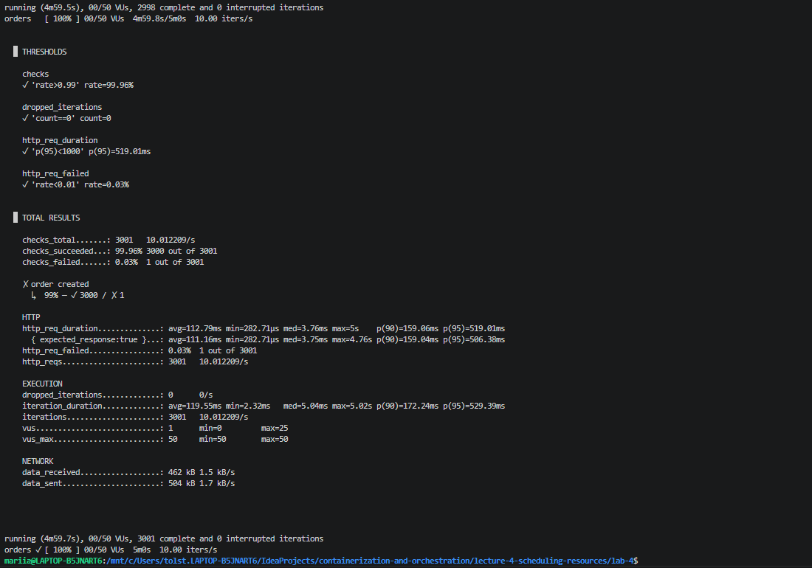
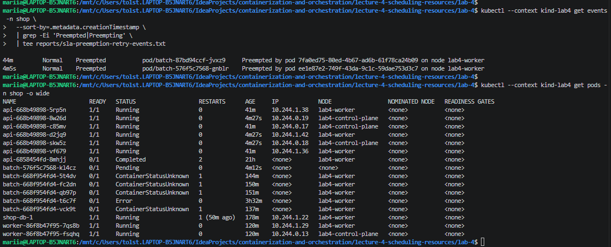

## Часть 9. Мониторинг и алерты

ServiceMonitor, PrometheusRule и ConfigMap дашборда встроены в чарт shop.

Я использовала три алерта:

- `ShopApiHighErrorRate`: доля 5xx выше 5% дольше двух минут при ненулевом трафике. Выявляет ошибки запросов пользователей.
- `ShopDatabaseNotReady`: нет готового PostgreSQL больше минуты. Нужен отдельно от health API, который не зависит от базы.
- `ShopWorkerDown`: нет доступных worker больше минуты. Заказы могут сохраняться, но перестают обрабатываться.

Я уменьшила worker.replicas до нуля через Helm и получила Firing у ShopWorkerDown. После возврата двух реплик правило стало Inactive. Alertmanager отключён для экономии ресурсов; firing проверяла в Prometheus.

Дашборд показывает RPS заказов, p95 POST /order, долю 5xx, working set batch и MemoryPressure нод. JSON находится в [chart/shop/dashboards/shop-sla.json](chart/shop/dashboards/shop-sla.json) и устанавливается через ConfigMap.

Grafana была нестабильна с лимитами 300m CPU и 256Mi RAM. После увеличения до 1 CPU и 512Mi интерфейс стал доступен. Прерванное обновление monitoring оставило pending-upgrade; я восстановила управление через rollback и повторный upgrade.

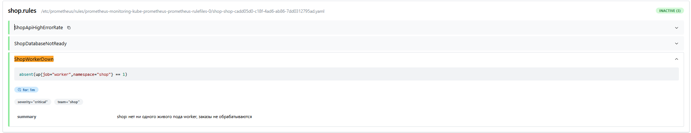
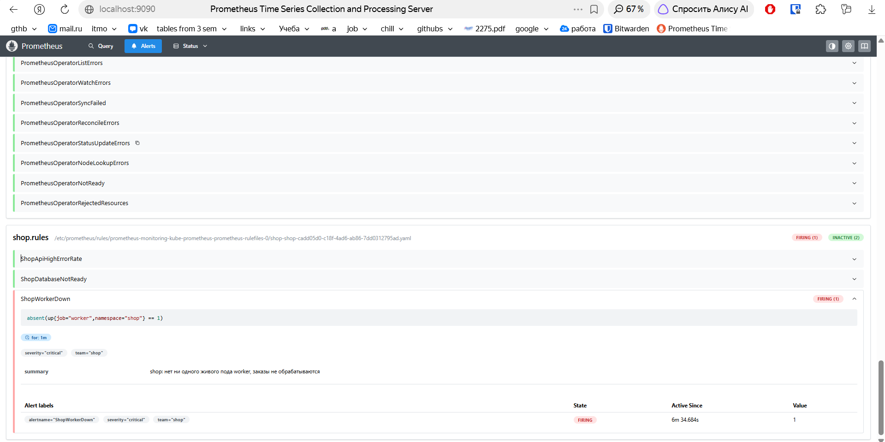
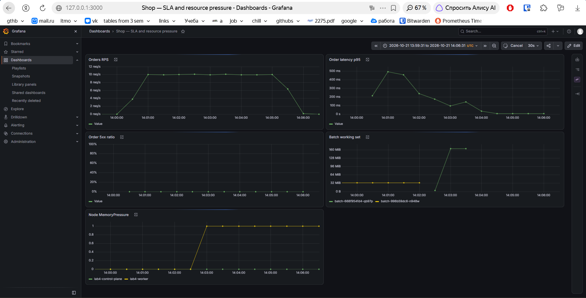

## Что осталось после опытов

После опытов я вернула три API, два worker, один PostgreSQL и один batch с 32Mi выделенной памяти и CPU duty cycle 1%. Исходный конфиг kubelet восстановлен, Grafana включена. На финальной проверке shop имел revision 38, monitoring - revision 6; все четыре Helm-релиза были deployed. Старые завершённые поды остались как следы опытов.

## Выводы

В этой лабе лучше всего стало видно, что requests и реальное потребление решают разные задачи. Batch почти не нагружал CPU, но из-за большого request занимал место для scheduler. А маленький CPU limit у API и базы, наоборот, мешал обслуживать короткие пики и отвечать на probes.

Ещё запомнился опыт с приоритетом batch. Число 1000 казалось небольшим рядом со 100000 у API, но оператор с приоритетом 0 оказался защищён хуже. Пришлось сравнивать batch со всеми соседями, а не только с критическими сервисами. После исправления удалось отдельно показать preemption scheduler и eviction kubelet, а затем проверить заказы во время обоих опытов.

Короткая история krr, единственный PostgreSQL, временное отключение Grafana в повторном CPU-опыте и общий ограниченный ресурс WSL остаются ограничениями полученных результатов.
