# Лабораторная работа 5 — Zero-trust сеть с доказательством

В этой лабе я разбирался с сетью в Kubernetes. Сначала хотелось доказать, что Service держит `shop` на плаву, даже когда поды под ним постоянно умирают и пересоздаются с новыми IP. Потом закрыть сеть по принципу «по умолчанию всё запрещено, открыто только нужное», проверить это матрицей доступа и в конце найти спрятанную поломку связности по карте трафика, а не наугад. Вообще очень удобно, когда запрет можно не гадать, а увидеть в Hubble.

Язык сервисов: **Go**. Новых сервисов не писал: взял `api`, `worker` и чарт `shop` из третьей лабы, а мониторинг из второй. Добавил только маленький генератор клиентской нагрузки `loadgen` (он нужен для доказательства непрерывности).

Окружение:

- хост — macOS (arm64), кластер — minikube v1.37.0 (Docker-драйвер), Kubernetes v1.34.0, Helm 4.3.1;
- кластер из **двух нод** (`minikube` и `minikube-m02`) с памятью 4500 МБ на ноду. В Docker Desktop поднял память до ~12 ГБ (`docker info` показывал 11,67 ГиБ), иначе две ноды с Cilium, мониторингом и оператором БД не помещались;
- CNI — **Cilium 1.20.4** с Hubble, оператор БД — CloudNativePG (chart 0.29.1), мониторинг — `kube-prometheus-stack` 92.10.1 (Alertmanager выключил, алерты смотрел в Prometheus);
- файлы: сервисы в [api/](./api/) и [worker/](./worker/), клиент нагрузки в [loadgen/](./loadgen/), чарт в [chart/shop/](./chart/shop/), конфиги стека в [monitoring/](./monitoring/), скрипты в [scripts/](./scripts/), политики Kyverno из лабы 3 лежат в [policies/](./policies/) (в этой лабе их не ставил).

---

## Часть 0. Выбор CNI

Сетевые политики исполняет CNI-плагин, а дефолтный `kindnet` правила молча игнорирует: правило принимается, но не работает. Поэтому нужен другой плагин. Я выбрал **Cilium**, а не Calico, по двум причинам. Во-первых, он построен на eBPF и умеет применять политики без цепочек iptables. Во-вторых, у него есть Hubble, то есть карта трафика с причинами каждого отказа, и для части 6 (поиск поломки) это именно то, что нужно. С Calico пришлось бы собирать диагностику из логов.

Кластер пересоздал без CNI, чтобы поставить Cilium своим чартом:

```bash
minikube delete
minikube start --nodes=2 --cni=false --cpus=4 --memory=4500
helm install cilium cilium/cilium -n kube-system -f monitoring/values-cilium.yaml
```

В [values-cilium.yaml](./monitoring/values-cilium.yaml) я оставил `kube-proxy` (`kubeProxyReplacement: false`), потому что в части 2 нужно посмотреть его режим, включил Hubble с relay и UI и метрики Hubble (`drop`, `tcp`, `flow`, `dns`, `port-distribution`) для Prometheus.

После `--cni=false` ноды сначала `NotReady`, и это нормально, пока нет CNI. Но на этом я споткнулся: поды `hubble-relay` и `hubble-ui` ушли в `CrashLoopBackOff`. Причина оказалась странной. Minikube оставляет на нодах свои запасные CNI-конфиги (`100-crio-bridge.conf` и `87-podman-bridge.conflist`), и поды, созданные до того, как Cilium стартовал, получили адреса от обычного bridge (`10.244.0.x` на ноде `minikube-m02`, хотя её диапазон `10.244.1.0/24`). Cilium потом переименовал эти файлы в `*.cilium_bak`, но поды остались вне его сети: relay не мог по DNS достучаться до `hubble-peer`, liveness его убивала. Помогло просто пересоздать их:

```bash
kubectl -n kube-system rollout restart deploy/hubble-relay deploy/hubble-ui
```

После этого у них адреса из `10.244.1.x` и всё `Running`:

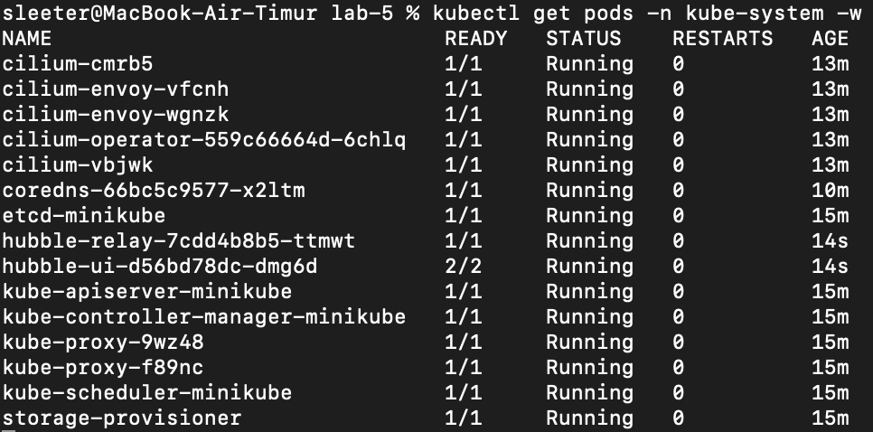

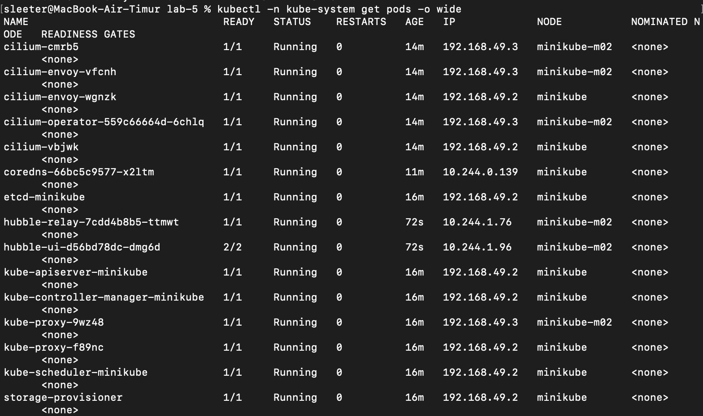

## Часть 1. Разворачиваем shop и смотрим на сеть пода

### Что пришлось поставить

Сначала мониторинг и оператор БД, потому что `ServiceMonitor` и `Cluster` из чарта требуют их CRD:

```bash
helm install kps prometheus-community/kube-prometheus-stack -n monitoring --create-namespace -f monitoring/values-prometheus.yaml
helm install cnpg cnpg/cloudnative-pg -n cnpg-system --create-namespace
```

Тут было несколько неприятностей, все из-за медленной загрузки образов с `ghcr.io` и `quay.io`:

- `helm install` для `kube-prometheus-stack` повис, а потом релиз стал `failed`. Хук `admission-patch` ждал образ `kube-webhook-certgen`, не уложился в таймаут, и Helm пометил установку упавшей. Имя `kps` из-за этого оказалось занято (`cannot reuse a name that is still in use`), а сами поды к тому времени уже поднялись. Починил обычным `helm upgrade` поверх упавшей ревизии.
- образ оператора CloudNativePG качался больше шести минут (в событиях было только `Pulling`). Подождал.

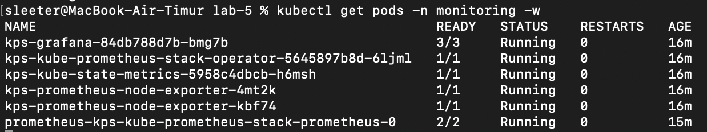

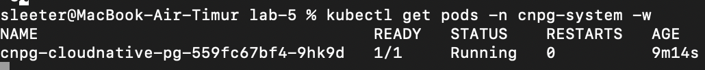

Образы `shop` собираются на хосте и грузятся в обе ноды (у каждой ноды свой containerd): `docker build`, потом `minikube image load`.

### Грабли: PostgreSQL не мог создать каталог

Установил `shop`:

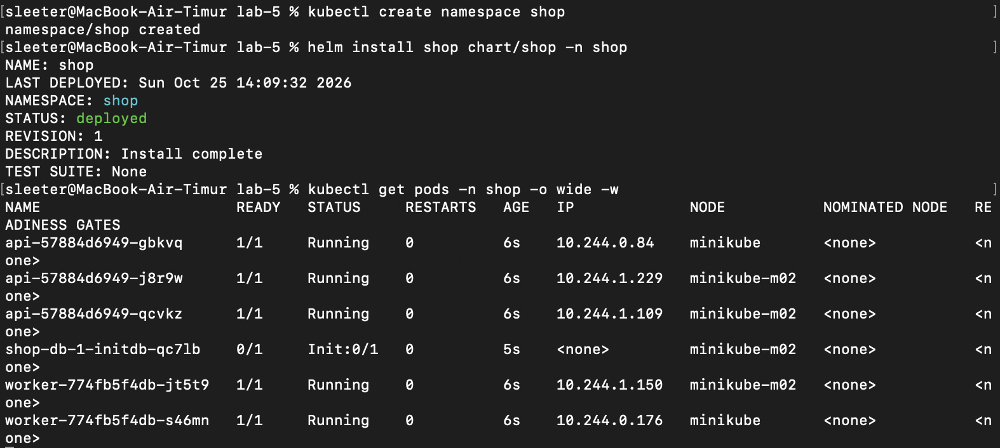

`api` и `worker` поднялись, а под `shop-db-1-initdb-...` падал с `Error` снова и снова, на этот раз не по сети:

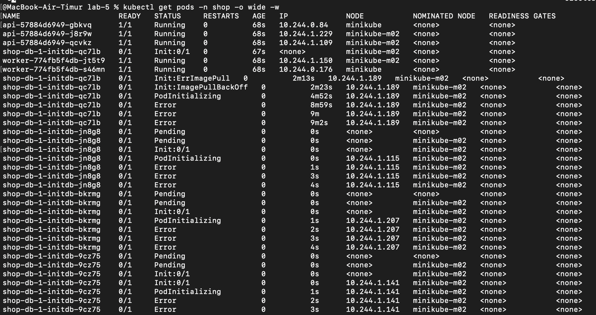

В логе было `initdb: error: could not create directory "/var/lib/postgresql/data/pgdata": Permission denied`. Дело в хранилище minikube (`k8s.io/minikube-hostpath`): том создаётся как обычный каталог на диске **одной** ноды. На control-plane он открыт на запись (`drwxrwxrwx`), а на `minikube-m02` каталог создал kubelet уже как `drwxr-xr-x root root`, и Postgres от пользователя с uid 26 туда писать не может. В лабе 3 нода была одна, поэтому там такого не было. Я привязал БД к ноде `minikube` через `nodeSelector` в `Cluster` (значение вынес в `values.yaml`: `db.node`), а `api` и `worker` остались на обеих нодах:

```yaml
spec:
  affinity:
    nodeSelector:
      kubernetes.io/hostname: {{ .Values.db.node }}
```

Пересоздал `Cluster` и PVC. Тут вылезла ещё одна мелочь: после пересоздания оператор сгенерировал в секрете `shop-db-app` **новый пароль**, а старые поды `api` и `worker` держали старый в переменной окружения (секрет читается один раз при старте пода), и `POST /order` отвечал `db not ready`. Помог `kubectl rollout restart deploy/api deploy/worker -n shop`.

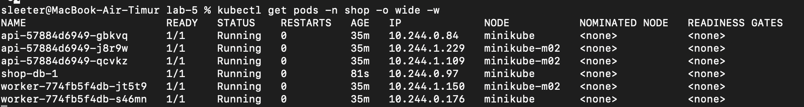

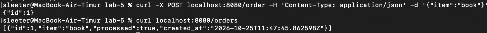

### Что под капотом у пода

Чтобы увидеть сеть пода, нужны поды с оболочкой, а `api` собран на `scratch`. Поэтому поставил два подопытных `busybox` на разных нодах ([tests/netcheck.yaml](./tests/netcheck.yaml)): `net-a` на `minikube` и `net-b` на `minikube-m02`. IP у них из разных диапазонов (`10.244.0.191` и `10.244.1.20`): у каждой ноды свой диапазон подов.

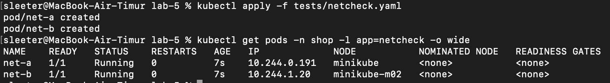

Внутри пода одна сетевая карта `eth0` с адресом из диапазона ноды (маска `/32`), а маршрут по умолчанию идёт на адрес внутри Cilium (`10.244.0.9`). Файл `iflink` говорит номер парного интерфейса на стороне ноды, это 47:

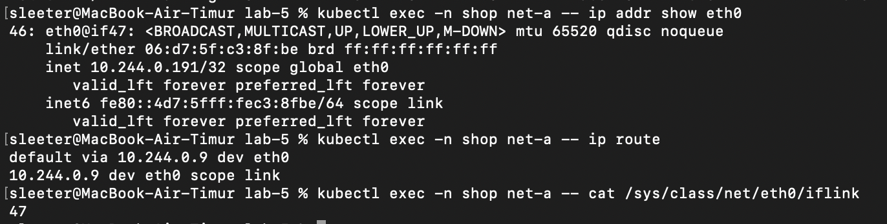

На ноде `minikube` интерфейс с номером 47 и есть парный конец этой пары, `lxcbe741226a484@if46` (его пара — `if46`, то есть `eth0` пода). У каждого пода на ноде свой `lxc`-интерфейс, это обычные veth-пары, которые создаёт Cilium:

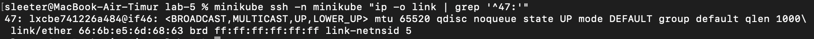

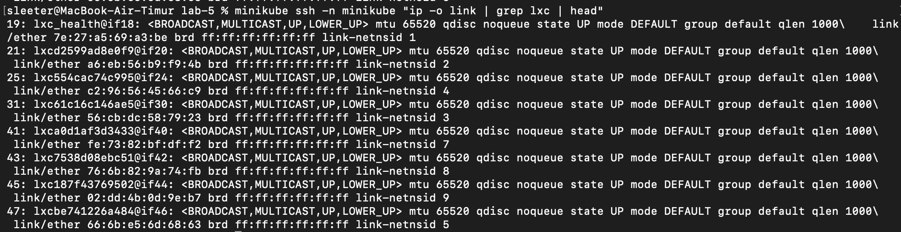

Поды на разных нодах видят друг друга напрямую по IP, без NAT:

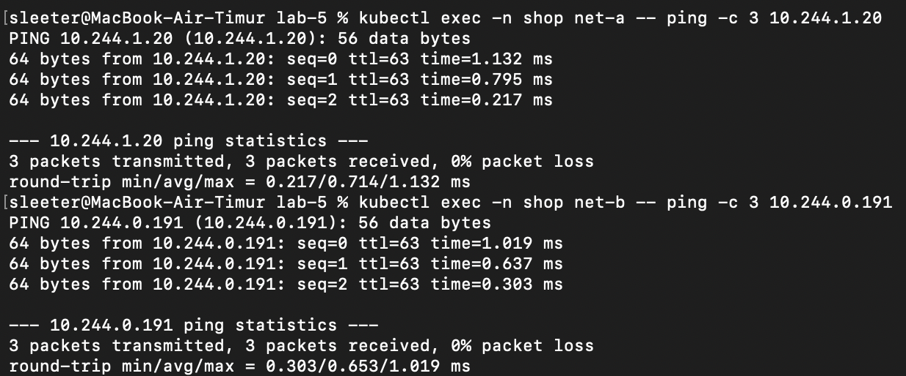

Как пакет добирается до другой ноды, видно по таблице маршрутов и режиму Cilium: маршрут на `10.244.1.0/24` идёт через `cilium_host`, а режим маршрутизации `Tunnel [vxlan]`, то есть между нодами трафик инкапсулируется в VXLAN. `Cluster health: 2/2 reachable`:

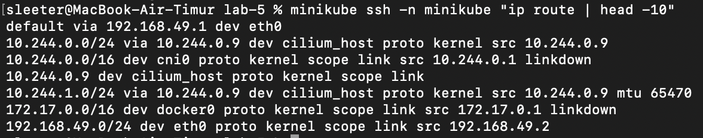

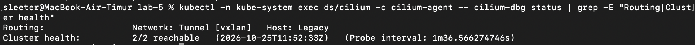

Пока политик нет, Cilium их у подов не применяет: в списке endpoint'ов `POLICY (ingress)` и `POLICY (egress)` стоят `Disabled`:

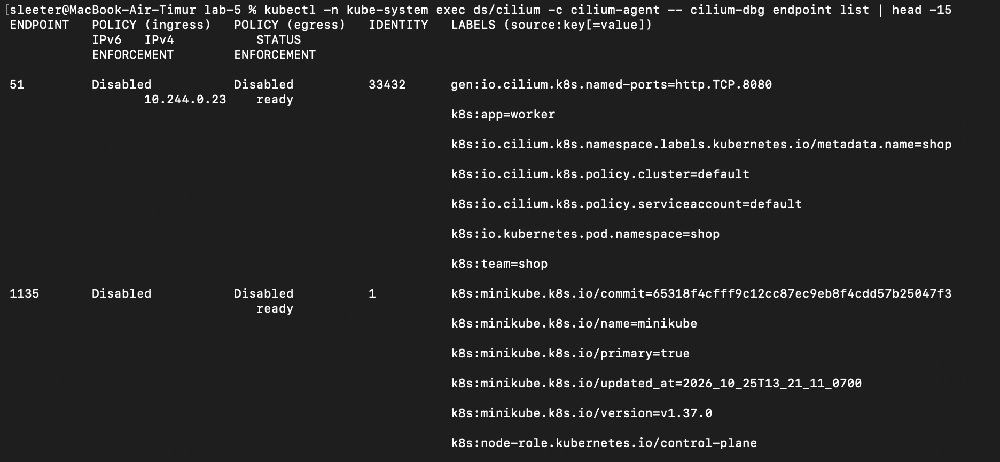

## Часть 2. Непрерывность при хаосе подов

### NodePort и чем он отличается от остальных

`api` я вынес наружу через `NodePort` 30080 (в чарте тип и порт берутся из `values.yaml`). Он отличается от соседей так:

- **NodePort** открывает один и тот же порт на **каждой** ноде кластера, kube-proxy принимает его и отправляет на один из подов Service. Это самый простой способ завести трафик снаружи, без облака;
- **LoadBalancer** это надстройка над NodePort: сверху появляется внешний балансировщик с отдельным адресом. В облаке его создаёт cloud-провайдер, в minikube без `minikube tunnel` он просто остаётся в `<pending>`;
- **headless-сервис** (`clusterIP: None`) вообще не имеет виртуального IP: DNS отдаёт напрямую адреса подов, балансировки нет. Так используют StatefulSet'ы, где клиенту важно знать, к какому именно поду он идёт.

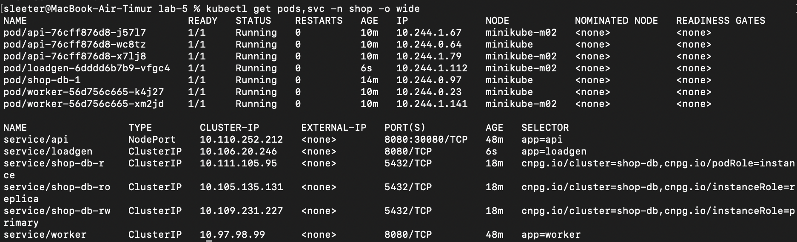

Порт отвечает на обеих нодах (`192.168.49.2` и `192.168.49.3`), а с самого мака в Docker-драйвере нужен туннель `minikube service api -n shop --url` (команда держит терминал открытым):

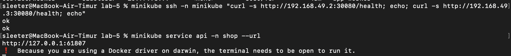

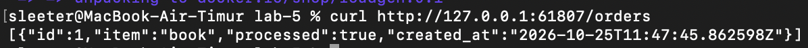

### Хаос и клиент

Клиент нагрузки — маленький сервис [loadgen](./loadgen/main.go). Он 20 раз в секунду ходит на `http://api.shop.svc.cluster.local:8080/orders` **по DNS-имени**, а не по IP пода, и считает успехи и провалы. Соединения он открывает заново на каждый запрос (без keep-alive), иначе клиент прилип бы к одному поду, и не было бы ни балансировки, ни обрыва при смерти пода. Метрики (`loadgen_requests_total{result=...}`) забирает Prometheus.

Хаос — скрипт [scripts/chaos.sh](./scripts/chaos.sh): раз в 5 секунд он удаляет случайный под `api` или `worker` и пишет журнал.

```bash
./scripts/chaos.sh
```

За ~70 секунд убито 15 подов, причём на обеих нодах:

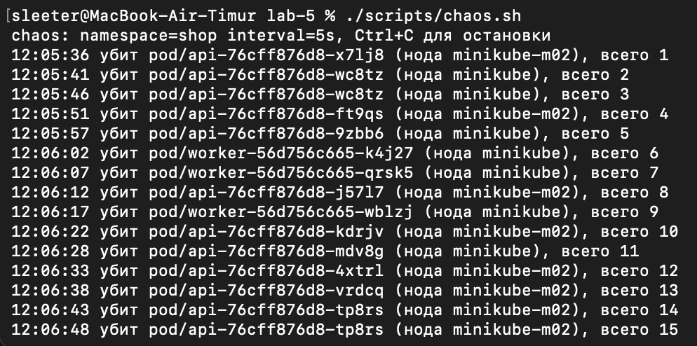

И вот доказательство. Запросы клиента держатся ровно на 20 в секунду всё время, и среди результатов есть только `ok`, провалов нет:

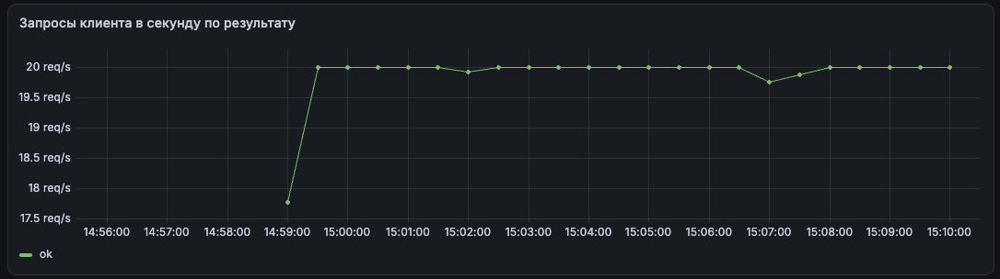

С панелью «новые поды» была заминка. Сначала она была пустая, потому что я смотрел окно в 30 секунд, а метрики подов собираются раз в 30 секунд, так что короткие всплески просто пропускались. Заодно у Grafana упал порт-форвард (подробности ниже в «Грабли с Grafana»). Расширил окно до минуты, и на втором графике видно, как под капотом всё это время рождались новые поды (от 2 до 4 в минуту), а клиент ничего не заметил:

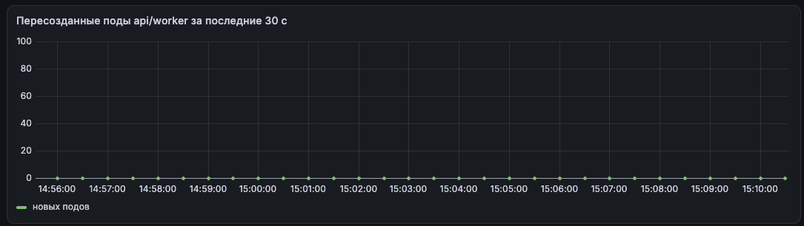

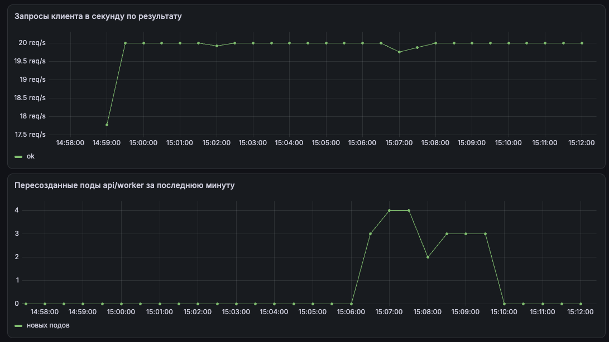

### Почему это сработало

Клиент всегда обращается к имени `api.shop.svc.cluster.local`, а каждый кусок сетевого стека отвечает за свою часть:

- **DNS (CoreDNS)** превращает имя в постоянный виртуальный адрес Service (ClusterIP). Он не меняется, пока живёт Service, как бы ни менялись поды;
- **Service** это стабильная «точка входа» с этим ClusterIP и селектором `app=api`;
- **EndpointSlice** это актуальный список IP живых и готовых подов за Service. Контроллер обновляет его каждый раз, когда под рождается или умирает. Под, который не прошёл readiness, в списке не появится;
- **kube-proxy** на каждой ноде читает EndpointSlice и программирует правила, которые разбрасывают пакеты на ClusterIP по IP подов.

Посмотрел это руками. EndpointSlice содержит три IP, у kube-proxy режим **iptables** (`Using iptables Proxier`; в ConfigMap `mode: ""` значит «по умолчанию»), а в цепочках iptables видно: `KUBE-SERVICES` ловит ClusterIP, `KUBE-SVC-*` выбирает под через `statistic mode random --probability 0.33...`, а `KUBE-SEP-*` (по одной на под) делает DNAT на `10.244.x.x:8080`. DNS отдаёт именно ClusterIP `10.110.252.212`:

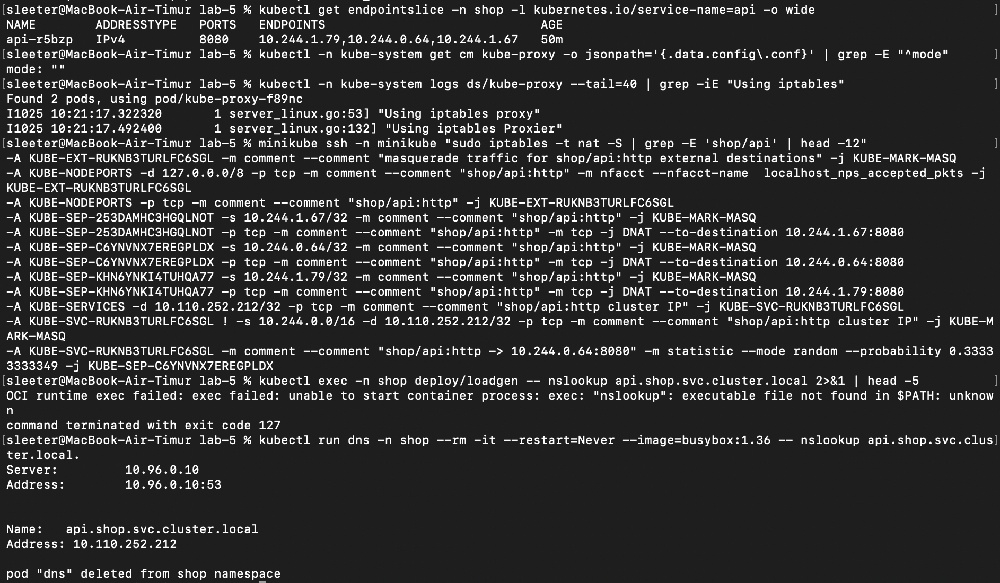

Про режимы kube-proxy: в **iptables** выбор пода делается цепочкой правил, поэтому при тысячах сервисов правил становится очень много, их обновление и поиск по списку замедляются. **IPVS** использует хеш-таблицы ядра и масштабируется лучше, плюс умеет разные алгоритмы балансировки. На нашем масштабе (несколько сервисов) разницы не заметно вообще, она проявляется на больших кластерах.

## Часть 3. Целевая матрица доступа

Прежде чем что-то запрещать, расписал, кто к кому должен ходить:

| откуда \ куда | api:8080 | worker:8080 | postgres:5432 | DNS | интернет |
|---|---|---|---|---|---|
| loadgen (клиент) | да | нет | нет | да | нет |
| api | нет | нет | да | да | нет |
| worker | нет | нет | да | да | нет |
| посторонний под | нет | нет | **нет** | да | да |

Служебные разрешения, без которых сломался бы сам стенд: Prometheus → метрики `api`, `worker` и `loadgen` на 8080; оператор CloudNativePG из `cnpg-system` → PostgreSQL на 5432 и порт статуса 8000; клиенты NodePort (адреса нод и «снаружи») → `api`. Для постороннего пода DNS и интернет я оставил открытыми специально: запрет нужен на пути к БД и к приложению, а не на любой исходящий трафик.

## Часть 4. Включаем zero-trust

Всё сделано шаблоном [networkpolicy.yaml](./chart/shop/templates/networkpolicy.yaml), а метки и порты вынесены в `values.yaml` (раздел `networkPolicy`). Схема такая:

1. `default-deny-ingress`: `podSelector: {}`, к любому поду в `shop` по умолчанию никто не подключается;
2. точечные разрешения по меткам и портам: `allow-api-ingress` (клиенты и Prometheus), `allow-metrics-ingress` (для `worker` и `loadgen`), `allow-postgres-ingress` (`api` и `worker` на 5432, оператор на 5432 и 8000);
3. egress: DNS отдельным правилом (kube-dns, порт 53 UDP и TCP), `allow-db-egress` (только к БД на 5432) и `allow-loadgen-egress` (клиент только к `api`);
4. NodePort: kube-proxy при заходе через ноду подменяет источник пакета, и обычным `NetworkPolicy` это не описать, поэтому отдельный `CiliumNetworkPolicy` с `fromEntities: [host, remote-node, world]`.

Кусок шаблона (значения из `values`):

```yaml
apiVersion: networking.k8s.io/v1
kind: NetworkPolicy
metadata:
  name: allow-db-egress
spec:
  podSelector:
    matchExpressions:
      - {key: app, operator: In, values: [api, worker]}
  policyTypes: [Egress]
  egress:
    - to:
        - podSelector:
            matchLabels:
              cnpg.io/cluster: {{ .Values.db.name }}
              cnpg.io/podRole: instance
      ports:
        - {protocol: TCP, port: {{ $np.ports.postgres }}}
```

Оговорка: egress у самого PostgreSQL я не ограничивал. Его инстанс-менеджер ходит в Kubernetes API, и для этого нужно отдельное правило Cilium с `kube-apiserver`. Это осознанное упрощение.

```bash
helm upgrade shop chart/shop -n shop
```

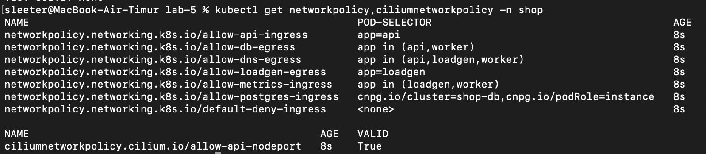

После этого в списке endpoint'ов у подов `shop` `POLICY (ingress)` и `POLICY (egress)` стали `Enabled`:

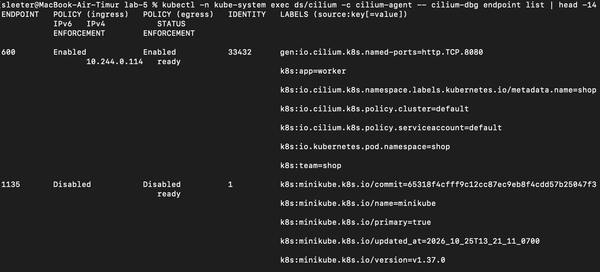

## Часть 5. Проверяем матрицу

Для проверки написал скрипт [scripts/matrix.sh](./scripts/matrix.sh): из каждого источника пробует достучаться до каждого адресата и сверяет результат с ожидаемым. В `api`, `worker` и `loadgen` нет оболочки (образ `scratch`), поэтому подключаюсь эфемерным контейнером `busybox` в тот же под через `kubectl debug`: он делит сеть пода, и политика видит ровно метки этого пода. В клетке `pass` значит «разрешено и работает», `block` «запрещено и не проходит», а `!pass` и `!block` это расхождение.

Сначала матрица **до** политик, то есть плоская сеть. Расхождений 12: посторонний под спокойно ходит в PostgreSQL, воркер в `api` и так далее:

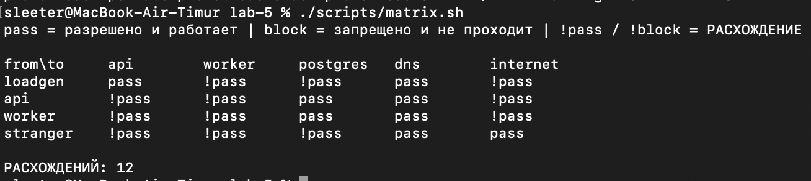

Скрипт пришлось дорабатывать, потому что в первых прогонах матрица врала:

- в клетках `api` и `loadgen` иногда был `no-data`: `kubectl debug` присоединяется к эфемерному контейнеру не мгновенно, и вывод слишком быстрой команды терялся. Добавил `sleep 2` в начале и повторы;
- клетка `worker → worker` то была `block`, то `pass`. Это не ошибка политики, а особенность: запрос на Service `worker` иногда балансировался в тот же под, из которого он шёл, а трафик пода к самому себе политики не режут. Теперь, если источник сам `api` или `worker`, скрипт ходит на IP **другого** пода этого приложения.

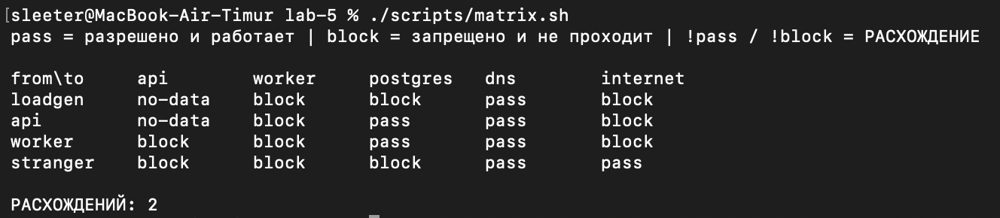

После правок матрица **зелёная**: разрешённое работает, запрещённое не проходит.

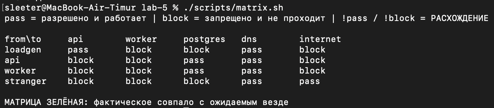

Отдельно проверил самое главное по заданию. Посторонний под не может подключиться к PostgreSQL, а заказ при этом создаётся и обрабатывается, значит, `api` и `worker` до БД доходят:

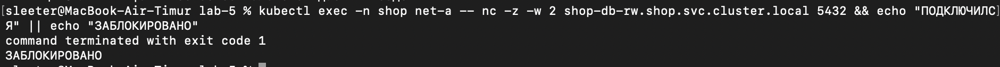

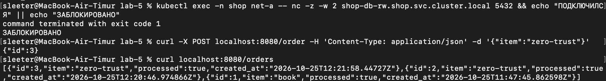

Политики ничего не сломали вокруг: NodePort по-прежнему отвечает на обеих нодах, а `loadgen` без ошибок.

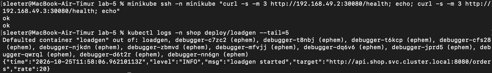

## Часть 6. Скрытая поломка связности

Для этой части написал [scripts/break.sh](./scripts/break.sh). Он случайно выбирает один из четырёх вариантов и вносит его через `values` (`helm upgrade -f`), файл чарта при этом не меняется. Варианты: неверная метка клиента в правиле `api`; неверный порт PostgreSQL; правило DNS не находит `kube-dns`; порт `api` в правилах не совпадает с портом сервиса. Что именно выбрано, скрипт не говорит, а ответ лежит в `scripts/.answer` в base64 и открывается отдельным `scripts/reveal.sh`. Я не заглядывал, пока не починил.

```bash
./scripts/break.sh
```

### Симптом

Заказы перестали проходить. Сервисы при этом `Running`, а в логах `loadgen` поток `503`, `POST /order` возвращает `db not ready` (на одной попытке соединение просто оборвалось). Матрица показала расхождения:

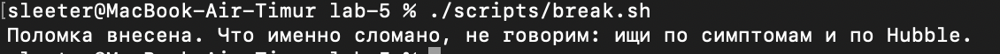

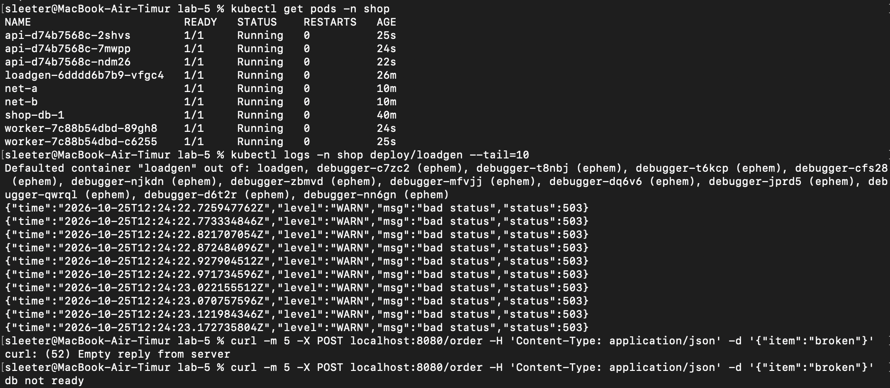

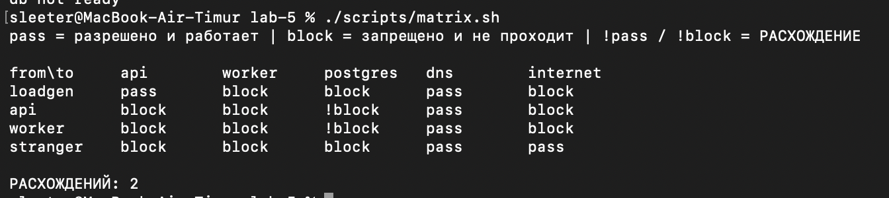

После поломки на дашборде непрерывности панель «Провалившиеся запросы клиента» показала 6530: клиент считает `503` от `api` отдельным результатом. Это обратная сторона графика из части 2: при хаосе подов этот счётчик был нулевой, а сломанное правило дало тысячи провалов.

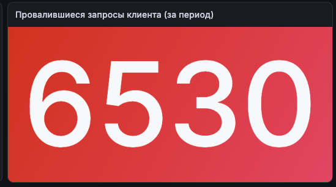

### Поиск по Hubble

Первая попытка посмотреть отбросы дала пустой вывод:

```bash
kubectl -n kube-system exec ds/cilium -c cilium-agent -- hubble observe --namespace shop --verdict DROPPED --last 30
```

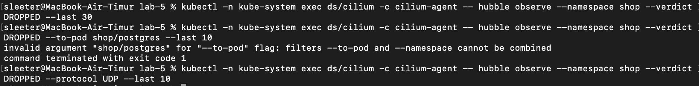

Причин было две. Во-первых, `ds/cilium` выбирает один случайный агент (по одному на ноду), а Hubble в агенте видит только потоки **своей ноды**. Во-вторых, у Hubble короткий кольцевой буфер, и постоянная нагрузка перезаписывает его за минуты, а заблокированный `SYN` это редкое событие. Заодно выяснилось, что `--to-pod` нельзя сочетать с `--namespace` (`filters --to-pod and --namespace cannot be combined`), и `--to-pod` принимает имя пода, а не приложения.

Правильный способ ловить такое: смотреть вживую (`--follow`) на **обоих** агентах, одновременно создавая трафик (я пересоздал поды):

```bash
kubectl -n kube-system exec cilium-cmrb5 -c cilium-agent -- hubble observe --follow --namespace shop --verdict DROPPED
kubectl -n kube-system exec cilium-vbjwk -c cilium-agent -- hubble observe --follow --namespace shop --verdict DROPPED
```

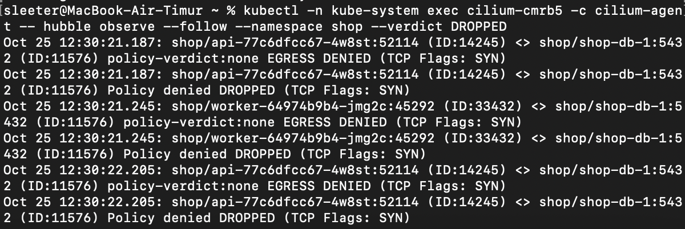

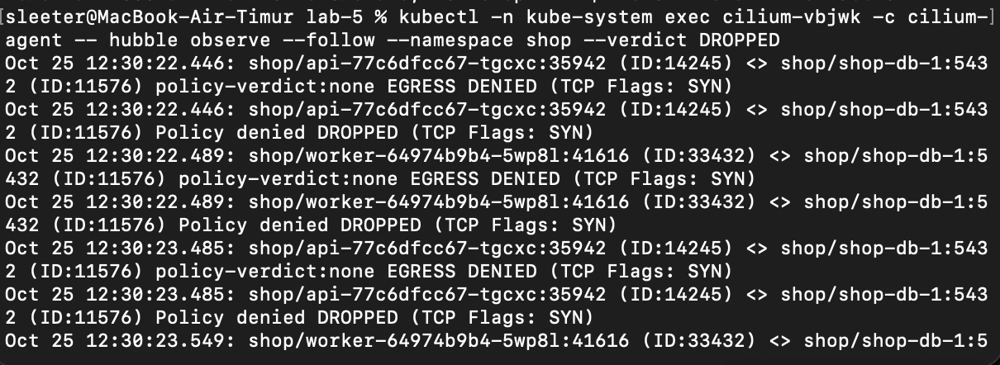

Вывод Hubble читается так: источники это поды `api-...` и `worker-...` (оба и на обеих нодах), адресат один, `shop/shop-db-1:5432`; направление **EGRESS**, то есть режет исходящее правило, а не входящее у БД; причина `policy-verdict:none`, то есть ни одно правило этот поток не разрешает (дефолт-запрет); все попытки застревают на `TCP Flags: SYN`, соединение даже не начинается. При этом дропов `loadgen → api` и DNS нет: клиент до `api` доходит и имена резолвятся. Сломан ровно один маршрут: `api` и `worker` → PostgreSQL.

### Причина и починка

Раз режет исходящее правило от `api` и `worker` к БД, открыл его:

```bash
kubectl describe networkpolicy allow-db-egress -n shop
```

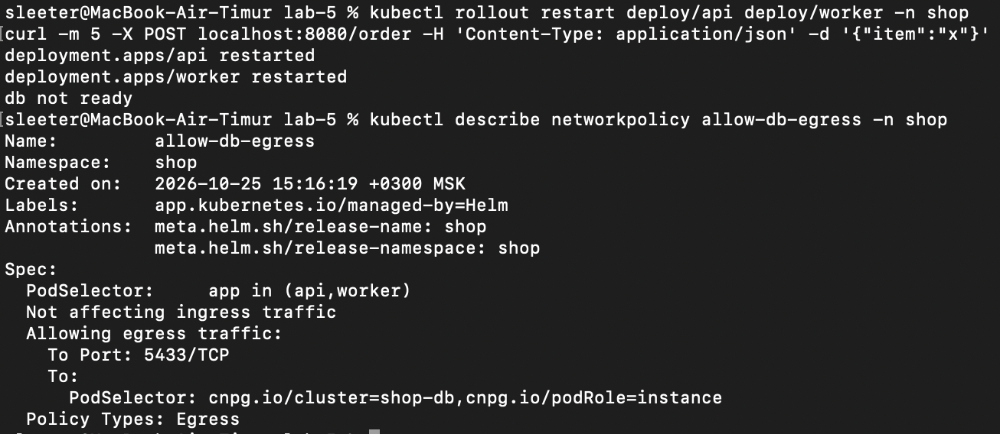

В правиле порт **5433/TCP**, а БД слушает **5432**: это видно и в дропе (`:5432`), и в сервисах, и по меткам подов:

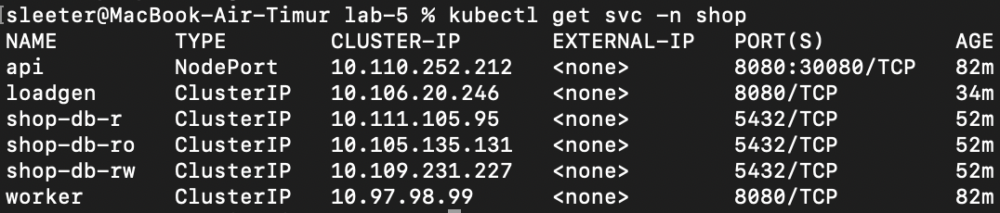

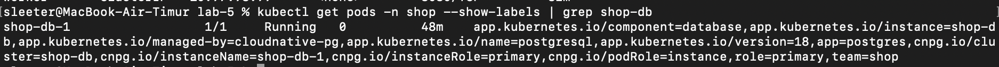

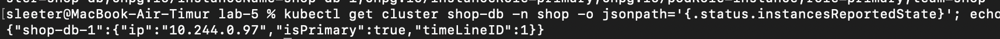

Метки у БД совпадают с селектором правила, а порт нет. То же самое оказалось и во входящем правиле на БД (порт Postgres один на оба правила в `values`).

Первый `helm upgrade shop chart/shop -n shop` не помог: матрица всё равно показывала `!block` для `api` и `worker` к postgres. Оказалось, что в Helm 4 без `--reset-values` значения прошлой ревизии (с поломкой) остаются, и ревизия просто пересобралась с теми же значениями. В `helm get manifest` порт 5433 встречался три раза. Нужно явно сбросить:

```bash
helm upgrade shop chart/shop -n shop --reset-values
helm get manifest shop -n shop | grep -c 5433   # 0
kubectl rollout restart deploy/api deploy/worker -n shop
```

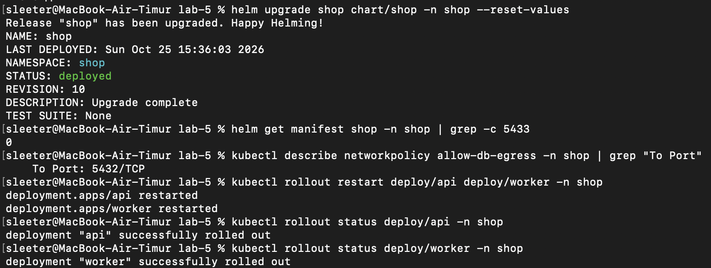

Матрица снова зелёная, и заказ проходит:

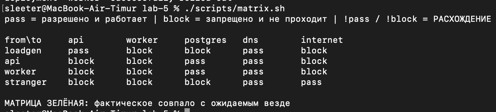

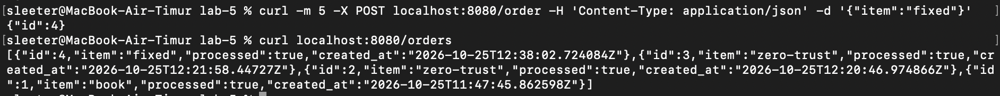

Только после починки открыл ответ. `scripts/reveal.sh` подтвердил: была внесена поломка «неверный порт PostgreSQL в правилах», то есть диагноз по Hubble и по правилу оказался верным. Заодно выяснилось, что сам `reveal.sh` у меня сначала не работал на macOS: `base64 -d файл` там не принимает имя файла, нужен `base64 -d < файл`. Поправил.

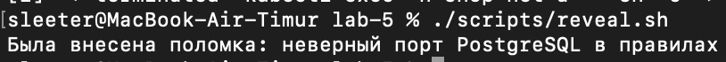

## Часть 7. Мониторинг

Всё встроено в чарт: `ServiceMonitor` для `api`, `worker`, `loadgen` и для метрик Hubble ([servicemonitor-hubble.yaml](./chart/shop/templates/servicemonitor-hubble.yaml), он смотрит в `kube-system`), `PrometheusRule` и два дашборда одним ConfigMap (`chart/shop/dashboards/`). Метрики Hubble (`hubble_drop_total`, `hubble_tcp_flags_total`) собираются с обоих агентов:

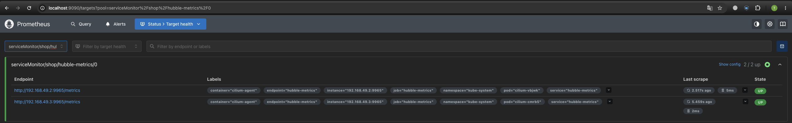

Дашборд «shop: сеть, политики и DNS» в спокойном состоянии (диапазон 15 минут, без поломок и дропов): отброшенных пакетов нет, около 74 новых TCP-соединений в секунду, около 160 запросов в секунду к CoreDNS, среди ответов NOERROR и много NXDOMAIN, а `SERVFAIL` нет, доля успешных запросов клиента 100%:

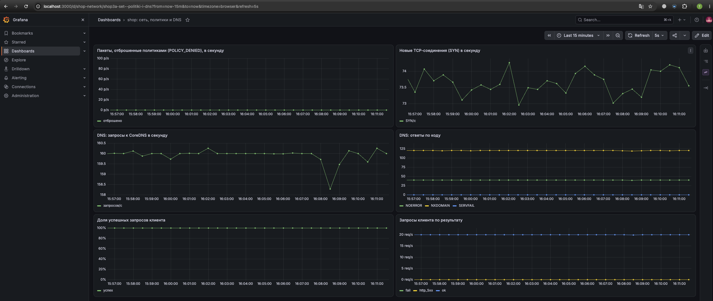

Про DNS пришлось уточнять: Hubble в этой сборке не выдаёт DNS-метрики (для них нужна L7-видимость), поэтому DNS смотрю по CoreDNS (`coredns_dns_requests_total`, `coredns_dns_responses_total`), который `kube-prometheus-stack` и так скрейпит. В Prometheus видно около 160 запросов в секунду, и `NXDOMAIN` там больше половины: это штатно из-за `ndots:5`, поэтому его в алертах не считаю.

### Три алерта

1. **ShopNetworkPolicyDrops**: `sum(rate(hubble_drop_total{reason="POLICY_DENIED"}[2m])) > 0.5` дольше двух минут. В покое отбросов почти нет, поэтому устойчивый поток значит либо сломанное правило (режется легитимный трафик, как в моей поломке), либо кто-то лезет туда, куда не положено. Дежурному: смотреть `hubble observe --verdict DROPPED`, найти, кто кого не пускает, и сравнить правило с реальностью.
2. **ShopClientConnectionsFailing**: доля успешных запросов клиента ниже 99% дольше минуты. Это взгляд пользователя на сеть: ловит и сломанные политики, и мёртвый `api`. Дежурному: смотреть логи `loadgen`, потом дропы и состояние подов.
3. **ShopDnsBroken**: CoreDNS получает меньше 1 запроса в секунду или `SERVFAIL`/`REFUSED` выше 5%. Если политика режет путь до `kube-dns`, он обычно не отвечает ошибками, а просто замолкает, поэтому проверка на «тишину» важнее, чем на ошибки.

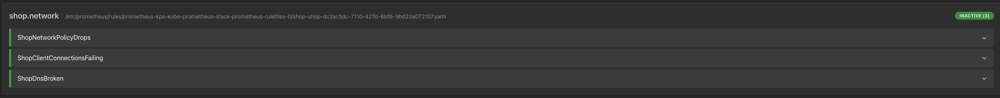

### Провокация

Спровоцировал `ShopNetworkPolicyDrops`: запустил десять циклов `nc` из постороннего пода `net-a` в запрещённую БД. Через минуту правило пошло в `pending`:


А через две с половиной минуты в `firing` (значение около 20 отбрасываемых пакетов в секунду):


Два других алерта отдельно не провоцировал, по заданию хватает одного (но клиентский алерт по сути зацепила поломка из части 6).

## Выводы

Больше всего в этой лабе понравилось, что сеть из «магии» стала видимой. Я своими глазами посмотрел veth-пару пода, цепочки iptables за Service и то, как kube-proxy раскидывает пакеты, а потом доказал графиком, что клиент не замечает убиваемых подов. А Hubble вообще круто: отброшенный пакет там подписан, кто, кому, в какую сторону и почему, и поломку можно найти по факту, а не по догадке.

Остальное ушло в мелочи: в Helm 4 надо явно писать `--reset-values`, `ds/cilium` смотрит только одну ноду, а у minikube-hostpath разные права на разных нодах. Ещё запомнилось, что проверка матрицы сама по себе может врать (гонка `kubectl debug`, трафик пода к самому себе), и сначала надо убедиться в самом инструменте.

Что осталось недоделанным: у PostgreSQL один инстанс и не ограничен egress, алерты на клиента и DNS отдельно не проверялись, а из четырёх вариантов поломки мне выпал только один.
