# Лабораторная работа 8. Автоматизация диагностики shop через n8n и AI

## Часть 1. Кейс

Для лабораторной я выбрала автоматизацию первоначальной диагностики интернет-магазина shop. В моём сценарии небольшая компания развивает магазин, а приложение поддерживают разработчики и дежурный DevOps-инженер. API принимает заказы, worker обрабатывает их, PostgreSQL хранит данные. Приложение работает в Kubernetes.

При обращении о неисправности дежурный вручную проверяет Deployment, готовность подов и метрики Prometheus. Данные находятся в разных системах, и на их сопоставление уходит время. Я решила автоматизировать сбор сведений и подготовку первоначальной сводки для дежурного.

Процесс запускается вручную в n8n. Обычный шаг задаёт параметры проверки, затем AI-агент получает данные через два MCP-сервера и формирует текстовый отчёт. В отчёте отдельно указаны факты, ограничения, гипотезы и дальнейшие проверки. Изменения в кластере агент не выполняет.

## Окружение

Работу выполняла на Windows через WSL и Docker. Использовала существующий кластер kind lab4 с приложением shop и мониторингом из предыдущих лабораторных.

n8n версии 2.44.6 запустила через Docker Compose. Его данные хранятся в отдельном Docker volume и сохраняются при пересоздании контейнера.

Для AI-шагов использовала Groq. Подключения DeepSeek и OpenAI не подошли из-за отсутствия средств на API-балансе. От локальной модели через Ollama отказалась, чтобы не увеличивать нагрузку на ноут.

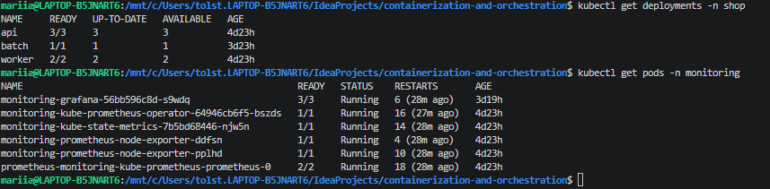
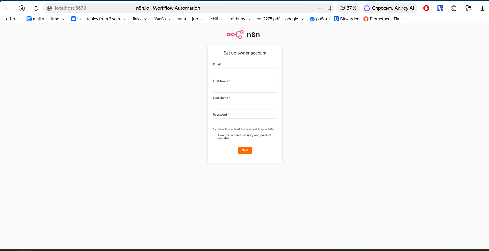

## Часть 2. Workflow и инструменты агента

Основной workflow называется Shop diagnostics. Он состоит из ручного триггера, узла Diagnostic request и AI Agent.

Manual Trigger запускает проверку по кнопке Execute. В Diagnostic request задала namespace shop, сервис api и текст задачи. Это обычный шаг без обращения к модели.

AI Agent получает параметры из предыдущего узла, вызывает инструменты и составляет отчёт. Модель подключена через Groq Chat Model. Ключ сохранён в credentials n8n.

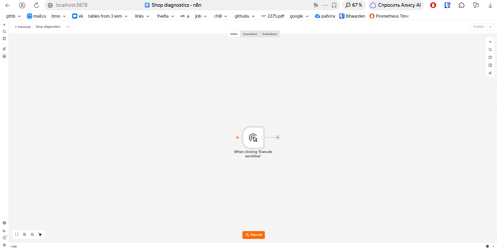
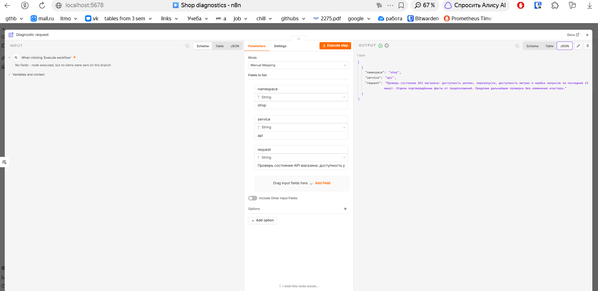

Сначала проверила модель без инструментов. Она сообщила, что не имеет доступа к кластеру. После этого отдельно подключила источники данных.

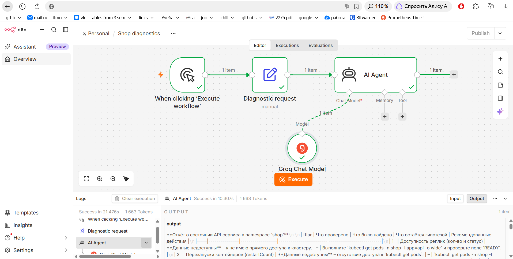

### MCP-серверы

Я создала два отдельных workflow с MCP Server Trigger. Они работают в одном экземпляре n8n, но предоставляют разные MCP endpoints и наборы инструментов.

Prometheus MCP даёт доступ к данным Prometheus. Kubernetes MCP читает состояние ресурсов в namespace shop. Основной агент подключается к ним через два MCP Client Tool с транспортом HTTP Streamable.

Первоначально инструмент Prometheus возвращал полный список targets со служебными метками. Такой ответ оказался слишком большим для бесплатной квоты модели. В итоговом варианте использовала компактный запрос.

```promql
up{namespace="shop"}
```

Название инструмента prometheus_targets сохранила. В финальной конфигурации он возвращает текущие значения up, а не полный ответ API targets.

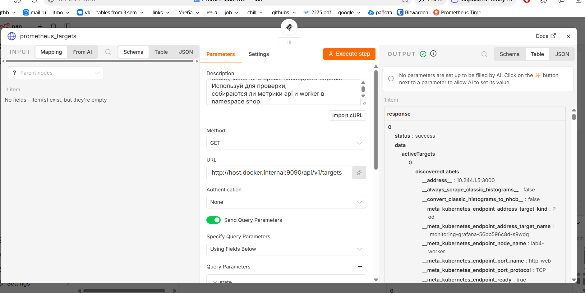
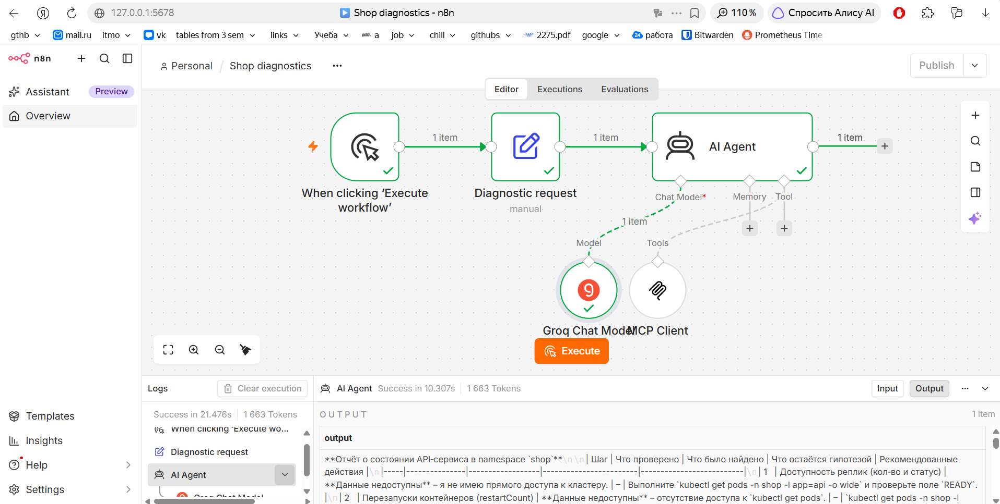
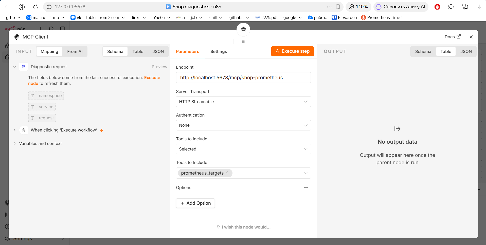

### Toolkit

| Инструмент | Сервер | Вход | Назначение |
|---|---|---|---|
| prometheus_targets | Prometheus MCP | Без аргументов | Получает текущие значения up для endpoints shop |
| kubernetes_pods | Kubernetes MCP | Без аргументов | Получает имена, phase и conditions незавершённых подов api и worker |
| kubernetes_deployments | Kubernetes MCP | Без аргументов | Получает желаемое число реплик и status Deployment в shop |

Область проверки зафиксирована в настройках HTTP-инструментов. Агенту не требуется передавать аргументы, и он не выбирает произвольный URL или namespace.

В Kubernetes-инструментах включила Optimize Response. Оставила поля, необходимые для диагностики. Для списка подов дополнительно задала фильтры по меткам api и worker и исключила завершённые поды. Это уменьшило объём данных, передаваемых модели.

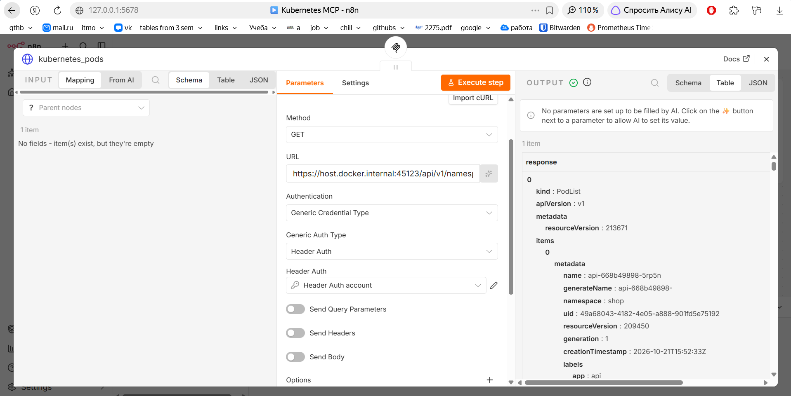
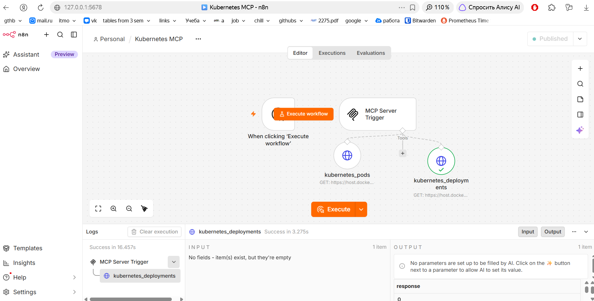
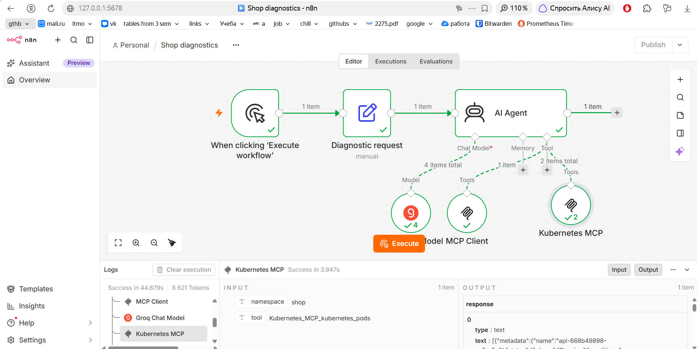

### Права доступа

Для Kubernetes создала ServiceAccount diagnostics-reader и выдала ему get и list для pods, events и deployments только в namespace shop.

Проверила, что учётная запись может читать поды, но не может удалять их или читать Secrets. В инструментах использовала временный токен, сохранённый в Header Auth credentials.

Для сертификата локального kind включила Ignore SSL Issues. Это упрощение учебного стенда.

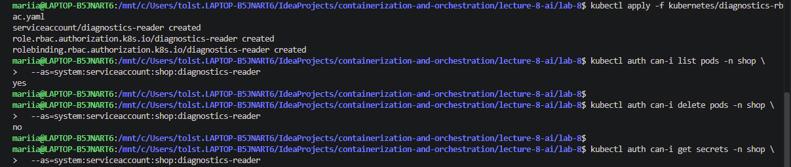

### Skills

Порядок диагностики описала в [skills/shop-diagnostics.md](skills/shop-diagnostics.md). Инструкции, которыми агент руководствуется при выполнении, задала в System Message. Сам файл автоматически в n8n не загружается.

Агент должен получить данные трёх инструментов, отдельно разобрать api и worker, сравнить желаемые и доступные реплики и проверить условие Ready. Затем он сопоставляет результат с успешностью scrape.

В инструкциях закрепила, что up=0 не доказывает падение пода, Running не означает Ready, а отсутствие поля не означает нулевое значение. Гипотезы должны быть отделены от фактов. Предложенные команды нельзя описывать как уже выполненные.

## Часть 3. Локальный запуск и результат

Выполнила полный запуск от Manual Trigger до отчёта AI Agent. В журнале выполнения проверила обращения к Prometheus MCP и двум инструментам Kubernetes MCP.

Во время диагностики Deployment api показывал три готовые и доступные реплики, worker показывал две. Поды имели условие Ready=True. При этом Prometheus возвращал up=0 для части endpoints.

Агент сопоставил данные Kubernetes и Prometheus и подготовил отчёт о расхождении между готовностью подов и успешностью сбора метрик. Результат доступен как текст в output выполнения n8n.

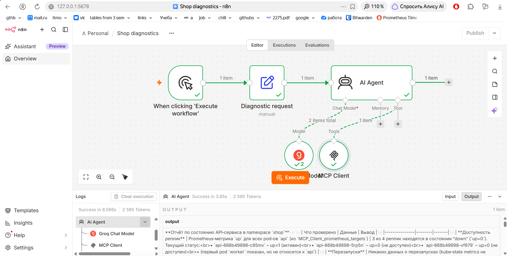
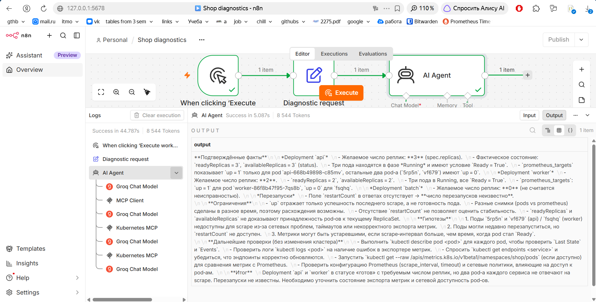

### Проверка качества ответа

В промежуточных отчётах модель ошибалась в подсчёте подов worker и утверждала отсутствие перезапусков, хотя restartCount не передавался инструментом. После проверок уточняла System Message.

Эти ошибки показали, что успешный вызов инструментов ещё не гарантирует правильную интерпретацию. Отчёт предназначен для первоначальной диагностики и требует проверки инженером.

Текущий toolkit не предоставляет число перезапусков, показатели HTTP-ошибок и задержек за последние 15 минут. Агент должен обозначать эти данные как недоступные. Причина ошибок scrape окончательно не установлена.

### Повторный запуск

Нужны Docker Compose, kubectl и существующий кластер lab4 с shop и мониторингом. Команды выполняются из каталога lab-8.

```bash
docker compose -f docker-compose.yml up -d
kubectl apply -f kubernetes/diagnostics-rbac.yaml
```

В интерфейсе n8n нужно импортировать три workflow.

| Файл | Назначение |
|---|---|
| Shop diagnostics.json | Основной процесс диагностики |
| Prometheus MCP.json | MCP-сервер Prometheus |
| Kubernetes MCP.json | MCP-сервер Kubernetes |

После импорта нужно назначить credentials Groq и Kubernetes. Секреты не включаются в обычный экспорт workflow.

Временный токен Kubernetes создаётся отдельно.

```bash
kubectl -n shop create token diagnostics-reader --duration=8h
```

В Header Auth используется заголовок Authorization со значением Bearer и токеном. После истечения срока токен нужно заменить.

Для доступа к Prometheus оставляю отдельный терминал с пробросом порта.

```bash
kubectl -n monitoring port-forward \
  svc/monitoring-kube-prometheus-prometheus 9090:9090
```

Prometheus-инструмент обращается к host.docker.internal на порту 9090. Kubernetes-инструменты используют опубликованный порт API kind. В моём стенде это 45123, при другом кластере адрес нужно проверить и изменить.

Оба MCP workflow нужно опубликовать. Затем в основном workflow проверить Production URL клиентов и запустить Execute.

compose.ollama.yml относится к первоначальной попытке использовать локальную модель. В итоговом варианте этот файл не используется.

## Часть 4. Мониторинг

Для n8n включила N8N_METRICS. Метрики доступны на /metrics, поэтому отдельный экспортер не понадобился.

Использовала существующий Prometheus и Grafana. Контейнер n8n подключила к Docker-сети kind и добавила ScrapeConfig из monitoring/n8n-scrape.yaml.

```bash
docker network connect kind lab8-n8n-1
docker inspect -f '{{(index .NetworkSettings.Networks "kind").IPAddress}}' lab8-n8n-1
```

Если контейнер уже подключён, повторять подключение не требуется. После пересоздания контейнера нужно проверить сеть и адрес. При изменении IP необходимо обновить target в ScrapeConfig.

```bash
kubectl apply -f monitoring/n8n-scrape.yaml
```

### Дашборд

На дашборд вывела успешность scrape, память RSS и CPU процесса n8n.

| График | PromQL | Что показывает |
|---|---|---|
| Успешность scrape | `up{job="lab8-n8n"}` | Получил ли Prometheus метрики при последнем опросе |
| Память | `n8n_process_resident_memory_bytes{job="lab8-n8n"}` | RSS процесса n8n |
| CPU | `100 * rate(n8n_process_cpu_seconds_total{job="lab8-n8n"}[2m])` | Использование CPU в процентах одного ядра |

На графике up видны неуспешные опросы. Они не доказывают остановку самого n8n. Пропуски на графиках ресурсов не заменяла нулями.

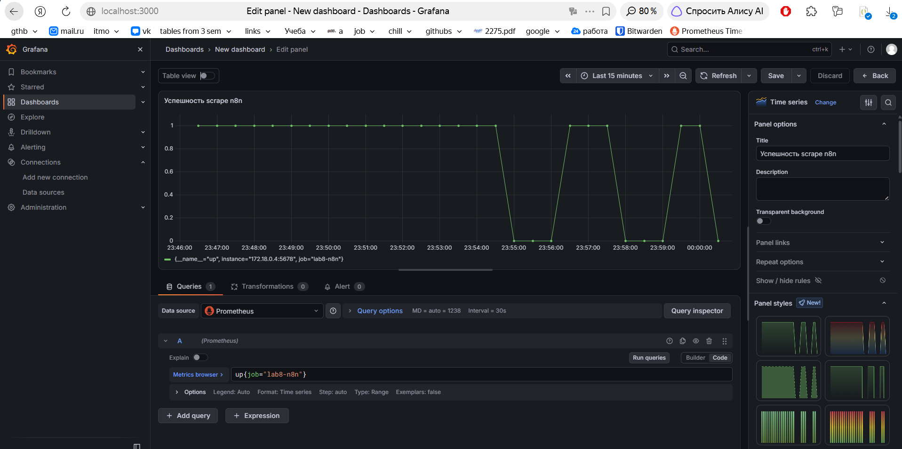
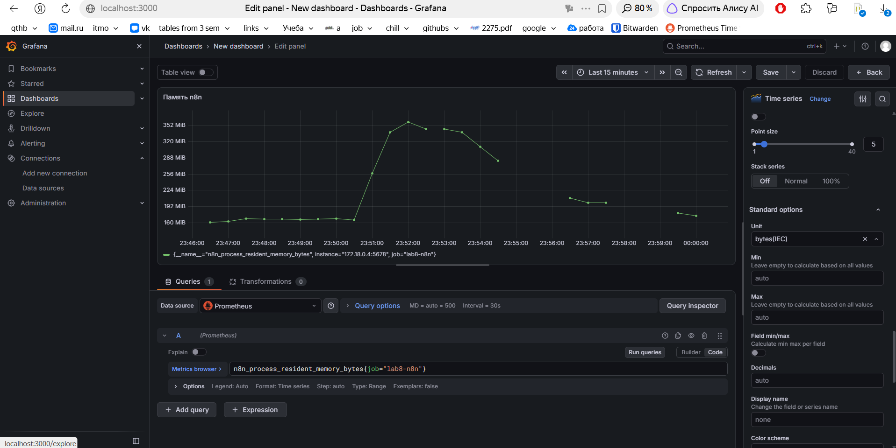
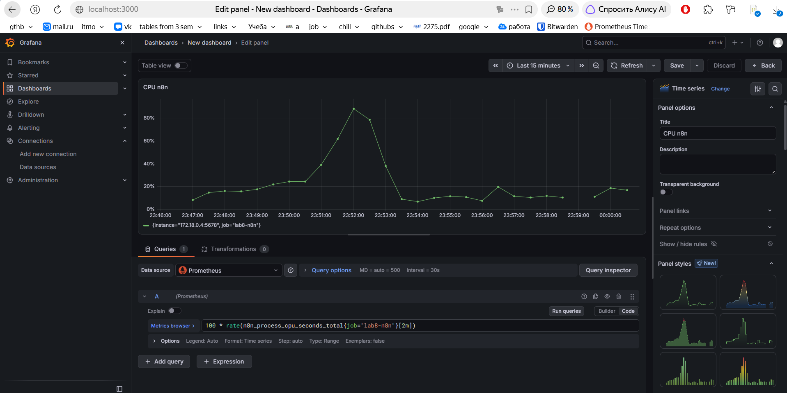
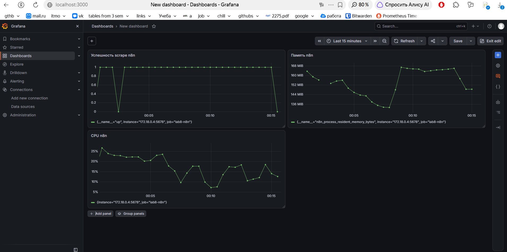

### Метрики для алертов

Для первого алерта выбрала up. Условие up=0 дольше двух минут показывает потерю сбора метрик. По нему нужно проверить n8n, endpoint /metrics и сетевой путь. Отсутствующую серию также нужно учитывать отдельно через absent.

Для второго алерта выбрала память RSS. Предварительное условие составляет больше 512 МиБ в течение пяти минут. Оно помогает заметить рост памяти и проверить нагрузку. Этот порог не является установленным пределом OOM и требует уточнения по более длительным наблюдениям.

Для третьего алерта выбрала CPU. Предварительное условие составляет больше 80% одного ядра в течение пяти минут. Продолжительная нагрузка может увеличивать время выполнения диагностики. Порог также нужно уточнять по baseline.

В работе выбрала метрики и обосновала условия алертов. Срабатывания этих правил не проверяла.

### Проблемы мониторинга

Во время настройки Prometheus неоднократно перезапускался. В событиях Kubernetes обнаружила таймауты liveness-пробы и сообщения о перезапуске контейнера. В логах было штатное завершение по SIGTERM. Доказательств OOM в полученных данных не было.

Я увеличила таймауты проб через патч ресурса Prometheus. После этого проверила готовность сервера и получила up=1 для n8n. Патч находится в monitoring/prometheus-probes-patch.yaml. Он смягчает реакцию на задержки, но не устанавливает их первопричину.

Grafana не могла подключиться к Prometheus через DNS, ClusterIP и прямой Pod IP. После размещения Grafana на той же ноде, где работал Prometheus, проверка источника прошла успешно. Это временный обход проблемы связи между компонентами. Исправление межузловой сети в этой работе не подтверждала.

## Результат

Я собрала локальную автоматизацию диагностики shop. Ручной триггер запускает процесс, обычный узел подготавливает параметры, AI-агент вызывает три инструмента через два MCP-сервера и выдаёт текстовый отчёт.

Экспорты основного workflow и MCP-серверов сохранены в JSON. Порядок действий и правила агента описаны в skills. Для мониторинга собрала три графика и выбрала три метрики для алертов с обоснованием.

Основное ограничение связано с качеством выводов модели. Она может получить правильные данные и ошибиться при их сопоставлении. Поэтому такой помощник сокращает ручной сбор сведений, но не заменяет проверку дежурным инженером.

Метрики n8n показывают доступность сбора и потребление ресурсов. Корректность AI-отчёта и успешность бизнес-операций shop эти графики не измеряют.